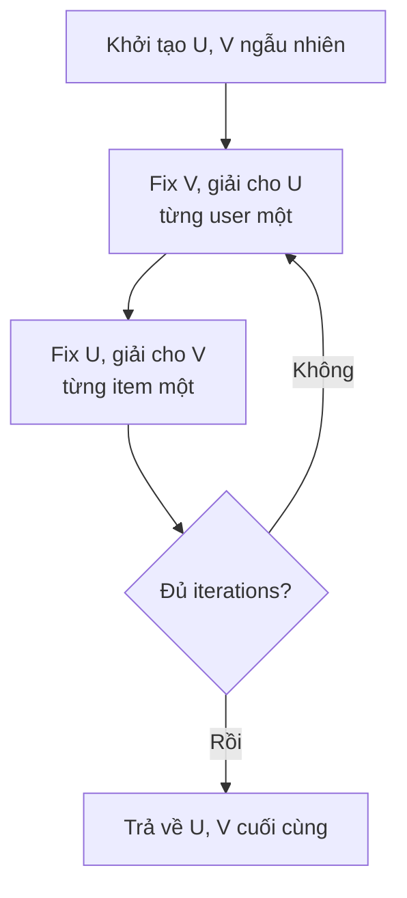

# ALS Recommender - Giải Thích Chi Tiết

> **File này giải thích riêng cho [`src/recommenders/als_recommender.py`](src/recommenders/als_recommender.py).** Đọc song song với code để hiểu lý thuyết được áp dụng như thế nào trong thực tế.

---

## 1. Bối Cảnh: Tại Sao Cần ALS?

### Vấn đề: Ma trận quá thưa

Giả sử hệ thống có:
- **162,000 người dùng**
- **59,000 bộ phim**
- **25 triệu ratings**

Ma trận user-item sẽ có: `162,000 × 59,000 = 9.5 tỷ ô`

Nhưng chỉ có 25 triệu ratings, tức sparsity:

```
Sparsity = 1 - (25 triệu / 9.5 tỷ) = 99.74%
```

**99.74% các ô là empty** — ta không biết user có thích item hay không.

### Giải pháp: Matrix Factorization

Thay vì lưu ma trận 9.5 tỷ ô, ta tìm 2 ma trận nhỏ hơn:

```
Ma trận gốc R (m × n) ≈ U (m × k) × Vᵀ (k × n)
```

Với `k = 64` (số chiều ẩn):
- `U`: lưu `162,000 × 64 = 10.4 triệu` số (vector cho mỗi user)
- `V`: lưu `59,000 × 64 = 3.8 triệu` số (vector cho mỗi item)
- **Tổng: 14.2 triệu số** — giảm **99.85%** bộ nhớ!

---

## 2. Ý Tưởng Cốt Lõi

### Mỗi user và item được biểu diễn bằng một vector

```
User vector:  u = [0.7, -0.2, 0.9, ...]   (64 chiều)
Item vector:  v = [0.8,  0.1, 0.6, ...]   (64 chiều)
```

**Ý nghĩa mỗi chiều:** Mỗi chiều trong vector là một "trait" ẩn. Ví dụ với phim:

| Chiều | Ý nghĩa ẩn (có thể) |
|-------|---------------------|
| 0 | Mức độ hành động |
| 1 | Mức độ lãng mạn |
| 2 | Mức độ khoa học viễn tưởng |
| ... | ... |

### Điểm dự đoán = Tích vô hướng

```
score(u, v) = u · v = Σ(u[f] × v[f]) = u₀v₀ + u₁v₁ + ... + uₖ₉v₆₃
```

- **Điểm cao** → user có thể thích item
- **Điểm âm** → user có thể ghét item

### Ví dụ đời thường

```
User Alice:    [0.9_action, 0.1_romance, 0.8_scifi]
Movie Inception: [0.9_action, 0.2_romance, 0.9_scifi]

score(Alice, Inception) = 0.9×0.9 + 0.1×0.2 + 0.8×0.9 = 1.61
→ Cao → gợi ý cho Alice
```

**Lưu ý:** Các chiều ẩn được học tự động từ dữ liệu, ta không biết chúng thực sự nghĩa gì — đó là "học biểu diễn" (representation learning).

---

## 3. Preference vs Confidence (Cho Implicit Feedback)

### Implicit feedback là gì?

Thay vì user đánh giá explicit (4 sao, 5 sao), ta chỉ biết:
- Đã click?
- Đã xem?
- Đã mua?

**Chỉ có 2 giá trị: có tương tác HOẶC không.**

### Preference (p_ui): Binary

```
p_ui = 1  nếu user u đã tương tác với item i
p_ui = 0  nếu chưa từng tương tác
```

### Confidence (c_ui): Độ tin cậy

**Vấn đề:** User xem phim 100 lần ≠ xem 1 lần. Cả hai đều là `p_ui = 1`, nhưng mức độ quan tâm rất khác nhau.

**Giải pháp:** Confidence weighting

```
c_ui = 1 + α × r_ui
```

Trong đó:
- `r_ui`: số lần tương tác (hoặc rating gốc)
- `α`: hệ số điều chỉnh (mặc định trong code = 1.0)

**Ví dụ:**

| Tương tác | α=1.0 | α=40 |
|-----------|-------|------|
| 1 lần xem | 2.0 | 41.0 |
| 10 lần xem | 11.0 | 401.0 |
| 100 lần xem | 101.0 | 4001.0 |

**Ý nghĩa:**
- Confidence cao → thuật toán "lắng nghe" tín hiệu đó nhiều hơn
- Confidence thấp → có thể chỉ là tò mò, không phải sở thích thật

### Code minh họa: Confidence Matrix

```python
# src/data_loader.py - DataPreprocessor.build_user_item_matrix()

if confidence_alpha is not None:
    # c_ui = 1 + alpha × rating
    data = (1.0 + confidence_alpha * df['rating']).astype(np.float32)
```

Trong `als_recommender.py`, `fit()` gọi:

```python
# src/recommenders/als_recommender.py

def fit(self, train_implicit_df: pd.DataFrame) -> "ALSRecommender":
    # build_user_item_matrix trả về confidence matrix
    # c_ui = 1 + alpha × rating (với alpha mặc định = 1.0)
    user_item_csr, user_map, movie_map = preprocessor.build_user_item_matrix(
        train_implicit_df,
        confidence_alpha=self.alpha  # mặc định = 1.0
    )
```

---

## 4. Hàm Mục Tiêu (Objective Function)

### Công thức đầy đủ

ALS tối ưu hàm mục tiêu:

$$
\min_{\mathbf{U}, \mathbf{V}} \sum_{u,i} c_{ui} (p_{ui} - \mathbf{u}_u^\top \mathbf{v}_i)^2 + \lambda \left( \sum_u \lVert\mathbf{u}_u\rVert^2 + \sum_i \lVert\mathbf{v}_i\rVert^2 \right)
$$

### Giải thích từng thành phần

**1. Weighted Squared Error — Sai số có trọng số:**

$$
c_{ui} (p_{ui} - \mathbf{u}_u^\top \mathbf{v}_i)^2
$$

- `(p_ui - u_uᵀv_i)²`: sai số bình phương giữa preference thực và dự đoán
- `c_ui`: nhân với confidence — tương tác confidence cao bị phạt nặng hơn khi sai
- **Tại sao?** Nếu user xem phim 100 lần nhưng ta dự đoán sai, đó là lỗi lớn

**2. L2 Regularization — Chống overfitting:**

$$
\lambda \left( \sum_u \lVert\mathbf{u}_u\rVert^2 + \sum_i \lVert\mathbf{v}_i\rVert^2 \right)
$$

- Giữ cho vector không quá lớn
- Ngăn chặn overfitting: mô hình không "học thuộc lòng" dữ liệu huấn luyện
- `λ` càng lớn → vector càng nhỏ → model càng "smooth"

### Code minh họa: Cấu hình trong AlternatingLeastSquares

```python
# src/recommenders/als_recommender.py

self.model = AlternatingLeastSquares(
    factors=64,           # k: số chiều ẩn
    regularization=0.01,  # λ: hệ số regularization L2
    iterations=15,        # số vòng lặp ALS
    random_state=42,
    calculate_training_loss=True  # log training loss để theo dõi
)
```

**Tham số `factors` và `regularization` chính là tham số trong công thức hàm mục tiêu.**

---

## 5. Thuật Toán Alternating Least Squares

### Tại sao "Alternating"?

**Vấn đề gốc:** Tối ưu đồng thời U và V trong hàm mục tiêu là **bài toán không lồi** (non-convex) — rất khó giải.

**Giải pháp brilliant:**
1. **Cố định V** → bài toán chỉ còn tối ưu U → **lồi** → giải được bằng công thức đóng
2. **Cố định U** → bài toán chỉ còn tối ưu V → **lồi** → giải được bằng công thức đóng
3. **Lặp lại** cho đến khi hội tụ



### Intuition: Như giải hệ phương trình

**Cách cũ (Gradient Descent):** Cập nhật dần dần theo gradient — có thể dao động, cần learning rate.

**Cách ALS (Alternating):** Vì ta cố định một ma trận, bài toán con có **công thức giải chính xác**:

```
Với user u cố định:
  u_u = (Vᵀ C^u V + λI)⁻¹ Vᵀ C^u p_u
```

Đây là phép tính ma trận chuẩn — không cần learning rate, hội tụ đơn điệu.

### Đặc điểm quan trọng

| Tính chất | Ý nghĩa |
|-----------|---------|
| **Có công thức đóng** | Không cần gradient descent |
| **Lồi khi alternating** | Đảm bảo hội tụ đến cực tiểu cục bộ |
| **Hội tụ đơn điệu** | Loss giảm hoặc không đổi mỗi vòng lặp |
| **Song song được** | Các user/item cập nhật độc lập |

### Code minh họa: Init model

```python
# src/recommenders/als_recommender.py - __init__()

def __init__(
    self,
    factors: int = 64,         # k: latent dimensions
    regularization: float = 0.01,  # λ: L2 regularization
    iterations: int = 15,      # số vòng lặp
    alpha: float = 1.0,         # confidence scaling
    random_state: int = 42
):
    self.factors = factors
    self.regularization = regularization
    self.iterations = iterations
    self.alpha = alpha
    self.random_state = random_state

    # Khởi tạo model với các tham số
    self.model = AlternatingLeastSquares(
        factors=factors,
        regularization=regularization,
        iterations=iterations,
        random_state=random_state,
        calculate_training_loss=True  # theo dõi loss
    )
```

**Thư viện `implicit` tự động:**
1. Khởi tạo U, V bằng giá trị ngẫu nhiên
2. Chạy vòng lặp alternating
3. Lưu U, V sau khi huấn luyện xong

---

## 6. Sinh Gợi Ý (Recommendation)

### Quy trình 4 bước

```
Bước 1: Lấy vector user từ U
Bước 2: Nhân với Vᵀ → điểm cho tất cả items
Bước 3: Filter items đã tương tác
Bước 4: Sort theo điểm, lấy top-N
```

### Code minh họa: Method `recommend()`

```python
# src/recommenders/als_recommender.py

def recommend(
    self,
    user_id: int,
    n: int = 10,
    seen: Optional[Set[int]] = None
) -> List[int]:
    # Bước 1: Kiểm tra user có trong training data không
    if self.train_matrix is None:
        raise RuntimeError("Call fit() first")

    if n <= 0:
        return []

    if user_id not in self.user_map:
        return []  # Cold-start user

    # Bước 2: Chuyển user_id → index trong ma trận
    user_idx = self.user_map[user_id]

    # Bước 3: Lấy items user đã tương tác (để filter)
    user_items = self.train_matrix[user_idx]

    # Bước 4: Gọi model.recommend() — thư viện implicit xử lý
    # - Nhân vector user với tất cả vectors item
    # - Sort theo điểm
    # - Filter items đã tương tác (filter_already_liked_items=True)
    try:
        indices, scores = self.model.recommend(
            userid=user_idx,
            user_items=user_items,
            N=n,
            filter_already_liked_items=True
        )
    except Exception as e:
        print(f"Warning: ALS recommend failed for user {user_id}: {e}")
        return []

    # Bước 5: Chuyển index → original movieId
    recommendations = [self.movie_map_inv[idx] for idx in indices]

    # Bước 6: Filter thêm các items đã xem (nếu truyền vào)
    if seen:
        recommendations = [mid for mid in recommendations if mid not in seen][:n]

    return recommendations
```

### Chi tiết `model.recommend()` làm gì bên trong

```python
# Minh họa nguyên lý (không phải code thật của implicit)

def recommend(user_idx, V, user_items, N):
    # 1. Lấy vector user
    user_vector = U[user_idx]  # shape: (k,)

    # 2. Tính điểm cho tất cả items: scores = V @ user_vector
    scores = V.dot(user_vector)  # shape: (n_items,)

    # 3. Loại bỏ items đã tương tác
    seen_indices = user_items.indices  # indices của items có trong train
    scores[seen_indices] = -inf

    # 4. Sort và lấy top-N
    top_indices = np.argsort(scores)[::-1][:N]

    return top_indices, scores[top_indices]
```

---

## 7. Hyperparameters

### Tổng quan các tham số

| Tham số | Ký hiệu | Mặc định | Khoảng thường dùng | Tác động |
|---------|---------|----------|-------------------|---------|
| **factors** | k | 64 | 32 - 128 | Cao hơn: biểu diễn phong phú hơn, nhưng chậm hơn và có thể overfit |
| **regularization** | λ | 0.01 | 0.001 - 0.1 | Cao hơn: tránh overfit nhưng model có thể underfit |
| **iterations** | T | 15 | 10 - 50 | Nhiều hơn: hội tụ tốt hơn, lợi ích giảm dần sau ~20 iterations |
| **alpha** | α | 1.0 | 1 - 40 | Cao hơn: tin tưởng tương tác nhiều lần hơn |

### Hướng dẫn tinh chỉnh

**Khởi đầu an toàn:**
```python
als = ALSRecommender(
    factors=64,
    regularization=0.01,
    iterations=15,
    alpha=1.0
)
```

**Grid search đầy đủ (180 combinations):**
```python
# Tham số: factors × regularization × iterations × alpha = 5 × 4 × 3 × 3 = 180
params = {
    'factors': [16, 32, 64, 128, 256],
    'regularization': [0.001, 0.01, 0.05, 0.1],
    'iterations': [15, 25, 40],
    'alpha': [1, 15, 40]  # confidence scaling - thêm vào grid search
}
```

**Theo dõi hội tụ:**
```python
# calculate_training_loss=True in __init__ sẽ log loss mỗi iteration
# Loss nên giảm đơn điệu theo thời gian
```

---

## 8. Code Tổng Hợp — Giải Thích Từng Dòng

```python
"""Alternating Least Squares (ALS) Recommender for Implicit Feedback."""

import pickle
from pathlib import Path
from typing import Set, List, Optional

import pandas as pd
from implicit.als import AlternatingLeastSquares


class ALSRecommender:
    """ALS cho implicit feedback data.

    Biểu diễn mỗi user/item bằng vector trong không gian k-chiều.
    Confidence: c_ui = 1 + α × rating
    """

    def __init__(
        self,
        factors: int = 64,           # Số chiều vector ẩn
        regularization: float = 0.01,  # Hệ số L2 regularization
        iterations: int = 15,        # Số vòng lặp ALS
        alpha: float = 1.0,           # Hệ số confidence
        random_state: int = 42       # Seed cho reproducibility
    ):
        # Lưu hyperparameters
        self.factors = factors
        self.regularization = regularization
        self.iterations = iterations
        self.alpha = alpha
        self.random_state = random_state

        # Khởi tạo model ALS từ thư viện implicit
        # Hàm mục tiêu: min Σ c_ui(p_ui - u_uᵀv_i)² + λ(||U||² + ||V||²)
        self.model = AlternatingLeastSquares(
            factors=factors,
            regularization=regularization,
            iterations=iterations,
            random_state=random_state,
            calculate_training_loss=True  # Log loss để theo dõi hội tụ
        )

        # Các biến sẽ được set trong fit()
        self.user_map = None       # userId → matrix index
        self.movie_map = None      # movieId → matrix index
        self.user_map_inv = None   # matrix index → userId
        self.movie_map_inv = None  # matrix index → movieId
        self.train_matrix = None   # User×Item confidence matrix

    # ─────────────────────────────────────────────────────────────
    # HUẤN LUYỆN
    # ─────────────────────────────────────────────────────────────

    def fit(self, train_implicit_df: pd.DataFrame) -> "ALSRecommender":
        """Huấn luyện ALS trên implicit feedback data.

        Args:
            train_implicit_df: DataFrame với [userId, movieId, rating]
                              Chỉ chứa positive interactions (rating >= threshold)

        Returns:
            self (chainable)
        """
        # Bước 1: Xây dựng confidence matrix
        # c_ui = 1 + alpha × rating
        from src.data_loader import DataPreprocessor

        preprocessor = DataPreprocessor()
        user_item_csr, user_map, movie_map = preprocessor.build_user_item_matrix(
            train_implicit_df,
            confidence_alpha=self.alpha  # = 1 + alpha × rating
        )

        # Bước 2: Lưu mappings để convert giữa ID và index
        self.user_map = user_map
        self.movie_map = movie_map
        self.user_map_inv = {idx: uid for uid, idx in user_map.items()}
        self.movie_map_inv = {idx: mid for mid, idx in movie_map.items()}
        self.train_matrix = user_item_csr

        # Bước 3: Huấn luyện model
        # implicit library yêu cầu ma trận item×user (transpose)
        print(f"Training ALS: factors={self.factors}, reg={self.regularization}, "
              f"iters={self.iterations}, alpha={self.alpha}")

        self.model.fit(user_item_csr)  # Thư viện tự transpose

        print(f"ALS training complete")

        return self

    # ─────────────────────────────────────────────────────────────
    # SINH GỢI Ý
    # ─────────────────────────────────────────────────────────────

    def recommend(
        self,
        user_id: int,
        n: int = 10,
        seen: Optional[Set[int]] = None
    ) -> List[int]:
        """Sinh top-N gợi ý cho user.

        Args:
            user_id: ID người dùng gốc
            n: Số lượng gợi ý
            seen: Set movieIds đã xem (sẽ được loại bỏ)

        Returns:
            List movieIds được đề xuất, sorted theo score giảm dần
        """
        # Kiểm tra đã fit chưa
        if self.train_matrix is None:
            raise RuntimeError("Call fit() first")

        # Validate n
        if n <= 0:
            return []

        # User không có trong training data → cold start
        if user_id not in self.user_map:
            return []

        # Chuyển user_id → matrix index
        user_idx = self.user_map[user_id]

        # Lấy items user đã tương tác
        user_items = self.train_matrix[user_idx]

        # Gọi model.recommend():
        # - Tính scores = V @ user_vector
        # - Filter items đã tương tác
        # - Sort và trả về top-N
        try:
            indices, scores = self.model.recommend(
                userid=user_idx,
                user_items=user_items,
                N=n,
                filter_already_liked_items=True
            )
        except Exception as e:
            print(f"Warning: ALS recommend failed for user {user_id}: {e}")
            return []

        # Chuyển index → original movieId
        recommendations = [self.movie_map_inv[idx] for idx in indices]

        # Filter thêm items đã xem (nếu có)
        if seen:
            recommendations = [mid for mid in recommendations if mid not in seen][:n]

        return recommendations

    # ─────────────────────────────────────────────────────────────
    # LƯU / NẠP MODEL
    # ─────────────────────────────────────────────────────────────

    def save(self, path: str):
        """Lưu model ra file pickle.

        Args:
            path: Đường dẫn file (VD: 'models/als_best.pkl')
        """
        Path(path).parent.mkdir(parents=True, exist_ok=True)

        with open(path, 'wb') as f:
            pickle.dump({
                # Model đã huấn luyện (U, V matrices)
                'model': self.model,
                # Hyperparameters
                'factors': self.factors,
                'regularization': self.regularization,
                'iterations': self.iterations,
                'alpha': self.alpha,
                'random_state': self.random_state,
                # Mappings để convert ID ↔ index
                'user_map': self.user_map,
                'movie_map': self.movie_map,
                'user_map_inv': self.user_map_inv,
                'movie_map_inv': self.movie_map_inv,
                # Training data matrix (để filter trong recommend)
                'train_matrix': self.train_matrix,
            }, f)

        print(f"ALS model saved to {path}")

    @classmethod
    def load(cls, path: str) -> "ALSRecommender":
        """Nạp model từ file pickle.

        Args:
            path: Đường dẫn file

        Returns:
            ALSRecommender instance đã load
        """
        with open(path, 'rb') as f:
            data = pickle.load(f)

        # Tạo instance với hyperparameters gốc
        obj = cls(
            factors=data['factors'],
            regularization=data['regularization'],
            iterations=data['iterations'],
            alpha=data['alpha'],
            random_state=data['random_state']
        )

        # Khôi phục tất cả state
        obj.model = data['model']
        obj.user_map = data['user_map']
        obj.movie_map = data['movie_map']
        obj.user_map_inv = data['user_map_inv']
        obj.movie_map_inv = data['movie_map_inv']
        obj.train_matrix = data['train_matrix']

        print(f"ALS model loaded from {path}")

        return obj
```

---

## 9. Minh Họa End-to-End

```python
# ========================
# Minh họa sử dụng đầy đủ
# ========================

import pandas as pd
from src.recommenders.als_recommender import ALSRecommender
from src.data_loader import DataPreprocessor

# 1. Load và preprocess data
loader = ML25MLoader('data/raw/ml-25m')
ratings = loader.load_ratings()

# Temporal split (70% train, 30% test)
preprocessor = DataPreprocessor()
train_ratings, test_ratings = preprocessor.temporal_split(ratings, train_ratio=0.7)

# Convert thành implicit (rating >= 4.0 = positive)
train_implicit = preprocessor.to_implicit(train_ratings, threshold=4.0)

# 2. Huấn luyện model
als = ALSRecommender(
    factors=64,
    regularization=0.01,
    iterations=15,
    alpha=1.0
)
als.fit(train_implicit)

# 3. Sinh gợi ý cho user
user_id = 42
recommendations = als.recommend(user_id, n=10, seen={1, 2, 3})
print(f"Gợi ý cho user {user_id}: {recommendations}")

# 4. Lưu model
als.save('models/als_best.pkl')

# 5. Load lại model (sau này)
als_loaded = ALSRecommender.load('models/als_best.pkl')
recs = als_loaded.recommend(user_id, n=10)
```

---

## 10. Tóm Tắt

| Khái niệm | Giải thích ngắn |
|-----------|----------------|
| **Matrix Factorization** | Phân rã ma trận lớn thành 2 ma trận nhỏ U và V |
| **Latent Factors** | Vector trong không gian k-chiều biểu diễn user/item |
| **Implicit Feedback** | Tín hiệu gián tiếp: click, xem, mua (thay vì rating) |
| **Preference** | Binary: user có tương tác (1) hay không (0) |
| **Confidence** | c_ui = 1 + α × r_ui — mức độ tin tưởng vào preference |
| **Alternating** | Fix U → solve V → Fix V → solve U — lặp cho đến hội tụ |
| **L2 Regularization** | Ngăn overfitting bằng cách penalize vector quá lớn |

**Một câu tóm tắt:** ALS tìm vector sở thích ẩn cho mỗi user và item bằng cách luân phiên tối ưu, với confidence weighting cho biết mức độ tin tưởng vào mỗi tương tác.

---

## Tài Liệu Tham Khảo

- **Bài báo gốc:** Hu, Y., Koren, Y., & Volinsky, C. (2008). "Collaborative Filtering for Implicit Feedback Datasets." *ICDM*.
- **Thư viện:** [implicit](https://github.com/benfred/implicit) — Cython implementation tối ưu
- **Tài liệu tổng hợp CF:** [`docs/theoretical-foundations-cf-methods.md`](docs/theoretical-foundations-cf-methods.md)

---

**Phiên bản:** 1.0  
**Cập nhật:** 2026-09-20  
**File gốc:** [`src/recommenders/als_recommender.py`](src/recommenders/als_recommender.py)
