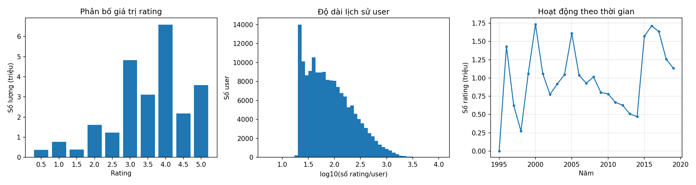
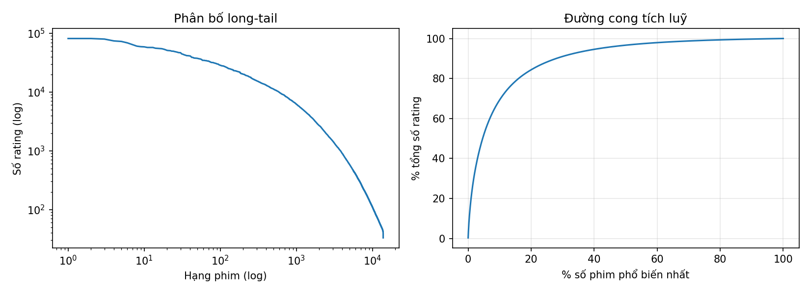
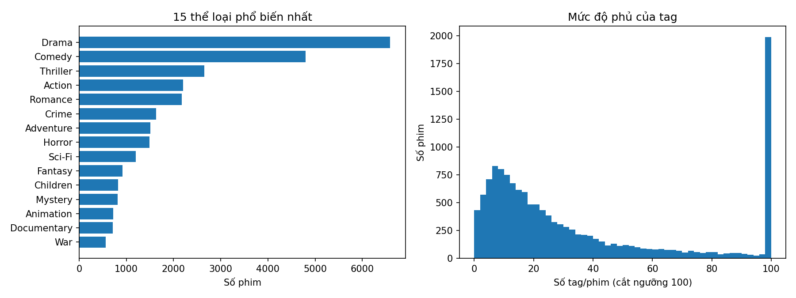
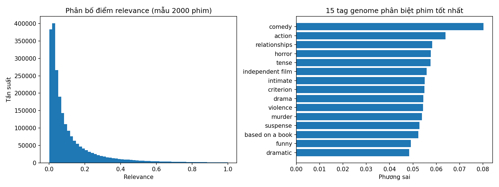

# Chương 3 — Dữ liệu, tiền xử lý và phương pháp

> **Phục vụ RQ1–RQ3:** mọi kết luận ở Chương 4 đều dựa trên dữ liệu được mô tả ở
> đây. Chương này trả lời ba câu hỏi tiền đề: dữ liệu có đủ đại diện cho bài toán
> không, các quyết định tiền xử lý có ảnh hưởng tới kết luận ra sao, và phần dữ liệu
> nào **không** được dùng để huấn luyện mà vẫn dùng để đánh giá.
>
> **Nguồn số liệu:** `results/final/dataset-summary.csv` và
> `results/final/tag-leakage-summary.csv` (27 bảng trong `results/final/` đã commit).

## 3.1 MovieLens 25M — tổng quan

### 3.1.1 Bộ dữ liệu gốc

MovieLens 25M là bộ dữ liệu đánh giá phim do **GroupLens** phát hành, gồm năm file:

| File | Số dòng | Nội dung |
|---|---:|---|
| `ratings.csv` | 25.000.095 | `userId,movieId,rating,timestamp` — hành vi xem phim |
| `movies.csv` | 62.423 | `movieId,title,genres` — siêu dữ liệu phim |
| `tags.csv` | 1.093.360 | tag do người dùng tự gán (có timestamp) |
| `genome-scores.csv` | 15.584.448 | Tag Genome — điểm liên quan của 1.128 tag với mỗi phim |
| `genome-tags.csv` | 1.128 | tên của 1.128 tag trong genome |

Khoảng thời gian phủ **1995–2019**, với 162.540 người dùng và 62.423 phim. Bộ dữ liệu
được phân phối theo giấy phép **GroupLens Non-Commercial Research**: cho phép dùng
nghiên cứu phi thương mại, **cấm phân phối lại** — đó là lý do thư mục `data/` bị
`.gitignore` và người đọc phải tải lại từ nguồn.

Vì sao chọn 25M mà không chọn bộ nhỏ hơn: bài toán cần đủ **tương tác dày** để
collaborative filtering có tín hiệu, đồng thời đủ **phim có Tag Genome** để
content-based chạy được trên cùng catalog. Bộ 1M quá nhỏ cho ma trận 13.816 phim;
bộ 25M vừa đủ mà vẫn chạy được toàn bộ thí nghiệm trên CPU.

### 3.1.2 Thống kê sau tiền xử lý

*Số liệu: `results/final/dataset-summary.csv`.*

| Chỉ số | Giá trị |
|---|---:|
| Số user | 162.540 |
| Số item | 13.816 |
| Số rating | 24.674.113 |
| Mật độ ma trận | 1,0988% |
| Rating ≥ 4 | 50,1% |
| Rating trung bình | 3,54 |
| Rating/user (trung vị / p90) | 71 / 351 |
| Rating/item (trung vị) | 288 |
| Rating thuộc 20% phim phổ biến nhất | 84,4% |
| Item có ≥ 1 tag | 13.633 |
| Khoảng thời gian | 1995–2019 |
| Số thể loại | 19 |
| Số tag genome | 1.128 |
| Relevance genome trung bình | 0,116 |
| Cosine trung bình giữa hai phim (genome thô) | 0,61 |
| Lượt gán tag (sau làm sạch) | 937.428 |
| Từ tag khác nhau (sau làm sạch) | 30.067 |
| Tag/phim (trung vị) | 21 |

Ba con số trong bảng này định hình toàn bộ phần còn lại của đồ án:

1. **Mật độ 1,0988%** — ma trận user×item thưa đến mức mọi mô hình đều phải làm việc
   trên cấu trúc CSR, không thể dày. Đây cũng là lý do bài toán được đánh giá theo
   full-ranking trên 13.816 ứng viên thay vì dùng ma trận dày.
2. **84,4% rating nằm trong 20% phim phổ biến nhất** — phân bố long-tail rất lệch.
   Đây là dữ bối của collaborative filtering: mô hình CF có xu hướng dồn suất vào
   các phim phổ biến, và kết quả đo được ở §4.9 (coverage của ALS chỉ 14,94%)
   là hệ quả trực tiếp của cấu trúc này.
3. **Cosine trung bình giữa hai phim = 0,61** — trong không gian Tag Genome, hai phim
   bất kỳ đã khá giống nhau. Điều này giải thích vì sao content-based dễ "chạm" được
   nhiều phim (coverage cao) nhưng lại khó tách bạch giữa các phim tương tự nhau.

### 3.1.3 Ba nguồn đặc trưng nội dung

Đồ án dùng đồng thời **ba** nguồn đặc trưng, vì mỗi nguồn có điểm mạnh khác nhau:

| Nguồn | Kích thước | Đặc điểm | Dùng ở |
|---|---|---|---|
| `genres` | 19 chiều nhị phân | Rất thưa, chỉ nghĩa khái quát ("Hành động") | CB-1…CB-4 (ghép vào đặc trưng) |
| Tag người dùng gán | 30.067 từ sau làm sạch | Mô tả cảnh chiến, tông màu, motif câu chuyện | CB-1 (TF-IDF), CB-2 (BM25) |
| Tag Genome | 1.128 chiều liên quan | Điểm liên quan ngoài động của GroupLens cho mọi phim | CB-3 (trực tiếp), CB-4 (fusion) |

Lựa chọn này là cố ý: ba nguồn có **mức rò rỉ metadata khác nhau** (xem §3.2.3), nên
khi so sánh CF và CB, người đọc có thể tách được "lợi thế của nội dung" khỏi "lợi
thế của metadata hậu kỳ" — một câu hỏi mà RQ3 yêu cầu trả lời.

## 3.2 Phân tích khám phá dữ liệu

### 3.2.1 Phân phối hành vi

**Hình 3.1** — phân phối rating và phân phối số tương tác mỗi người dùng:



Phân phối rating không đối xứng: 50,1% lượt rating ≥ 4,0 nhưng trung bình chỉ 3,54.
Điều này quyết định cách chuyển bài toán "dự đoán rating" thành "xếp hạng" — xem
§2.4 — và cũng định nghĩa ngưỡng relevant ở §3.3.4.

Phía người dùng: trung vị 71 tương tác nhưng p90 = 351, tức độ lệch rất lớn. Chỉ
**41.343 / 66.131 / 51.300** người dùng rơi vào ba nhóm lịch sử 5–30 / 31–100 / >100
(số liệu ở §4.5) — nhóm giữa và nhóm cuối chiếm 3/4 tập user. Vì vậy phát hiện ở
§4.5 rằng khoảng cách CF–CB **thu hẹp dần** theo độ dài lịch sử là phát hiện trên
phần lớn tập user, không chỉ một nhóm thiểu số.

### 3.2.2 Long-tail của độ phổ biến phim

**Hình 3.2** — đường cong long-tail:



Đường cong thuận hình hyperbola đặc trưng: một đầu rất ít phim chiếm phần lớn
lượt rating, đuôi dài gồm hàng nghìn phim chỉ có vài chục lượt. Hệ quả trực tiếp:

- **CF khó học được phần đuôi.** Với một phim chỉ có 5 lượt rating, ma trận phân rã
  không có đủ tín hiệu để ước lượng factor — và nếu có, ước lượng đó cũng nhiễu.
- **CB có lợi thế ở phần đuôi.** Mô hình nội dung dựa vào đặc trưng phim, không vào
  đếm lượt xem, nên một phim hiếm vẫn có hồ sơ nội dung đầy đủ.
- **Đây là cơ chế đằng sau kết luận ở §4.9:** coverage đảo ngược với độ
  chính xác. ALS chính xác nhất nhưng chỉ chạm 14,94% catalog; CB-3 kém nhất trong
  nhóm CB nhưng chạm 67,20%.

### 3.2.3 Đặc trưng nội dung và mốc thời gian của tag

**Hình 3.3** — phân bố thể loại, số tag mỗi phim, độ dài tài liệu:



**Hình 3.4** — phân bố điểm Tag Genome và độ tương quan cosine giữa hai phim:



Ba phát hiện ở đây có ảnh hưởng trực tiếp tới thiết kế thí nghiệm:

**(i) 183 phim không có tag nào.** Không thể dựng tag document cho chúng, nên mô hình
content phải xử lý vector rỗng. Vì vậy điểm hiệu chỉnh của BM25 tính trên **toàn bộ
tập document** (kể cả 188 document rỗng theo bản ghi tiền xử lý), vì bỏ chúng ra sẽ
làm trung bình độ dài tài liệu sai lệch ~1,4% và thay đổi thứ hạng.

**(ii) Ngày gán tag đầu tiên là 2005-12-24**, trong khi trung vị ngày kết thúc huấn
luyện của user tập phát triển là **2006-09-25**. Nghĩa là phần lớn user trong tập phát
triển đã **train xong trước khi hệ thống tag tồn tại**. Đây là nền tảng của RQ3 và
được phân tích đầy đủ ở §4.6–§4.7.

**(iii) Số tag mỗi phim tương quan mạnh với độ phổ biến** — Pearson = 0,768
(Spearman = 0,700). Tag và popularity **không độc lập**: phim phổ biến thường được
nhiều người gán tag hơn. Hệ quả: một phần lợi thế của content-based có thể chỉ là
"phổ biến gián tiếp", và đó là lý do §4.7.3 còn một đối chứng "chỉ dùng genres".

*Nguồn: `results/final/tag-leakage-summary.csv`.*

## 3.3 Tiền xử lý

Bốn quyết định tiền xử lý ảnh hưởng trực tiếp tới kết luận, nên mỗi quyết định đều
được nêu kèm lý do.

### 3.3.1 Lọc catalog theo Tag Genome

**Quyết định:** giữ lại **13.816 phim** có Tag Genome, từ 62.423 phim gốc — giữ
**98,7% khối lượng rating**.

**Lý do:** mọi mô hình phải so sánh trên *cùng một tập ứng viên*. Nếu CB-3 (Tag
Genome) chỉ chạy được trên 13.816 phim còn CF chạy trên 62.423 phim, thì bảng so
sánh trở thành so sánh giữa hai bài toán khác nhau chứ không phải hai thuật toán
trên cùng bài toán. Việc lọc trước, rồi mới tách `train`/`test`, giữ cho mọi mô hình
**cùng một catalog ứng viên** ở mọi giao thức.

Cách tái lập: `venv/bin/python -m src.data.load_movielens_filtered` → ghi
`data/processed/ratings_genome.parquet`.

### 3.3.2 Làm sạch đặc trưng nội dung

**Quyết định:** 1.093.360 lượt gán tag thô → **937.428 lượt sau làm sạch** → **30.067
từ tag khác nhau**; 13.633/13.816 phim có ≥ 1 tag (183 phim không có).

Làm sạch gồm: chuẩn hoá chữ thường, loại ký tự đặc biệt, gộp các biến thể viết
tắt, và bỏ tag quá hiếm (xuất hiện ở quá ít phim — ngưỡng `min_df` được quét trong
CB-2). Sau đó mỗi phim được biểu diễn bằng một *tag document* — chuỗi các tag của nó
— là đầu vào cho TF-IDF (CB-1) và BM25 (CB-2).

### 3.3.3 Chia tập thời gian theo từng user

**Quyết định:** trong mỗi user, sắp xếp tương tác theo `timestamp`, lấy **80% đầu**
làm `train`, **20% cuối** làm `test`.

**Điều kiện giữ lại user:** `train` có ≥ 5 tương tác **và** `test` có ≥ 1 rating ≥ 4,0
(user không có phim relevant trong test thì Recall/NDCG không tính được).

**Kết quả:** **158.774 user** hợp lệ; `train` 19.801.784 rating, `test` 4.831.397
rating, trong đó 2.288.027 rating relevant (≥ 4,0).

**Vì sao split theo thời gian chứ không ngẫu nhiên:** ngẫu nhiên sẽ để rating
"tương lai" của user nằm trong `train` và rating "quá khứ" nằm trong `test` — mô hình
được hỏi về một thứ nó đã biết. Split thời gian mô phỏng đúng tình huống sản xuất:
*dự đoán từ lịch sử, đánh giá trên tương tác về sau*.

**Vì sao chia theo từng user chứ không chia toàn cục:** đây là quyết định có tác
động lớn nhất trong toàn bộ chương. Chia toàn cục theo mốc thời gian sẽ giữ lại
chỉ những user còn hoạt động *sau* mốc chia, và loại bỏ toàn bộ user đã ngừng xem
— tức loại bỏ chính những user có lịch sử ngắn, vốn là nhóm mà content-based được
kỳ vọng cạnh tranh được. Đo lại trên dữ liệu hiện tại:

| Cách chia | `min_train` | Ngưỡng relevant | User hợp lệ |
|---|---:|---:|---:|
| global 70/30 theo quantile timestamp | 5 | ≥ 4,0 | **4.399** |
| global 70/30 | 1 | ≥ 4,0 | 4.450 |
| global 75/25 | 5 | ≥ 4,0 | 5.622 |
| **per-user 80/20 (dùng trong đồ án)** | 5 | ≥ 4,0 | **158.774** |

Hệ số tăng thực tế là **158.774 / 4.399 ≈ 36,1 lần**. Đây không phải con số "đẹp" mà
là hệ quả có ý nghĩa: split toàn cục làm mất 97% user, và những user bị mất đó chính
là nhóm mà kết luận "CB cạnh tranh được với CF ở user lịch sử ngắn" (§4.5) cần để
kiểm chứng. Cách tái lập: `ratings_genome.parquet` → global 70/30 theo quantile của
`ts` → lọc `train ≥ 5` & `test có rating ≥ 4,0`.

### 3.3.4 Dựng ma trận và chuẩn hoá chỉ số

**Quyết định:** biểu diễn `train`/`test` bằng ma trận thưa CSR, remap `userId`/`movieId`
về chỉ số nguyên 0..n−1; ngưỡng relevant là **rating ≥ 4,0**
(`paths.RELEVANCE_THRESHOLD`).

Ba điểm kỹ thuật đáng nêu:

- **Chống cặp trùng lặp:** `_to_csr` kiểm tra `(user, item)` trùng trước khi dựng
  ma trận, vì `scipy` cộng dồn giá trị ở ô trùng — sai cả rating lẫn nhãn relevant,
  mà không có lỗi nào được ném ra.
- **Ngưỡng 4,0 được dùng thống nhất** ở MostPop, ALS, ItemKNN-CF và nhãn test. Hệ quả
  là mọi mô hình "chơi" với cùng một định nghĩa relevant — điều kiện cần để bảng
  so sánh ở Chương 4 có ý nghĩa.
- **Tách `TrainData` khỏi `Dataset`:** mô hình chỉ nhận `TrainData`, nên về mặt cấu
  trúc **không thể** chạm tới nhãn test. Đây là hàng rào chống leakage ở tầng thiết
  kế, thứ mà unit test không bắt được — gõ nhầm `train_csr` thành `test_rel_csr`
  vẫn chạy trơn tru vì hai ma trận cùng shape và dtype, chỉ có metric là nhảy vọt.

## 3.4 Tóm tắt và ảnh hưởng tới các chương sau

| Quyết định tiền xử lý | Ảnh hưởng tới kết luận ở đâu |
|---|---|
| Lọc 13.816 phim (giữ 98,7% rating) | Mọi bảng so sánh ở Chương 4 công bằng; CF không bị lợi thế catalog |
| Lọc sạch tag → 30.067 từ | Đầu vào CB-1/CB-2; độ phủ từ vựng quyết định `min_df` |
| Split thời gian per-user 80/20 | Giữ 158.774 user (×36,1 so với global); cho phép đo §4.5 về user lịch sử ngắn |
| Ngưỡng relevant ≥ 4,0 | Định nghĩa chung cho mọi mô hình và cho nhãn test |
| Tách `TrainData` / `Dataset` | Chống leakage ở tầng cấu trúc, không chỉ bằng quy ước |
| Giữ nguyên 183 phim không có tag | Buộc mô hình nội dung xử lý document rỗng; ảnh hưởng trung bình độ dài BM25 |

**Điểm cần nói rõ khi trình bày:** quyết định lọc catalog là *đánh đổi có ý thức*.
Giữ 98,7% khối lượng rating nghĩa là đồ án **không** đánh giá được trên toàn bộ 62.423
phim của MovieLens — các phim không có Tag Genome (chủ yếu phim rất ít người biết)
không xuất hiện trong bất kỳ bảng kết quả nào. Đây là giới hạn của đồ án, được nêu
lại ở §5.4.

---

**Tài liệu tham khảo chương này:** Harper & Konstan (2015) — *The MovieLens datasets:
history and context*; Robertson & Zaragoza (2009) — *The probabilistic relevance
framework: BM25 and beyond*; Järvelin & Kekäläinen (2002) — *Cumulated gain-based
evaluation of IR techniques*.

---

> **Phục vụ RQ1–RQ3:** chương này mô tả **cách** 9 mô hình được huấn luyện và chấm
> điểm trên một giao thức thống nhất. Ba giao thức ở §3.9 là nền để so sánh được
> CF với content-based (RQ1), để đo đảo chiều ở cold-start (RQ2), và để kiểm tra
> tín hiệu content theo kỷ nguyên (RQ3).
>
> **Nguồn số liệu:** `results/final/full-summary.csv` (cột `fit_s`, `score_s`),
> `results/final/ablation-*.csv` (144 dòng sweep).

## 3.5 Thiết lập thực nghiệm

### 3.5.1 Môi trường

| Thành phần | Giá trị |
|---|---|
| Ngôn ngữ | Python 3.12 |
| Tính toán ma trận | `numpy` 2.5.2, `scipy` 1.18.1 |
| Phân rã ma trận / BPR | `implicit` 0.7.3 (CPU) |
| Xử lý dữ liệu | `pandas` 3.0.5, `pyarrow` |
| Vector hoá TF-IDF | `scikit-learn` 1.9.0 |
| Lạc quan hóa | `scipy.sparse.linalg` |
| Kết xuất hình | `matplotlib` 3.9.2, `seaborn` 0.13.2 |
| **Random seed** | **42** (`paths.SEED`) |

Toàn bộ thí nghiệm chạy trên CPU, không dùng GPU. Đây là quyết định có chi phí:
mô hình BPR bị giới hạn `num_threads=1` (§3.8.3) nên `fit` mất 39,84s thay vì ~7s —
đánh đổi lấy tính tái lập được tuyệt đối (§5.3).

### 3.5.2 Cấu trúc repo và cách tái lập

Cấu trúc được thiết kế để **một mô hình không thể vô tình nhìn thấy nhãn test**:

```
src/
├── data/        # tiền xử lý: nạp, dựng đặc trưng, chia tập
├── models/      # 9 mô hình + lớp cơ sở + tiện ích dùng chung
├── eval/        # evaluator, registry, bảng kết quả, phân tích
├── api/         # tầng serving (demo) — không import src.eval.*
└── paths.py     # đường dẫn, hằng số, ngưỡng relevant
scripts/         # CLI: sinh bảng kết quả, vẽ hình, đối chiếu số báo cáo
configs/         # 159 file YAML: 144 sweep + 13 best-* + 2 baseline-*
tests/           # 288+ test
```

Hướng dẫn chạy lại đầy đủ: [`docs/codebase-summary.md`](../codebase-summary.md).

### 3.5.3 Vì sao `TrainData` và `Dataset` phải tách

Đây là quyết định thiết kế quan trọng nhất của đồ án, và nó **không** phải chuyện
sắp xếp code cho đẹp.

```python
@dataclass
class TrainData:      # mô hình chỉ được thấy cái này
    train_csr: sparse.csr_matrix
    train_df: pd.DataFrame
    n_users: int
    n_items: int

@dataclass
class Dataset:        # chỉ evaluator được thấy cái này
    train: TrainData
    test_rel_csr: sparse.csr_matrix   # nhãn relevant
    eval_users: np.ndarray
```

Mọi mô hình đều nhận `fit(train: TrainData, item_features: dict)` — kiểu dữ liệu đó
**không chứa** nhãn test, nên mô hình về mặt cấu trúc không thể đọc nó. Lỗi "gõ nhầm
`train_csr` thành `test_rel_csr`" sẽ không biên dịch được chứ không chỉ chạy sai âm
thầm.

Vấn đề này không giả định: nó xảy ra thật trong quá trình phát triển đồ án. Trước
đây có hai evaluator song song với protocol khác nhau (global 70/30 và per-user 80/20),
dẫn tới kết quả không thể so sánh. Việc hợp nhất về một đường chạy — 9 mô hình ×
3 giao thức, một evaluator — là đóng góp thứ nhất của đồ án (§5.7).

## 3.6 Baseline

Hai baseline không phải để cạnh tranh mà để **kiểm tra evaluator**: nếu evaluator
đúng, Random phải cho metric ≈ 0 và MostPop phải cho một mức sàn hợp lý.

| Baseline | Cách chấm | Vai trò |
|---|---|---|
| **Random** | Xếp hạng ngẫu nhiên 13.816 phim | **Kiểm tra evaluator** — mọi metric phải ≈ 0 (NDCG@10 = 0,0012) |
| **MostPop** | Xếp hạng theo số lượt rating ≥ 4,0 trong `train` | Sàn sống của mọi mô hình (NDCG@10 = 0,0739) |

MostPop dùng **cùng ngưỡng relevant** (≥ 4,0) và **cùng tập train** như mọi mô hình
khác — không có ngoại lệ nào. Ở giao thức `full`, MostPop đạt NDCG@10 = 0,0739, tức
bằng 54% NDCG của ALS (0,1375). Con số này đặt ngữ cảnh: **một mô hình không học gì
ngoài độ phổ biến** vẫn đạt hơn một nửa mức của mô hình tốt nhất — hệ thống gợi ý
thực tế đang cạnh tranh với một heuristic rất đơn giản.

Ở giao thức cold-start, MostPop rơi về **0,0000** (§4.3) vì mọi phim held-out đều
có popularity bằng 0 trong tập train. Đây là tiền lệ cho kết luận ở §4.3: mọi
mô hình dựa trên độ phổ biến cũng chết ở cold-start, không chỉ CF.

## 3.7 Mô hình Content-based

### 3.7.1 Kiến trúc chung: hồ sơ user trên không gian đặc trưng item

Cả bốn mô hình content trong đồ án dùng **cùng một kiến trúc**, chỉ khác ở cách dựng
ma trận đặc trưng `X` [n_items, D]:

```
X  (đặc trưng item, L2-normalised)
W  (trọng số lịch sử user)              P = normalize(W_batch @ X)   (hồ sơ user)
                                          S = X @ P.T               (điểm ứng viên)
```

Hai quyết định kỹ thuật trong kiến trúc này:

- **Hồ sơ tính theo lô, không precompute toàn bộ.** Với 158.774 user và D lớn, tính
  trước P cho mọi user sẽ tốn hàng chẻm bộ nhớ; tính theo lô 2.000 user giữ mức
  dùng RAM không đổi theo số user.
- **Ma trận `X` giữ dạng thưa nếu đầu vào thưa.** TF-IDF trên tag có mật độ ~0,14%;
  bản dense 13.816 × 20.000 chiếm 2,06 GB (peak 8,28 GB khi dựng) trong khi CSR chỉ
  ~6 MB. Phép nhân cũng nhanh hơn vì chi phí tỉ lệ với số phần tử khác 0.

### 3.7.2 Bốn mô hình và tham số quét

| Mô hình | Cấu hình | Số config sweep | Ghi chú |
|---|---|---:|---|
| **CB-1 TF-IDF** | TF-IDF trên tag document + genres | 15 | `min_df`, `max_df`, `max_features`, `sublinear_tf` |
| **CB-2 BM25** | BM25 trên tag, lưới `k1` × `b` | 21 | `k1`, `b`, `min_df`, `max_df` |
| **CB-3 Tag Genome** | 1.128 chiều genome, chuẩn hoá, threshold, SVD | 22 | 19 `cb3-genome` + 3 `cb3-ridge` |
| **CB-4 Hybrid** | Late fusion BM25 + Genome | 35 | 32 `cb4-hybrid` + 3 `cb1-tfidf` time-decay |

> **Phân biệt hai con số dễ nhầm:** **144** là số dòng sweep thực sự đã chạy
> (51 CF + 93 CB, xem `results/final/ablation-*.csv`). **159** là số file trong
> `configs/` — gồm 144 sweep + 13 file `best-*.yaml` (bản config đã khoá) + 2 file
> `baseline-*.yaml`. Báo cáo dùng **144** khi nói về sweep và **159** khi nói về số
> file config.

**CB-1 — TF-IDF.** Với mỗi phim i, `tfidf(t, i) = tf(t,i) · idf(t) · L2-normalise`,
trong đó `idf(t) = ln((1+N)/(1+df(t))) + 1`. Tham số `sublinear_tf` quyết định dùng
`1 + ln(tf)` hay `tf` thẳng — quyết định này ảnh hưởng mạnh tới việc một tag bị
gán 500 lần có "áp đảo" tag được 5 lần hay không.

**CB-2 — BM25.** Công thức Robertson & Zaragoza (2009), với N = số phim,
`df_t` = số phim chứa tag t:

\[
idf_t = \ln\frac{N - df_t + 0{,}5}{df_t + 0{,}5} + 1
\qquad
w_{it} = idf_t \cdot \frac{c_{it}(k_1+1)}{c_{it} + k_1(1 - b + b\,\ell_i/\bar{\ell})}
\]

BM25 khác TF-IDF ở **đúng hai chỗ**, và cả hai đều cần thiết cho tag document:

- **Bão hoà tần suất** `c/(c+k1)`: một tag được 500 người gán không được áp đảo
  tag được 5 người gán gấp 100 lần. `sublinear_tf` của TF-IDF cũng làm việc này
  nhưng bằng `log`, không điều chỉnh được.
- **Chuẩn hoá độ dài tài liệu** qua `b`: phim blockbuster có hàng nghìn tag không
  tự động giống mọi thứ. Ở đây điều này đáng chú ý vì **số tag mỗi phim tương quan
  0,768 với độ phổ biến** (§3.2.3) — tức độ dài tài liệu chính là popularity đội lốt
  nội dung.

**CB-3 — Tag Genome.** Ma trận genome thô (13.816 × 1.128) được xử lý theo thứ tự
**bắt buộc**: threshold → standardize → SVD → L2-normalise. Threshold phải áp lên
*relevance thô* mới đúng nghĩa "tag yếu"; nếu chạy sau z-score thì ngưỡng không còn
là ngưỡng relevance — đo trên dữ liệu thật, nó xoá 76,7% ô thay vì 66,2%, và 15,1%
tổng số ô bị xoá oan dù relevance thô ≥ 0,1. Tệ hơn, sau z-score giá trị 0 nghĩa là
"đúng bằng trung bình của tag đó" chứ không phải "không liên quan", nên clamp về 0 là
đi mà phim về mức trung bình. SVD được cache theo vân tay của ma trận đầu vào, không
chỉ theo tham số.

**CB-4 — Hybrid late fusion.**

\[
S = \sum_m w_m \cdot \mathrm{minmax\_row}(S_m) + \lambda_{pop}\cdot \mathrm{pop\_norm}
\]

Chuẩn hoá min-max là bắt buộc trước khi cộng: thang điểm của BM25 (cosine trong
[0,1]) và Genome (tương tự) không so được với nhau nếu không chuẩn hoá. Điểm tinh tế:
min-max phải tính **chỉ trên tập ứng viên** (đã loại phim user xem), vì item user đã
xem chính là item điểm cao nhất của mô hình nội dung — nếu lấy min/max trên toàn bộ
13.816 phim, thang điểm của phần ứng viên sẽ phụ thuộc vào khoảng cách "đã xem/chưa
xem" riêng của từng mô hình, và trọng số `w = 0,75` sẽ không còn nghĩa là "75% mô hình
A".

### 3.7.3 Bẫy `pop_prior` — điều phải nêu trước khi trích dẫn bảng chính

CB-4 có hai biến thể: content thuần (`λ_pop = 0`) và có popularity prior
(`λ_pop = 0,4`). Bản có prior **tốt hơn** ở giao thức thường:

| Bản CB-4 | NDCG@10 (`full`) | NDCG@10 (`coldstart`) | `frac_unseen@10` (`coldstart`) |
|---|---:|---:|---:|
| Content thuần (`λ_pop = 0`) | 0,1054 | **0,0347** | 0,2223 |
| Có prior (`λ_pop = 0,4`) | **0,1081** | 0,0010 | 0,0036 |

*(Nguồn: `results/final/benchmark-coldstart.csv`, `results/final/beyond-accuracy-coldstart.csv`.)*

Nguyên nhân rất rõ: ở split cold-start, mọi phim held-out có popularity bằng 0 trong
tập train, nên prior **không phân biệt được** chúng và kéo điểm của mọi phim held-out
xuống đáy bảng xếp hạng.

**Vì vậy bảng chính của báo cáo lấy bản content thuần**, và bản có prior chỉ được
trích dẫn ở đây làm đối chứng. Đây là ví dụ điển hình của bài học ở §5.3: một siêu
tham số có vẻ chỉ "cải thiện" ở giao thức thường lại có thể phá hỏng hoàn toàn ở giao
thức khác — nên phải đánh giá trên **cả hai** trước khi chọn.

### 3.7.4 Chế độ trọng số hồ sơ

Ma trận trọng số `W` được dựng từ `train_csr` theo ba chế độ:

| Chế độ | Công thức | Ý nghĩa |
|---|---|---|
| `binary_pos` | 1 nếu rating ≥ 4,0, 0 ngược lại | Chỉ quan tâm user **có thích** hay không |
| `rating` | Giữ nguyên giá trị rating | Phim 5 sao đóng góp nhiều hơn 4 sao |
| `centered` | `r − ū_train` | Phim không thích kéo hồ sơ ra xa thể loại đó |

Ngoài ra có tham số `half_life_days` áp hệ số suy giảm `0,5^(Δt/half_life)` cho
mỗi tương tác — phim xem lâu rồi đóng góp ít hơn vào hồ sơ. Hiệu ứng của ba chế độ
được đo ở §4.8.

## 3.8 Mô hình Collaborative Filtering

| Mô hình | Thư viện / cài đặt | Ghi chú |
|---|---|---|
| **ALS** | `implicit.als.AlternatingLeastSquares` | `c_ui = 1 + α`, chỉ tương tác relevant |
| **Item-CF (RS)** | Tự cài, trọng số = **rating thật** | Quét `k_neighbors`, `weight_mode` |
| **BPR-MF** | `implicit.bpr` | `num_threads=1` — tái lập được tuyệt đối |
| **ItemKNN-CF** | Tự cài, trọng số **nhị phân** | Trong registry, không vào bảng chính |

### 3.8.1 ALS cho implicit feedback

Hu, Koren & Volinsky (2008) mở rộng ALS sang phản hồi ẩn bằng cách gán mỗi tương tác
một mức tin cậy `c_ui` và tối ưu:

\[
\min_{P,Q} \sum_{u,i} c_{ui}\,(p_u^\top q_i - r_{ui})^2 + \lambda(\|P\|^2 + \|Q\|^2)
\]

**Ngữ nghĩa confidence — chỗ dễ sai nhất của toàn bộ đồ án.** Thư viện `implicit` coi
**giá trị lưu trong ma trận chính là `c_ui`**, rồi dùng `(c−1)` để tích luỹ `YᵀC_uY`
và `c` cho vế phải. Do đó:

- phải lưu **`1 + α`**, không phải `α`;
- **chỉ được lưu tương tác relevant** (rating ≥ 4,0). Nếu lưu cả rating thấp với
  `c = 1` thì số hạng `(c−1)` bằng 0 nhưng `b += 1·factor` vẫn cộng vào — tức mô
  hình học "user thích phim này với độ tin cậy 1" cho đúng những phim user đã chấm
  điểm thấp.

Đây chính là lý do `paths.RELEVANCE_THRESHOLD` được dùng thống nhất ở ALS, MostPop,
ItemKNN-CF và nhãn test.

Một chi tiết kỹ thuật khác: trong lúc `fit`, BLAS bị ép về 1 luồng qua
`threadpoolctl`. ALS đã tự song song hoá theo user; để OpenBLAS mở thêm threadpool
lồng nhau gây tranh chấp và làm chậm đi nhiều lần.

### 3.8.2 Item-based CF

Hai biến thể dùng cùng một nguyên lý ("người xem phim này cũng xem phim kia") nhưng
khác trọng số:

- **`rs-itemcf`** — trọng số = **rating thật** của user lên item, cộng trọng số của
  các hàng xóm có rating cao. Cho phim user thích điểm cao đóng góp nhiều hơn.
- **`cf-itemknn`** — trọng số **nhị phân** (có tương tác hay không). Bản này nằm
  trong registry để thí nghiệm nhưng **không vào bảng chính**.

Item-based CF scale tốt hơn user-based vì số phim (13.816) ít hơn nhiều lần số user
đánh giá (158.774), và ma trận tương đồng item×item thưa hơn ma trận user×user.

### 3.8.3 BPR-MF và lý do `num_threads=1`

BPR (Rendle et al., 2009) tối ưu mục tiêu pairwise ranking:

\[
\mathcal{L} = \sum_{(u,i,j)} -\ln \sigma(\hat{r}_{ui} - \hat{r}_{uj}) + \lambda\|\Theta\|^2
\]

với `j` lấy bằng **negative sampling** trên các item user chưa tương tác.

`num_threads=1` là quyết định **cố ý**: với nhiều luồng, thứ tự cập nhật tham số
phụ thuộc lịch trình, khiến kết quả **không tái lập được tuyệt đối** giữa các lần
chạy. Đánh đổi: `fit_s = 39,84` cho 158.774 user ở giao thức `full`
(*nguồn: cột `fit_s` của `results/final/full-summary.csv`*) thay vì ~7s khi dùng
nhiều luồng. Trong một đồ án đánh giá, tính tái lập được quan trọng hơn tốc độ — nhưng
đây là một đánh đổi đã ghi nhận, không phải lựa chọn miễn phí (§5.3).

## 3.9 Giao thức đánh giá

### 3.9.1 Ba giao thức

| Giao thức | Số user | `split_id` | Dùng để |
|---|---:|---|---|
| `dev` | 20.000 | `temporal80_20` | **chọn tham số** — sweep 144 config (51 CF + 93 CB) |
| `full` | 158.774 | `temporal80_20` | **bảng chính** — chạy **một lần** sau khi khoá config |
| `coldstart` | 10.992 | `temporal80_20+coldstart_item` | cold-start item (§4.3) |

> **Số user của `coldstart` phụ thuộc bảng:** `coldstart-item.csv` ghi
> `n_eval_users = 10.992`, còn `beyond-accuracy-coldstart.csv` dùng **10.988** user
> (đã loại 4 user không có tín hiệu nào để chấm). Khi trích dẫn phải nói rõ đang
> nói về bảng nào.

**`dev` ⊂ `full`**, cùng `train.parquet`/`test.parquet` — khác biệt duy nhất là ai
được chấm điểm. Median train/user = 58 ở cả hai; NDCG@10 lệch ≤ 1,7% và **thứ hạng
không đảo** giữa `dev` và `full`. Đây là cơ sở để dùng biên độ sweep đo ở `dev`
(20.000 user, rẻ hơn nhiều) trong báo cáo, với điều kiện phải **ghi rõ mức user của
từng bảng**.

**Giao thức cold-start item:** giữ lại **1.381 phim** (10% catalog, phân tầng theo
5 nhóm năm phát hành) và **xoá toàn bộ tương tác train** của các phim đó. Mô hình
được huấn luyện lại trên split này rồi chấm điểm trên tập relevant của các phim
held-out. Đây là nơi kết luận đảo chiều (§4.3).

### 3.9.2 Vì sao full ranking, không sampled

Mỗi user được chấm điểm trên **toàn bộ 13.816 ứng viên**. Lý do:

1. **Sampled metrics có thể đảo thứ hạng.** Krichene & Rendle (2020) chỉ ra rằng với
   một mẫu negative nhỏ, thứ hạng giữa hai thuật toán có thể bị đảo — tức phép đo
   không còn bảo toàn thứ hạng mà ta muốn so sánh.
2. **Ở đây phép đo còn đặc biệt rẻ.** Với NDCG@10, một item có relevance nhị phân,
   toàn bộ đóng góp vào DCG nằm ở 10 vị trí đầu — nên chỉ cần sắp xếp một phần
   nhỏ đầu danh sách cũng đủ dùng làm ứng viên cho điểm số, miễn là bảo đảm không
   bỏ sót ứng viên thật sự có thể lọt vào top-10.
3. **Chi phí vẫn chấp nhận được.** Chấm theo lô 2.000 user để tránh dựng ma trận
   8,9 GB; toàn bộ giao thức `full` mất 21,67s (BPR) đến 140,19s (CB-4) cho phần
   chấm điểm.

### 3.9.3 Bằng chứng thực nghiệm: full ranking bảo toàn thứ hạng

*Lựa chọn full ranking ở §3.9.2 không chỉ dựa trên trích dẫn học thuật — nó được
**kiểm chứng bằng phép đo thực nghiệm** trong chính repo này.*

Giao thức thay thế (LOO + 100 negative lấy mẫu) đã được cài đặt trong
`src/eval/sampled_loo_evaluator.py` và chạy trên **cùng bộ 12 config `best-*.yaml`**
(`scripts/run_sampled_loo_comparison.py`). Kết quả: **Kendall τ = 0,908**
(`p = 4,81e-05`) giữa bảng thứ hạng theo full ranking và theo sampled LOO.

*Nguồn: `results/final/sampled-vs-full.csv`.*

| `exp_name` | NDCG@10 (full) | Hạng (full) | NDCG@10 (sampled) | Hạng (sampled) |
|---|---:|---:|---:|---:|
| `cf-als-f064-a005-reg0p1` | 0,1383 | 1 | 0,5959 | 3 |
| `cf-itemknn-k200` | 0,1297 | 2 | 0,5973 | 1 |
| `rs-itemcf-k200-binary-pos` | 0,1297 | 2 | 0,5973 | 1 |
| `rs-bpr-f64-i10-reg0p00001-lr0p01` | 0,1106 | 4 | 0,5030 | 4 |
| `cb4-06-late-bm25-pop-lam0040` | 0,1067 | 5 | 0,4924 | 5 |
| `cb4-04-late-bm25-w075` | 0,1043 | 6 | 0,4700 | 6 |
| `cb2-01-k1-05-b000` | 0,0986 | 7 | 0,4541 | 7 |
| `cb4-03-timedecay-hl0365` | 0,0921 | 8 | 0,4335 | 9 |
| `baseline-mostpop` | 0,0723 | 9 | 0,4491 | 8 |
| `cb3-04d-item-knn-tau020-k100` | 0,0703 | 10 | 0,3472 | 10 |
| `cb3-05-ridge-lambda100` | 0,0125 | 11 | 0,1878 | 11 |
| `baseline-random` | 0,0011 | 12 | 0,0453 | 12 |

**Đọc kết quả — và những gì nó không nói.** τ = 0,908 nghĩa là hai giao thức **gần
như giữ nguyên thứ hạng**: 8/12 mô hình giữ nguyên hạng, và các đảo hạng chỉ xảy ra
ở **các cặp hạng kề nhau** (ALS 1→3, MostPop 9→8, CB-1 8→9). Đây đúng là hiện tượng
mà Krichene & Rendle (2020) mô tả: sampled metric có xu hướng **đảo thứ hạng giữa
những mô hình gần điểm nhau**, chứ ít khi đảo thứ hạng giữa nhóm xa nhau.

Ba kết luận cụ thể rút ra từ bảng:

1. **Các kết luận *định tính* của đồ án vẫn đúng dưới sampled LOO.** Thứ tự nhóm
   vẫn rõ: CF (ALS, Item-CF) ở trên, CB-4/CB-2 ở giữa, CB-3 Ridge và Random ở
   đáy. Không có cặp nào đảo chiều *qua nhóm*.
2. **Con số *tuyệt đối* thì không.** NDCG@10 dưới sampled LOO là 0,5959 (ALS) so với
   0,1383 dưới full ranking — chênh lệch tới 4,3 lần, vì sampled LOO đặt nhiều
   negative lấy mẫu vào trước item relevant. Đây là lý do trong báo cáo **không** so
   sánh con số của đồ án này với con số trong bài báo khác: chúng khác giao thức đo.
3. **Các đảo hạng đều ở vùng "gần nhau"** — nơi quyết định thứ hạng không quan
   trọng với ứng dụng. Vì vậy lựa chọn full ranking là **đủ để bảo vệ các kết luận
   quan trọng**, và chi phí (~140s/mô hình) là hợp lý.

> **Giới hạn còn lại của phép đo này:** Kendall τ được tính trên **12 mô hình tốt
> nhất** của mỗi họ, chạy trên giao thức `dev` (20.000 user). Phép đo chưa kiểm tra
> liệu thứ hạng giữa **các config trong cùng một lưới tham số** (144 dòng sweep) có
> bị đảo hay không — đó là nơi độ nhạy của sampled metric cao nhất. Tuy nhiên bảng
> sweep ở §4.2 chỉ dùng để so **biên độ**, không dùng để kết luận thứ hạng giữa
> các mô hình, nên kết luận của đồ án không phụ thuộc vào điểm này.

### 3.9.4 Bằng chứng protocol trên từng dòng kết quả

Mỗi dòng trong mọi bảng kết quả mang ba cột:

| Cột | Ví dụ | Ý nghĩa |
|---|---|---|
| `split_id` | `temporal80_20` | Cách chia tập đã dùng |
| `catalog_id` | `ml25m-n13816-de09a1b710f6` | Mã băm của tập ứng viên (13.816 phim + mã cấu hình) |
| `seed` | `42` | Hạt random toàn cục |

Cơ chế này biến câu "các mô hình này được đánh giá trên cùng một giao thức" từ **lời
tuyên bố** thành **thứ kiểm chứng được**: đối chiếu `split_id` + `catalog_id` của
hai dòng là kiểm tra ba trường hợp ký tự. Người đọc không phải tin lời.

`scripts/check_report_numbers.py` dùng chính bộ bằng chứng này để đối chiếu mọi
con số trong báo cáo với 27 bảng CSV — và phải báo **0 lệch**.

### 3.9.5 Metric đánh giá

Bài toán là **xếp hạng top-N**, không phải dự đoán rating, nên không dùng RMSE/MAE
(định nghĩa và lý do ở §2.4). Bốn metric chính:

| Metric | Định nghĩa | Ý nghĩa |
|---|---|---|
| `P@k` | `hits / k` | Tỉ lệ người dùng mà đúng `k` người dùng khác sẽ thích |
| `R@k` | `hits / \|relevant\|` | Độ phủ của tập relevant |
| `HR@k` | Tỉ lệ user có ≥ 1 hit trong top-k | User nào tìm được thứ muốn |
| `NDCG@k` | DCG chuẩn hoá theo IDCG | Có trọng số theo vị trí |

> **Định nghĩa đúng của `P@k` là `hits / k`** — phân biệt với `hits / len(top_k)`.
> Với `k = 10` và danh sách luôn đủ 10 phim thì hai cách trùng nhau, nhưng định
> nghĩa đúng phải là `hits/k` và evaluator hiện dùng đúng cách đó.

Ngoài độ chính xác còn bốn metric mô tả **hành vi** của hệ thống: `coverage@10`
(tỉ lệ phim từng được gợi ý), `gini@10` (mức dồn suất), `novelty@10` (độ mới lạ),
`ILD@10` (độ đa dạng nội dung trong danh sách). Kết quả ở §4.9 cho thấy
coverage **đảo ngược** với độ chính xác.

Kiểm định thống kê: **bootstrap CI 95%** (`bootstrap-ci.csv`) và **Wilcoxon
signed-rank ghép cặp** (`wilcoxon-{cf,cb,coldstart}.csv`).

## 3.10 Tóm tắt: thiết kế nào đảm bảo so sánh được

| Yếu tố thiết kế | Đảm bảo điều gì |
|---|---|
| Một evaluator, một đường chạy | Không còn so sánh giữa hai protocol khác nhau |
| `TrainData` tách `Dataset` | Mô hình không thể chạm nhãn test (ở tầng cấu trúc) |
| Cùng catalog 13.816 phim cho mọi mô hình | Bảng so sánh là so thuật toán, không so bài toán |
| Cùng ngưỡng relevant ≥ 4,0 | "Relevant" nghĩa giống nhau cho mọi mô hình |
| Split thời gian per-user | Mô hình bị hỏi về tương tác về sau, không phải quá khứ |
| Sweep cân bằng 51 CF / 93 CB | Kết luận "CF thắng" không mang nghi ngờ thiên lệch |
| `split_id` + `catalog_id` + `seed` | "Cùng giao thức" kiểm chứng được, không phải lời tuyên bố |
| Đánh giá trên cả `full` lẫn `coldstart` | Không bỏ sót điều kiện mà phương pháp thắng |
| Bằng chứng sweep commit trong repo | Người đọc tự đếm, không phải tin |

---

**Tài liệu tham khảo chương này:** Hu, Koren & Volinsky (2008); Koren, Bell &
Volinsky (2009); Rendle et al. (2009); Robertson & Zaragoza (2009); Järvelin &
Kekäläinen (2002); Krichene & Rendle (2020); Harper & Konstan (2015).
