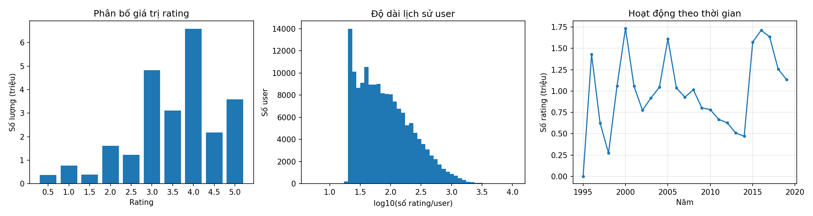
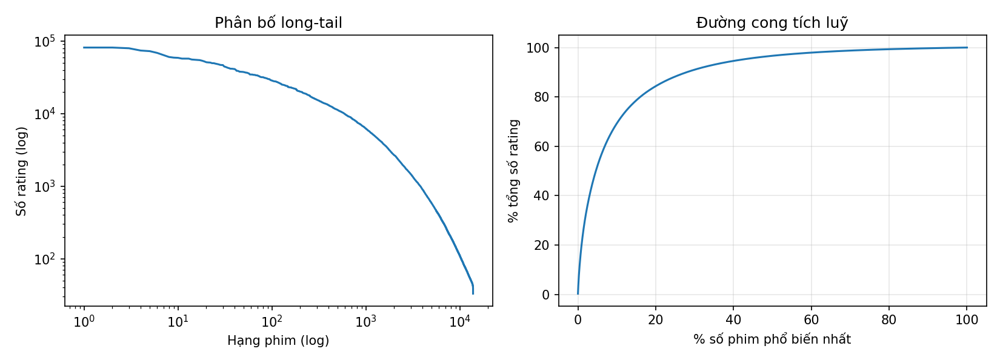
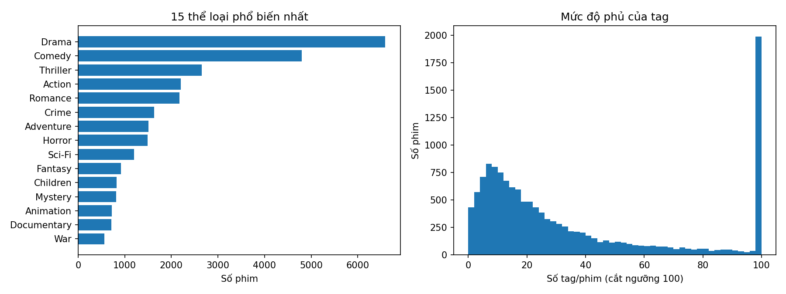
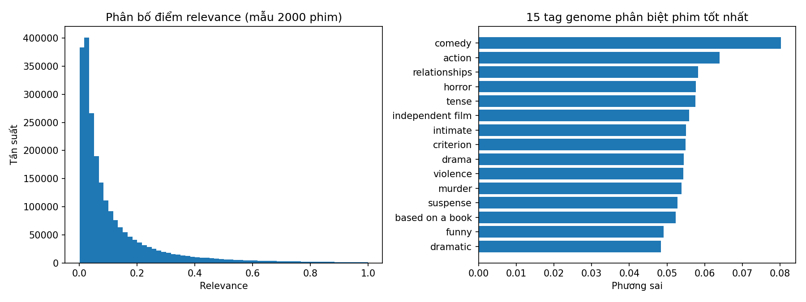

# Chương 3 — Dữ liệu và tiền xử lý

> **Phục vụ RQ1–RQ3:** mọi kết luận ở Chương 5–6 đều dựa trên dữ liệu được mô tả ở
> đây. Chương này trả lời ba câu hỏi tiền đề: dữ liệu có đủ đại diện cho bài toán
> không, các quyết định tiền xử lý có ảnh hưởng tới kết luận ra sao, và phần dữ liệu
> nào **không** được dùng để huấn luyện mà vẫn dùng để đánh giá.
>
> **Nguồn số liệu:** `results/final/dataset-summary.csv` và
> `results/final/tag-leakage-summary.csv` (27 bảng trong `results/final/` đã commit).

---

## 3.1 MovieLens 25M — tổng quan

### 3.1.1 Bộ dữ liệu gốc

MovieLens 25M là bộ dữ liệu đánh giá phim do **GroupLens** phát hành, gồm năm file:

| File | Số dòng | Nội dung |
|---|---:|---|
| `ratings.csv` | 25.000.095 | `userId,movieId,rating,timestamp` — hành vi xem phim |
| `movies.csv` | 62.423 | `movieId,title,genres` — siêu dữ liệu phim |
| `tags.csv` | 1.093.360 | tag do người dùng tự gán (có timestamp) |
| `genome-scores.csv` | 15.584.448 | Tag Genome — điểm liên quan của 1.128 tag với mỗi phim |
| `genome-tags.csv` | 1.128 | tên của 1.128 tag trong genome |

Khoảng thời gian phủ **1995–2019**, với 162.540 người dùng và 62.423 phim. Bộ dữ liệu
được phân phối theo giấy phép **GroupLens Non-Commercial Research**: cho phép dùng
nghiên cứu phi thương mại, **cấm phân phối lại** — đó là lý do thư mục `data/` bị
`.gitignore` và người đọc phải tải lại từ nguồn.

Vì sao chọn 25M mà không chọn bộ nhỏ hơn: bài toán cần đủ **tương tác dày** để
collaborative filtering có tín hiệu, đồng thời đủ **phim có Tag Genome** để
content-based chạy được trên cùng catalog. Bộ 1M quá nhỏ cho ma trận 13.816 phim;
bộ 25M vừa đủ mà vẫn chạy được toàn bộ thí nghiệm trên CPU.

### 3.1.2 Thống kê sau tiền xử lý

*Số liệu: `results/final/dataset-summary.csv`.*

| Chỉ số | Giá trị |
|---|---:|
| Số user | 162.540 |
| Số item | 13.816 |
| Số rating | 24.674.113 |
| Mật độ ma trận | 1,0988% |
| Rating ≥ 4 | 50,1% |
| Rating trung bình | 3,54 |
| Rating/user (trung vị / p90) | 71 / 351 |
| Rating/item (trung vị) | 288 |
| Rating thuộc 20% phim phổ biến nhất | 84,4% |
| Item có ≥ 1 tag | 13.633 |
| Khoảng thời gian | 1995–2019 |
| Số thể loại | 19 |
| Số tag genome | 1.128 |
| Relevance genome trung bình | 0,116 |
| Cosine trung bình giữa hai phim (genome thô) | 0,61 |
| Lượt gán tag (sau làm sạch) | 937.428 |
| Từ tag khác nhau (sau làm sạch) | 30.067 |
| Tag/phim (trung vị) | 21 |

Ba con số trong bảng này định hình toàn bộ phần còn lại của đồ án:

1. **Mật độ 1,0988%** — ma trận user×item thưa đến mức mọi mô hình đều phải làm việc
   trên cấu trúc CSR, không thể dày. Đây cũng là lý do bài toán được đánh giá theo
   full-ranking trên 13.816 ứng viên thay vì dùng ma trận dày.
2. **84,4% rating nằm trong 20% phim phổ biến nhất** — phân bố long-tail rất lệch.
   Đây là dữ bối của collaborative filtering: mô hình CF có xu hướng dồn suất vào
   các phim phổ biến, và kết quả đo được ở Chương 6.4 (coverage của ALS chỉ 14,94%)
   là hệ quả trực tiếp của cấu trúc này.
3. **Cosine trung bình giữa hai phim = 0,61** — trong không gian Tag Genome, hai phim
   bất kỳ đã khá giống nhau. Điều này giải thích vì sao content-based dễ "chạm" được
   nhiều phim (coverage cao) nhưng lại khó tách bạch giữa các phim tương tự nhau.

### 3.1.3 Ba nguồn đặc trưng nội dung

Đồ án dùng đồng thời **ba** nguồn đặc trưng, vì mỗi nguồn có điểm mạnh khác nhau:

| Nguồn | Kích thước | Đặc điểm | Dùng ở |
|---|---|---|---|
| `genres` | 19 chiều nhị phân | Rất thưa, chỉ nghĩa khái quát ("Hành động") | CB-1…CB-4 (ghép vào đặc trưng) |
| Tag người dùng gán | 30.067 từ sau làm sạch | Mô tả cảnh chiến, tông màu, motif câu chuyện | CB-1 (TF-IDF), CB-2 (BM25) |
| Tag Genome | 1.128 chiều liên quan | Điểm liên quan ngoài động của GroupLens cho mọi phim | CB-3 (trực tiếp), CB-4 (fusion) |

Lựa chọn này là cố ý: ba nguồn có **mức rò rỉ metadata khác nhau** (xem §3.2.3), nên
khi so sánh CF và CB, người đọc có thể tách được "lợi thế của nội dung" khỏi "lợi
thế của metadata hậu kỳ" — một câu hỏi mà RQ3 yêu cầu trả lời.

---

## 3.2 Phân tích khám phá dữ liệu

### 3.2.1 Phân phối hành vi

**Hình 3.1** — phân phối rating và phân phối số tương tác mỗi người dùng:

Phân phối rating không đối xứng: 50,1% lượt rating ≥ 4,0 nhưng trung bình chỉ 3,54.
Điều này quyết định cách chuyển bài toán "dự đoán rating" thành "xếp hạng" — xem
§2.4 — và cũng định nghĩa ngưỡng relevant ở §3.3.4.

Phía người dùng: trung vị 71 tương tác nhưng p90 = 351, tức độ lệch rất lớn. Chỉ
**41.343 / 66.131 / 51.300** người dùng rơi vào ba nhóm lịch sử 5–30 / 31–100 / >100
(số liệu ở §5.5) — nhóm giữa và nhóm cuối chiếm 3/4 tập user. Vì vậy phát hiện ở
§5.5 rằng khoảng cách CF–CB **thu hẹp dần** theo độ dài lịch sử là phát hiện trên
phần lớn tập user, không chỉ một nhóm thiểu số.

### 3.2.2 Long-tail của độ phổ biến phim

**Hình 3.2** — đường cong long-tail:

Đường cong thuận hình hyperbola đặc trưng: một đầu rất ít phim chiếm phần lớn
lượt rating, đuôi dài gồm hàng nghìn phim chỉ có vài chục lượt. Hệ quả trực tiếp:

- **CF khó học được phần đuôi.** Với một phim chỉ có 5 lượt rating, ma trận phân rã
  không có đủ tín hiệu để ước lượng factor — và nếu có, ước lượng đó cũng nhiễu.
- **CB có lợi thế ở phần đuôi.** Mô hình nội dung dựa vào đặc trưng phim, không vào
  đếm lượt xem, nên một phim hiếm vẫn có hồ sơ nội dung đầy đủ.
- **Đây là cơ chế đằng sau kết luận ở Chương 6.4:** coverage đảo ngược với độ
  chính xác. ALS chính xác nhất nhưng chỉ chạm 14,94% catalog; CB-3 kém nhất trong
  nhóm CB nhưng chạm 67,20%.

### 3.2.3 Đặc trưng nội dung và mốc thời gian của tag

**Hình 3.3** — phân bố thể loại, số tag mỗi phim, độ dài tài liệu:

**Hình 3.4** — phân bố điểm Tag Genome và độ tương quan cosine giữa hai phim:

Ba phát hiện ở đây có ảnh hưởng trực tiếp tới thiết kế thí nghiệm:

**(i) 183 phim không có tag nào.** Không thể dựng tag document cho chúng, nên mô hình
content phải xử lý vector rỗng. Vì vậy điểm hiệu chỉnh của BM25 tính trên **toàn bộ
tập document** (kể cả 188 document rỗng theo bản ghi tiền xử lý), vì bỏ chúng ra sẽ
làm trung bình độ dài tài liệu sai lệch ~1,4% và thay đổi thứ hạng.

**(ii) Ngày gán tag đầu tiên là 2005-12-24**, trong khi trung vị ngày kết thúc huấn
luyện của user tập phát triển là **2006-09-25**. Nghĩa là phần lớn user trong tập phát
triển đã **train xong trước khi hệ thống tag tồn tại**. Đây là nền tảng của RQ3 và
được phân tích đầy đủ ở Chương 6.

**(iii) Số tag mỗi phim tương quan mạnh với độ phổ biến** — Pearson = 0,768
(Spearman = 0,700). Tag và popularity **không độc lập**: phim phổ biến thường được
nhiều người gán tag hơn. Hệ quả: một phần lợi thế của content-based có thể chỉ là
"phổ biến gián tiếp", và đó là lý do Chương 6 còn một đối chứng "chỉ dùng genres".

*Nguồn: `results/final/tag-leakage-summary.csv`.*

---

## 3.3 Tiền xử lý

Bốn quyết định tiền xử lý ảnh hưởng trực tiếp tới kết luận, nên mỗi quyết định đều
được nêu kèm lý do.

### 3.3.1 Lọc catalog theo Tag Genome

**Quyết định:** giữ lại **13.816 phim** có Tag Genome, từ 62.423 phim gốc — giữ
**98,7% khối lượng rating**.

**Lý do:** mọi mô hình phải so sánh trên *cùng một tập ứng viên*. Nếu CB-3 (Tag
Genome) chỉ chạy được trên 13.816 phim còn CF chạy trên 62.423 phim, thì bảng so
sánh trở thành so sánh giữa hai bài toán khác nhau chứ không phải hai thuật toán
trên cùng bài toán. Việc lọc trước, rồi mới tách `train`/`test`, giữ cho mọi mô hình
**cùng một catalog ứng viên** ở mọi giao thức.

Cách tái lập: `venv/bin/python -m src.data.load_movielens_filtered` → ghi
`data/processed/ratings_genome.parquet`.

### 3.3.2 Làm sạch đặc trưng nội dung

**Quyết định:** 1.093.360 lượt gán tag thô → **937.428 lượt sau làm sạch** → **30.067
từ tag khác nhau**; 13.633/13.816 phim có ≥ 1 tag (183 phim không có).

Làm sạch gồm: chuẩn hoá chữ thường, loại ký tự đặc biệt, gộp các biến thể viết
tắt, và bỏ tag quá hiếm (xuất hiện ở quá ít phim — ngưỡng `min_df` được quét trong
CB-2). Sau đó mỗi phim được biểu diễn bằng một *tag document* — chuỗi các tag của nó
— là đầu vào cho TF-IDF (CB-1) và BM25 (CB-2).

### 3.3.3 Chia tập thời gian theo từng user

**Quyết định:** trong mỗi user, sắp xếp tương tác theo `timestamp`, lấy **80% đầu**
làm `train`, **20% cuối** làm `test`.

**Điều kiện giữ lại user:** `train` có ≥ 5 tương tác **và** `test` có ≥ 1 rating ≥ 4,0
(user không có phim relevant trong test thì Recall/NDCG không tính được).

**Kết quả:** **158.774 user** hợp lệ; `train` 19.801.784 rating, `test` 4.831.397
rating, trong đó 2.288.027 rating relevant (≥ 4,0).

**Vì sao split theo thời gian chứ không ngẫu nhiên:** ngẫu nhiên sẽ để rating
"tương lai" của user nằm trong `train` và rating "quá khứ" nằm trong `test` — mô hình
được hỏi về một thứ nó đã biết. Split thời gian mô phỏng đúng tình huống sản xuất:
*dự đoán từ lịch sử, đánh giá trên tương tác về sau*.

**Vì sao chia theo từng user chứ không chia toàn cục:** đây là quyết định có tác
động lớn nhất trong toàn bộ chương. Chia toàn cục theo mốc thời gian sẽ giữ lại
chỉ những user còn hoạt động *sau* mốc chia, và loại bỏ toàn bộ user đã ngừng xem
— tức loại bỏ chính những user có lịch sử ngắn, vốn là nhóm mà content-based được
kỳ vọng cạnh tranh được. Đo lại trên dữ liệu hiện tại:

| Cách chia | `min_train` | Ngưỡng relevant | User hợp lệ |
|---|---:|---:|---:|
| global 70/30 theo quantile timestamp | 5 | ≥ 4,0 | **4.399** |
| global 70/30 | 1 | ≥ 4,0 | 4.450 |
| global 75/25 | 5 | ≥ 4,0 | 5.622 |
| **per-user 80/20 (dùng trong đồ án)** | 5 | ≥ 4,0 | **158.774** |

Hệ số tăng thực tế là **158.774 / 4.399 ≈ 36,1 lần**. Đây không phải con số "đẹp" mà
là hệ quả có ý nghĩa: split toàn cục làm mất 97% user, và những user bị mất đó chính
là nhóm mà kết luận "CB cạnh tranh được với CF ở user lịch sử ngắn" (§5.5) cần để
kiểm chứng. Cách tái lập: `ratings_genome.parquet` → global 70/30 theo quantile của
`ts` → lọc `train ≥ 5` & `test có rating ≥ 4,0`.

### 3.3.4 Dựng ma trận và chuẩn hoá chỉ số

**Quyết định:** biểu diễn `train`/`test` bằng ma trận thưa CSR, remap `userId`/`movieId`
về chỉ số nguyên 0..n−1; ngưỡng relevant là **rating ≥ 4,0**
(`paths.RELEVANCE_THRESHOLD`).

Ba điểm kỹ thuật đáng nêu:

- **Chống cặp trùng lặp:** `_to_csr` kiểm tra `(user, item)` trùng trước khi dựng
  ma trận, vì `scipy` cộng dồn giá trị ở ô trùng — sai cả rating lẫn nhãn relevant,
  mà không có lỗi nào được ném ra.
- **Ngưỡng 4,0 được dùng thống nhất** ở MostPop, ALS, ItemKNN-CF và nhãn test. Hệ quả
  là mọi mô hình "chơi" với cùng một định nghĩa relevant — điều kiện cần để bảng
  so sánh ở Chương 5 có ý nghĩa.
- **Tách `TrainData` khỏi `Dataset`:** mô hình chỉ nhận `TrainData`, nên về mặt cấu
  trúc **không thể** chạm tới nhãn test. Đây là hàng rào chống leakage ở tầng thiết
  kế, thứ mà unit test không bắt được — gõ nhầm `train_csr` thành `test_rel_csr`
  vẫn chạy trơn tru vì hai ma trận cùng shape và dtype, chỉ có metric là nhảy vọt.

---

## 3.4 Tóm tắt và ảnh hưởng tới các chương sau

| Quyết định tiền xử lý | Ảnh hưởng tới kết luận ở đâu |
|---|---|
| Lọc 13.816 phim (giữ 98,7% rating) | Mọi bảng so sánh Chương 5 công bằng; CF không bị lợi thế catalog |
| Lọc sạch tag → 30.067 từ | Đầu vào CB-1/CB-2; độ phủ từ vựng quyết định `min_df` |
| Split thời gian per-user 80/20 | Giữ 158.774 user (×36,1 so với global); cho phép đo §5.5 về user lịch sử ngắn |
| Ngưỡng relevant ≥ 4,0 | Định nghĩa chung cho mọi mô hình và cho nhãn test |
| Tách `TrainData` / `Dataset` | Chống leakage ở tầng cấu trúc, không chỉ bằng quy ước |
| Giữ nguyên 183 phim không có tag | Buộc mô hình nội dung xử lý document rỗng; ảnh hưởng trung bình độ dài BM25 |

**Điểm cần nói rõ khi trình bày:** quyết định lọc catalog là *đánh đổi có ý thức*.
Giữ 98,7% khối lượng rating nghĩa là đồ án **không** đánh giá được trên toàn bộ 62.423
phim của MovieLens — các phim không có Tag Genome (chủ yếu phim rất ít người biết)
không xuất hiện trong bất kỳ bảng kết quả nào. Đây là giới hạn của đồ án, được nêu
lại ở §7.4.

---

**Tài liệu tham khảo chương này:** Harper & Konstan (2015) — *The MovieLens datasets:
history and context*; Robertson & Zaragoza (2009) — *The probabilistic relevance
framework: BM25 and beyond*; Järvelin & Kekäläinen (2002) — *Cumulated gain-based
evaluation of IR techniques*.
