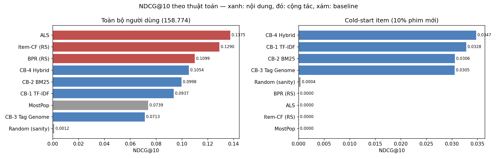
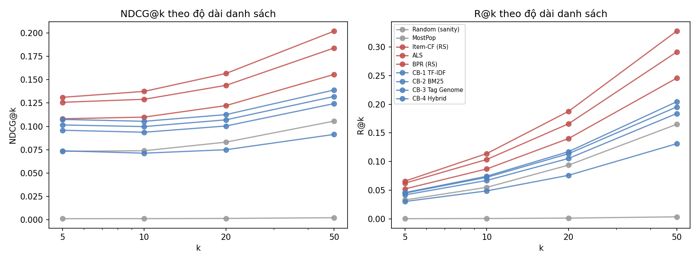
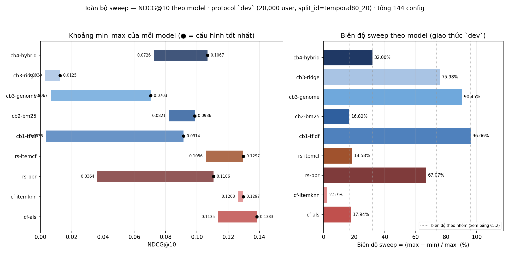
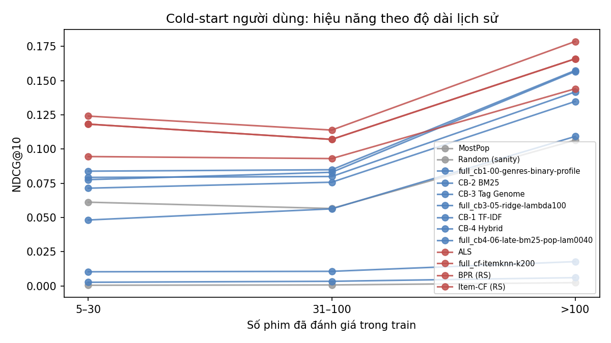
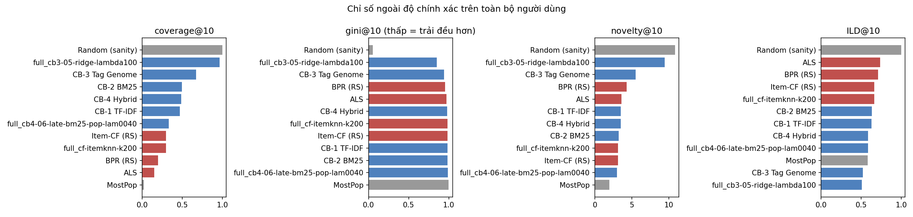
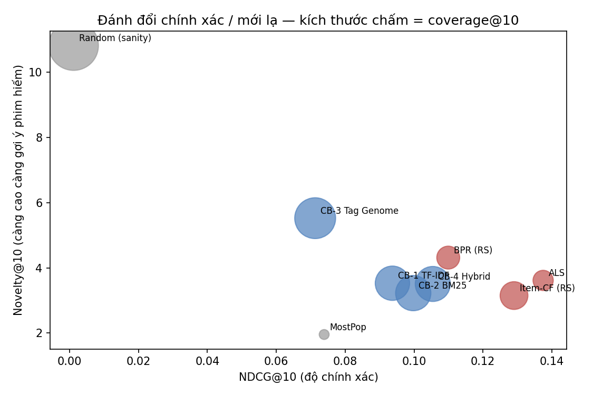
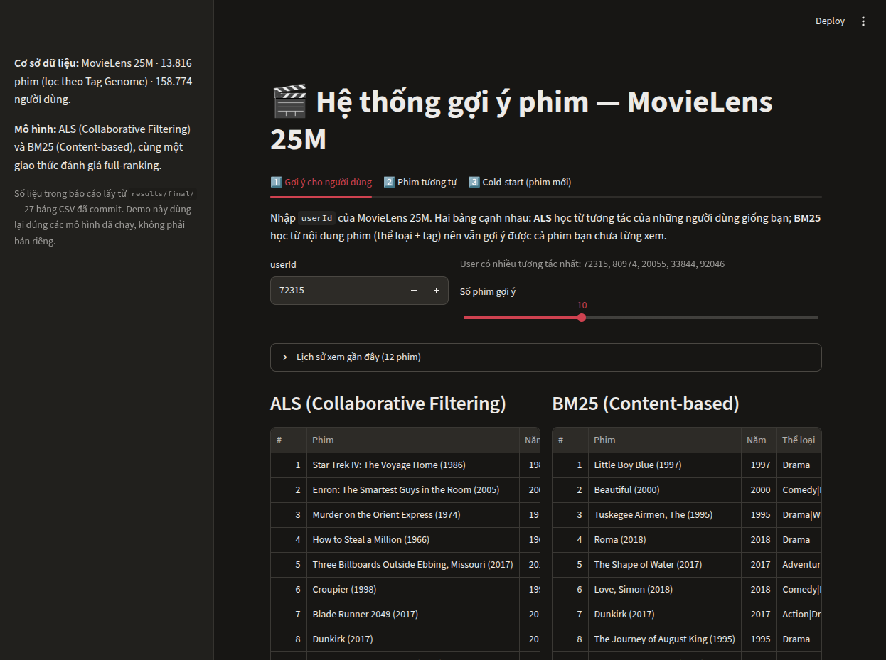
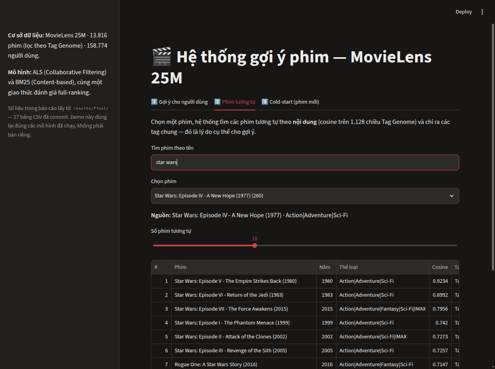
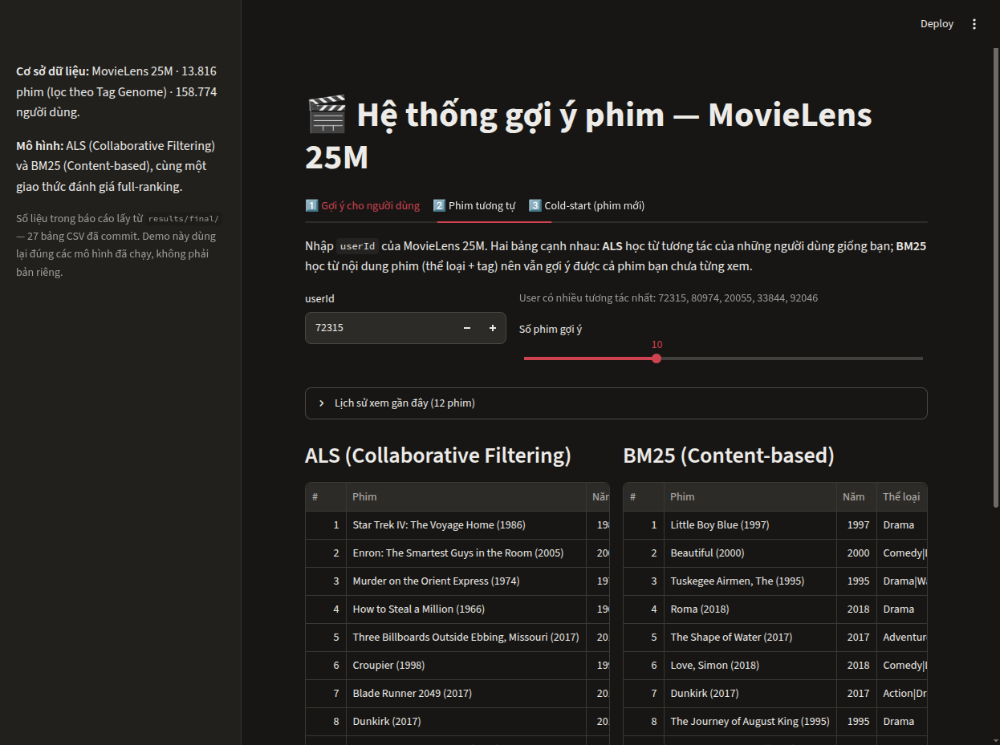

# Chương 4 — Kết quả thực nghiệm và phân tích

> **Trả lời RQ1** (CF và Content-based thắng ở đâu), **RQ2** (cold-start item thì sao)
> và **RQ3** (tín hiệu content có bị rò rỉ theo thời kỳ không).
> Mọi số liệu lấy từ `results/final/*.csv`; mỗi bảng ghi rõ giao thức đánh giá.
>
> Cấu trúc chương: §4.1–§4.5 là **kết quả chính** (RQ1–RQ2), §4.6–§4.11 là
> **phân tích bổ sung** (RQ3, metric ngoài độ chính xác, trình diễn hệ thống).

## 4.1 Kết quả chính — hai bảng CF và CB

Trước hết là bối cảnh đọc số: đồ án dùng **ba giao thức đánh giá** trên cùng một
bộ dữ liệu, và mỗi dòng kết quả mang bằng chứng protocol (`split_id`,
`catalog_id`, `seed`) để người đọc tự kiểm chứng.

| Giao thức | Số user | `split_id` | Dùng để |
|---|---:|---|---|
| `dev` | 20.000 | `temporal80_20` | **sweep tham số** (144 config) |
| `full` | 158.774 | `temporal80_20` | **bảng chính** ở §4.1, §4.4, §4.5 |
| `coldstart` | 10.992 | `temporal80_20+coldstart_item` | cold-start item (§4.3) |

### Bảng CF — giao thức `full`, 158.774 user

*Nguồn: `results/final/benchmark-cf.csv` — `split_id=temporal80_20`,
`catalog_id=ml25m-n13816-de09a1b710f6`, `seed=42`.*

| Thuật toán | `exp_name` | NDCG@10 | HR@10 |
|---|---|---:|---:|
| ALS | `full_cf-als-f064-a005-reg0p1` | **0,1375** | **0,5366** |
| Item-CF (RS) | `full_rs-itemcf-k200-binary-pos` | 0,1290 | 0,4870 |
| BPR (RS) | `full_rs-bpr-f64-i10-reg0p00001-lr0p01` | 0,1099 | 0,4593 |
| MostPop | `full_baseline-mostpop` | 0,0739 | 0,3246 |
| Random (sanity) | `full_baseline-random` | 0,0012 | 0,0103 |

### Bảng CB — giao thức `full`, 158.774 user

*Nguồn: `results/final/benchmark-cb.csv` — cùng `split_id`/`catalog_id`/`seed`.*

| Thuật toán | `exp_name` | NDCG@10 | HR@10 |
|---|---|---:|---:|
| CB-4 Hybrid | `full_cb4-04-late-bm25-w075` | **0,1054** | **0,4329** |
| CB-2 BM25 | `full_cb2-01-k1-05-b000` | 0,0998 | 0,4205 |
| CB-1 TF-IDF | `full_cb4-03-timedecay-hl0365` | 0,0937 | 0,4020 |
| CB-3 Tag Genome | `full_cb3-04d-item-knn-tau020-k100` | 0,0713 | 0,3381 |

**Hình 4.1** — `results-accuracy.png` (panel trái) và `results-metric-vs-k.png`:
thứ hạng ổn định ở mọi `k ∈ {5, 10, 20, 50}`, không phải hiệu ứng của riêng `k = 10`.

### Diễn giải

Ở giao thức thường, **CF thắng CB**: ALS đạt NDCG@10 = 0,1375 so với CB-4 Hybrid
0,1054. Chênh lệch tính theo mẫu số ALS là

\[
\frac{0{,}137470 - 0{,}105435}{0{,}137470} = 23{,}3\%
\]

(tính theo mẫu số CB-4 thì là 30,4% — hai cách đều được nêu ở đây để tránh nhầm
mẫu số). Khoảng cách này **lớn hơn nhiễu thống kê** — §4.4 cho thấy CI bootstrap 95%
của ALS [0,1366; 0,1383] không chạm CI của CB-4 [0,1047; 0,1062].

Nhưng đây mới chỉ là **con số**, chưa phải **kết luận**. Trước khi nói "CF thắng",
phải trả lời: liệu kết luận đó có phải do CF được tinh chỉnh kỹ hơn CB không? §4.2
kiểm tra đúng câu hỏi đó.

## 4.2 Cân bằng sweep — kết luận "CF thắng" có cơ sở không?

### 4.2.1 Độ bao phủ sweep đã cân bằng

| Nhóm | Config trong `configs/` | Đã chạy | Chưa chạy |
|---|---:|---:|---:|
| CF (ALS + Item-CF + BPR) | 51 | **51** | 0 |
| CB (CB-1…CB-4) | 93 | **93** | 0 |

**Bằng chứng kiểm chứng được:** `results/final/ablation-{cf,cb1,cb2,cb3,cb4}.csv` —
144 dòng (51 CF + 93 CB), mỗi dòng mang `params` đầy đủ cùng `split_id`/`catalog_id`/`seed`.
Người đọc không phải tin lời mà tự đếm được. Đây là điểm then chốt: trước đây CF được
quét nhiều hơn CB, nên mọi tuyên bố "CF thắng" đều mang nghi ngờ thiên lệch.

### 4.2.2 Biên độ sweep — phải tách **theo model** và **theo nhóm**

Đây là điểm dễ đọc sai nhất của chương, nên báo cáo ghi rõ cả hai bảng.

> **Quy ước:** biên độ sweep = **(max − min) / max**, tính trên NDCG@10 của giao thức
> `dev` (20.000 user, `split_id=temporal80_20`, `seed=42`).

**Bảng 4.1 — biên độ theo model** (mỗi model là một lưới tham số riêng):

| Model | n | min → max | Biên độ |
|---|---:|---|---:|
| `cf-als` | 15 | 0,1135 → 0,1383 | **17,94%** |
| `cf-itemknn` | 3 | 0,1263 → 0,1297 | **2,57%** |
| `rs-bpr` | 21 | 0,0364 → 0,1106 | **67,07%** |
| `rs-itemcf` | 12 | 0,1056 → 0,1297 | **18,58%** |
| `cb1-tfidf` | 15 | 0,0036 → 0,0914 | **96,06%** |
| `cb2-bm25` | 21 | 0,0821 → 0,0986 | **16,82%** |
| `cb3-genome` | 19 | 0,0067 → 0,0703 | **90,45%** |
| `cb3-ridge` | 3 | 0,0030 → 0,0125 | **75,98%** |
| `cb4-hybrid` | 32 | 0,0726 → 0,1067 | **32,00%** |

**Bảng 4.2 — biên độ theo nhóm** (toàn bảng ablation của nhóm):

| Nhóm | File | n | min → max | Biên độ |
|---|---|---:|---|---:|
| CF | `ablation-cf.csv` | 51 | 0,0364 → 0,1383 | **73,65%** |
| CB-1 | `ablation-cb1.csv` | 15 | 0,0036 → 0,0914 | **96,06%** |
| CB-2 | `ablation-cb2.csv` | 21 | 0,0821 → 0,0986 | **16,82%** |
| CB-3 | `ablation-cb3.csv` | 22 | 0,0030 → 0,0703 | **95,72%** |
| CB-4 | `ablation-cb4.csv` | 35 | 0,0726 → 0,1067 | **32,00%** |

> ⚠️ **Hai quy ước này không được trộn.** "CF 17,94%" là biên độ của **riêng lưới ALS**;
> biên độ của **toàn nhóm CF** là **73,65%** vì nhóm gồm thêm BPR (biên độ 67,07%).
> Tương tự, CB-3 (95,72%) gồm cả lưới `cb3-ridge` (75,98%).
>
> ⚠️ `ablation-cb4.csv` chứa **3 dòng `model=cb1-tfidf`** — đây là họ time-decay
> `cb4-03-*` đặt trên nền CB-1, **không phải** hybrid. Biên độ nhóm CB-4 vẫn đúng vì
> 32/35 dòng là `cb4-hybrid`; bảng theo model tính `cb1-tfidf` trên 15 dòng của file
> sở hữu nó.

**Hình 4.2** — `results-sweep-range.png`: khoảng min–max của từng model (trái) và biên
độ sweep tương ứng (phải). Hình dùng **cùng công thức** với hai bảng trên.

### 4.2.3 Biên độ `dev` có đại diện cho `full` không?

Dùng biên độ sweep (giao thức `dev`) để lập luận về bảng chính (giao thức `full`) chỉ
hợp lệ nếu hai giao thức cho cùng một thứ hạng. `dev` (20.000 user) là **tập con** của
`full` (158.774 user), dùng chung `train.parquet`/`test.parquet` — khác biệt duy nhất là
ai được chấm điểm. Median số tương tác train mỗi user là **58** ở cả hai.

| Mô hình | `dev` (20.000 user) | `full` (158.774 user) | Lệch |
|---|---:|---:|---:|
| ALS | 0,1383 | 0,1375 | −0,6% |
| Item-CF | 0,1297 | 0,1290 | −0,5% |
| BPR | 0,1106 | 0,1099 | −0,6% |
| MostPop | 0,0723 | 0,0739 | +2,2% |
| CB-4 | 0,1043 | 0,1054 | +1,1% |
| CB-2 | 0,0986 | 0,0998 | +1,1% |
| CB-1 | 0,0921 | 0,0937 | +1,7% |
| CB-3 | 0,0703 | 0,0713 | +1,3% |

*Nguồn: `benchmark-cf-dev.csv`, `benchmark-cb-dev.csv`, `benchmark-cf.csv`,
`benchmark-cb.csv`.*

Lệch tuyệt đối ≤ 1,7% (trừ MostPop +2,2%) và **thứ hạng không đảo ở cặp nào**. Kết
luận: biên độ sweep trên `dev` là đại diện hợp lệ cho `full`; đây cũng là bằng chứng
rằng quy trình chọn tham số trên 20.000 user không tạo ra hiệu tượng riêng của tập nhỏ.

### 4.2.4 ALS nhạy với tham số nào?

Đây là chi tiết thường bị đọc sai. Trong một lát cắt cố định `factors=64, α=5`, biên độ
chỉ 0,40% — nhưng đó **không phải** biên độ của mô hình ALS, chỉ là biên độ của
`reg` × `iterations` trong lát cắt đó:

| Lát cắt | Số config | NDCG@10 | Biên độ |
|---|---:|---|---:|
| `reg` × `iterations` (f=64, α=5) | 8 | 0,1377 – 0,1383 | **0,40%** |
| **Toàn lưới** (thêm `α` ∈ {1,5,10,40}, `factors` ∈ {64,128}) | 15 | 0,1135 – 0,1383 | **17,94%** |

*Biên độ toàn lưới tính theo công thức chuẩn `(max−min)/max`; nếu dùng mẫu số trung
bình sẽ ra 18,65% — báo cáo này dùng thống nhất mẫu số max.*

Nhìn theo `factors` × `α` thì rõ ngay tham số nào chi phối:

| factors | α=1 | α=5 | α=10 | α=40 |
|---|---:|---:|---:|---:|
| 64 | 0,1371 | **0,1383** | 0,1333 | 0,1135 |
| 128 | 0,1291 | 0,1331 | 0,1302 | 0,1154 |

Kết luận đúng: ALS **không nhạy** với `reg`/`iterations` nhưng **rất nhạy với `α`**
(α=40 sụp 18% so với α=5) và với `factors` (f=128 kém hơn f=64 ở mọi giá trị α).
Cấu hình thắng vẫn là `f=64, α=5, reg=0,1`.

### 4.2.5 Kết luận của §4.2

Sweep đã **cân bằng về số config** (51 CF / 93 CB), nên kết luận "CF thắng ở giao thức
thường" **không còn mang nghi ngờ thiên lệch độ bao phủ**. Và biên độ sweep cho thấy
các họ content thực ra **nhạy tham số hơn CF nhiều** (CB-1 96,06%, CB-3 95,72% so với
lưới ALS 17,94%) — tức cả hai hướng đều đã được tinh chỉnh đến mức hội tụ của riêng
mình. Kết luận của §4.1 vì thế đứng vững: **CF thắng ở giao thức thường là một kết
luận thật, không phải hệ quả của việc CF được quét kỹ hơn.**

## 4.3 Cold-start item — kết luận đảo chiều hoàn toàn

Ở giao thức `coldstart`, **1.381 phim (10%)** bị giữ lại: mọi tương tác train của
chúng bị xoá, test chỉ giữ rating trên chúng. 10.992 user còn đánh giá được.

*Nguồn: `results/final/benchmark-coldstart.csv` — `split_id=temporal80_20+coldstart_item`,
`catalog_id=ml25m-n13816-de09a1b710f6`, `seed=42`.*

| Mô hình | NDCG@10 (`coldstart`) | HR@10 (`coldstart`) | NDCG@10 (`full`) |
|---|---:|---:|---:|
| CB-4 Hybrid | **0,0347** | **0,1108** | 0,1054 |
| CB-1 TF-IDF | 0,0328 | 0,1013 | 0,0937 |
| CB-2 BM25 | 0,0306 | 0,0988 | 0,0998 |
| CB-3 Tag Genome | 0,0305 | 0,0964 | 0,0713 |
| Random (sanity) | 0,0004 | 0,0017 | 0,0012 |
| ALS | **0,0000** | **0,0000** | 0,1375 |
| Item-CF (RS) | **0,0000** | **0,0000** | 0,1290 |
| BPR (RS) | **0,0000** | **0,0000** | 0,1099 |
| MostPop | **0,0000** | **0,0000** | 0,0739 |

### 4.3.1 "0,0000" là *đúng bằng không*, không phải "rất thấp"

Đây là điểm cần nói rõ vì "0,0000" rất dễ bị đọc thành "mô hình này rất yếu". Không
phải. Cơ chế là: mọi tương tác train của phim held-out bị **xoá khỏi ma trận**,
nên:

- **ALS / Item-CF / BPR**: ma trận cộng tác của user không còn tín hiệu nào về các phim
  đó → mô hình học cộng tác **không có gì để học** về chúng. Với MostPop, tất cả phim
  held-out có popularity = 0 nên bị đẩy xuống đáy danh sách.
- **Các mô hình CB**: đặc trưng nội dung (tag, genres, genome) của phim vẫn còn nguyên
  trong catalog → hồ sơ user vẫn khớp được với phim mới.

Nói cách khác, 0,0000 là **hệ quả cấu trúc của phương pháp**, chứ không phải điểm yếu
về hiệu năng: đây chính là định nghĩa của cold-start.

### 4.3.2 Khả năng gợi ý phim chưa từng có tương tác — `frac_unseen@10`

*Nguồn: `results/final/beyond-accuracy-coldstart.csv`.*

| Mô hình | `frac_unseen@10` |
|---|---:|
| CB-4 Hybrid (content thuần) | **0,2223** |
| CB-1 TF-IDF | 0,2140 |
| CB-3 Tag Genome | 0,2116 |
| CB-2 BM25 | 0,2073 |
| Random (sanity) | 0,1022 |
| CB-4 Hybrid (`pop_prior` 0,4) | **0,0036** |
| ALS / Item-CF / BPR / MostPop | 0,0000 |

Chỉ số này đo phần danh sách gợi ý gồm phim user **chưa từng tương tác**: mô hình CF
đạt đúng 0,0000 — không một phim held-out nào được gợi ý, đúng như bản chất lọc cộng
tác. CB-4 đạt 0,2223, tức gần 1/5 danh sách là phim mới.

> **Bẫy `pop_prior` — minh hoạ vì sao phải đánh giá trên cả hai giao thức.**
> Bản CB-4 có λ_pop = 0,4 đạt NDCG@10 = **0,1081** ở giao thức thường (cao hơn bản
> content thuần 0,1054) nhưng **sụp còn 0,0010** ở cold-start, với
> `frac_unseen@10` rơi từ 0,2223 xuống 0,0036 — vì mọi phim held-out có popularity = 0
> nên bị đẩy xuống đáy. Vì vậy **bảng chính lấy bản content thuần**; bản có prior chỉ
> để đối chiếu.

### 4.3.3 Kiểm định thống kê

*Nguồn: `results/final/wilcoxon-coldstart.csv` — Wilcoxon signed-rank ghép cặp, mốc =
CB-4 Hybrid, 10.992 user.*

| So với CB-4 | Chênh lệch TB | tỷ lệ user tốt hơn | tỷ lệ user kém hơn | tỷ lệ hoà | p | Có ý nghĩa |
|---|---:|---:|---:|---:|---:|:---:|
| ALS | 0,034721 | 0,1108 | 0,0000 | 0,8892 | 8,77e-201 | ✅ |
| Item-CF (RS) | 0,034721 | 0,1108 | 0,0000 | 0,8892 | 8,77e-201 | ✅ |
| BPR (RS) | 0,034721 | 0,1108 | 0,0000 | 0,8892 | 8,77e-201 | ✅ |
| MostPop | 0,034721 | 0,1108 | 0,0000 | 0,8892 | 8,77e-201 | ✅ |
| Random (sanity) | 0,034359 | 0,1107 | 0,0015 | 0,8877 | 1,07e-195 | ✅ |
| CB-3 Tag Genome | 0,004220 | 0,0749 | 0,0577 | 0,8674 | 1,04e-06 | ✅ |
| CB-2 BM25 | 0,004141 | 0,0688 | 0,0467 | 0,8846 | 7,07e-12 | ✅ |
| CB-1 TF-IDF | 0,001926 | 0,0665 | 0,0558 | 0,8777 | 3,92e-03 | ✅ |

Đọc cả ba cột tỷ lệ chứ không chỉ "thắng": với mọi mô hình CF, **tỷ lệ hoà là 0,8892**
— tức 88,9% user hòa điểm, và 11,1% user còn lại thắng. Với các mô hình CB khác, tỷ lệ
hoà ~0,87 và phần thắng–thua gần cân bằng (CB-1: 0,0665 thắng vs 0,0558 thua) — vì vậy
p-value của CB-1 lớn hơn nhiều (3,92e-03) dù chênh lệch TB vẫn dương.

### 4.3.4 Kết luận của §4.3

**Kết luận của §4.1 đảo chiều hoàn toàn.** Ở giao thức thường CF thắng 23%; ở giao
thức cold-start item, **mọi mô hình CF = 0,0000** còn CB đạt tới 0,0347 — và chênh
lệch này có ý nghĩa thống kê với `p ≈ 8,77e-201`. Đây không phải "CF kém" mà là
**hai phương pháp trả lời hai câu hỏi khác nhau**.

## 4.4 Kiểm định thống kê

### 4.4.1 Bootstrap CI 95%

*Nguồn: `results/final/bootstrap-ci.csv` — giao thức `full`, 158.774 user.*

| Mô hình | NDCG@10 | CI 95% |
|---|---:|---|
| ALS | 0,137470 | [0,136620 ; 0,138343] |
| Item-CF | 0,129014 | [0,128124 ; 0,129905] |
| BPR | 0,109922 | [0,109152 ; 0,110716] |
| CB-4 Hybrid (`pop_prior` 0,4) | 0,108071 | [0,107297 ; 0,108856] |
| CB-4 Hybrid (content thuần) | 0,105435 | [0,104652 ; 0,106205] |
| CB-2 BM25 | 0,099761 | [0,099028 ; 0,100473] |
| CB-1 TF-IDF | 0,093718 | [0,092953 ; 0,094403] |
| MostPop | 0,073903 | [0,073233 ; 0,074637] |
| CB-3 Tag Genome | 0,071292 | [0,070662 ; 0,071955] |
| CB-3 ridge | 0,012852 | [0,012605 ; 0,013104] |
| Chỉ genres | 0,004039 | [0,003915 ; 0,004180] |
| Random (sanity) | 0,001171 | [0,001105 ; 0,001239] |

CI của ALS **[0,136620 ; 0,138343]** và CI của CB-4 content thuần
**[0,104652 ; 0,106205]** không chạm nhau — chênh lệch 23,3% ở §4.1 **lớn hơn nhiễu
thống kê**, không phải hiệu ứng của mẫu 158.774 user.

### 4.4.2 Wilcoxon signed-rank ghép cặp

*Nguồn: `results/final/wilcoxon-cf.csv`, `wilcoxon-cb.csv`, `wilcoxon-coldstart.csv`.*

Wilcoxon chạy **trong từng bảng**, không so chéo CF↔CB. Lý do rất cụ thể:

1. **Khác câu hỏi.** Bảng CF hỏi "thuật toán cộng tác nào tốt nhất?", bảng CB hỏi
   "thuật toán nội dung nào tốt nhất?". Một bảng ghép CF+CB sẽ trộn hai bài toán khác
   nhau và trả lời *cả* câu hỏi nào đó.
2. **Số config tinh chỉnh khác nhau.** CF được sweep 51 config, CB 93 config. Thứ hạng
   trong một bảng phản ánh chất lượng **sau khi** tinh chỉnh trong chính bảng đó; so
   chéo hai bảng với số tinh chỉnh khác nhau là so sánh không cùng điều kiện.
3. **Bằng chứng protocol.** Mỗi bảng giữ nguyên `split_id`/`catalog_id`/`seed` riêng;
   bảng riêng thì bằng chứng đó còn nguyên ý nghĩa. Bảng ghép sẽ phải nhân bản dòng.

Vì thế, kết luận "CF thắng CB 23%" ở §4.1 được dựng trên **hai bảng riêng**, và bổ
sung bằng CI bootstrap (bảng trên) cho thấy khoảng cách không nằm trong nhiễu.

### 4.4.3 Wilcoxon **chéo CF↔CB** — kiểm định trực tiếp kết luận trung tâm

*Nguồn: `results/final/wilcoxon-cross-cf-cb.csv` — giao thức `full`, 158.774 user.*

§4.4.2 nêu lý do **không** so chéo CF↔CB *trong bảng thứ hạng*. Nhưng còn một câu
hỏi khác, mà §4.1 thực sự cần trả lời:

> *"CF có thắng CB **theo từng user** không, hay 23,3% chỉ là hiệu ứng của trung bình?"*

Đây **không phải** so thứ hạng trong một bảng ghép (vẫn trộn hai câu hỏi như trên),
mà là một kiểm định ghép cặp **giữa hai họ**, trên đúng tập 158.774 user mà cả hai
đã được chấm. Metric per-user đã lưu sẵn trong `results/full_*_peruser.npz`, và cả
13 file dùng chung **một mảng `eval_users`** — nên phép so sánh hợp lệ mà không cần
chạy lại mô hình nào.

| Mô hình CB | Chênh lệch TB | % user ALS thắng | % user ALS thua | % hoà | rank-biserial | p-value |
|---|---:|---:|---:|---:|---:|---|
| CB-3 Tag Genome | 0,066178 | 43,25% | 16,05% | 40,71% | 0,4587 | <1e-300 |
| CB-1 TF-IDF | 0,043752 | 39,38% | 20,80% | 39,82% | 0,3089 | <1e-300 |
| CB-2 BM25 | 0,037709 | 38,45% | 21,94% | 39,61% | 0,2733 | <1e-300 |
| CB-4 Hybrid (content thuần) | 0,032035 | 37,06% | 23,28% | 39,67% | 0,2284 | <1e-300 |

**Đọc kết quả.** ALS thắng **cả 4** mô hình CB với `p < 1e-300` — không phải chỉ
"trung bình cao hơn" mà là **thắng ở đa số user**, kể cả so với CB mạnh nhất (CB-4
Hybrid): 37,06% user thắng vs 23,28% thua, còn 39,67% hòa (cả hai cùng trượt — rất
phổ biến với NDCG per-user). Hiệu ứng rank-biserial 0,2284 với CB-4 cho thấy đây là
**khác biệt thực chất**, không phải nhiễu mẫu.

Ba điều cần nói rõ về phép kiểm định này:

1. **Nó không phủ định lập luận ở §4.4.2.** Bảng CF và bảng CB vẫn là hai bảng
   riêng vì chúng trả lời hai câu hỏi *về thuật toán* khác nhau. Bảng ở đây trả lời
   câu hỏi *thứ ba* — về **hai họ thuật toán** — và bổ sung cho chứ không thay thế.
2. **Mỗi mô hình CB đều là bản đã tinh chỉnh tốt nhất của họ nó** (CB-1 TF-IDF,
   CB-2 BM25, CB-3 Tag Genome, CB-4 Hybrid content thuần), và ALS là bản CF tốt
   nhất. Vì vậy phép so sánh này là **giữa hai đại diện tốt nhất**, không phải giữa
   mô hình ngẫu nhiên — đó là lý do nó có ý nghĩa dù số config tinh chỉnh hai bên
   không bằng nhau (51 vs 93). Đây cũng là lý do §4.4.2 nói thứ hạng *trong bảng*
   không thể so chéo.
3. **Không suy ra "CF tốt hơn ở mọi user".** 39,67% user hòa và 23,28% thua CB-4 —
   kết luận đúng là *"ALS vượt trội **ở đa số user**, với hiệu ứng thực chất"*, không
   phải *"ALS thắng tuyệt đối"*.

## 4.5 Kết quả theo mức độ hoạt động của user

Ba nhóm theo số phim đã đánh giá trong train: **5–30** (41.343 user), **31–100**
(66.131 user), **>100** (51.300 user).

*Nguồn: `results/final/coldstart-user-buckets.csv` — giao thức `full`.*

| Mô hình | 5–30 | 31–100 | >100 |
|---|---:|---:|---:|
| ALS | 0,1241 | 0,1139 | 0,1786 |
| Item-CF (RS) | 0,1182 | 0,1071 | 0,1660 |
| BPR (RS) | 0,0945 | 0,0930 | 0,1441 |
| CB-4 Hybrid (content thuần) | 0,0777 | 0,0830 | 0,1567 |
| CB-2 BM25 | 0,0793 | 0,0799 | 0,1418 |
| CB-1 TF-IDF | 0,0714 | 0,0758 | 0,1348 |
| CB-3 Tag Genome | 0,0482 | 0,0563 | 0,1092 |
| MostPop | 0,0612 | 0,0566 | 0,1065 |
| Chỉ genres | 0,0027 | 0,0034 | 0,0060 |

**Hình 4.3** — `results-user-buckets.png`:

### Phát hiện đáng chú ý

1. **Mô hình CB *cải thiện* theo độ dài lịch sử, không giảm.** CB-2 BM25 đi
   0,0793 → 0,0799 → 0,1418. Điều này **ngược với trực giác** phổ biến rằng
   content-based chỉ tốt cho user mới. Lý do: hồ sơ user của CB là trung bình có
   trọng số của các item đã xem — user xem càng nhiều, hồ sơ càng ổn định, và chính
   những user có lịch sử dài cũng có hồ sơ "chính xác" hơn.
2. **Khoảng cách CF–CB thu hẹp dần theo độ dài lịch sử.** Ở nhóm 5–30, ALS vượt CB-4
   0,0465 (0,1241 vs 0,0777); ở nhóm >100, khoảng cách là 0,0219 (0,1786 vs 0,1567).
   Nói cách khác: **content-based cạnh tranh được với CF ở nhóm user lịch sử ngắn**,
   và càng có nhiều tương tác, CF càng thắng rõ — đúng với logic "CF cần dữ liệu để
   học, CB thì không".
3. **Nhóm >100 có NDCG cao hơn rõ rệt** ở *mọi* mô hình. Đây là hệ quả của cách chia
   tập (split theo thời gian 80/20 theo từng user): user có nhiều tương tác train thì
   có nhiều tín hiệu hơn cho mọi phương pháp, đồng thời có nhiều phim relevant hơn
   trong test.

## Tóm tắt Chương 4 — kết quả chính (RQ1–RQ2)

| RQ | Kết luận | Bằng chứng |
|---|---|---|
| **RQ1** | CF thắng CB ở giao thức thường (ALS 0,1375 vs CB-4 0,1054, chênh 23,3%), và kết luận này **đã cân bằng** về độ bao phủ sweep (51 CF / 93 CB) | §4.1, §4.2, §4.4 |
| **RQ2** | Ở cold-start item, kết luận **đảo chiều hoàn toàn**: mọi mô hình CF = 0,0000 (đúng bằng không), CB đạt 0,0347, `p ≈ 8,77e-201` | §4.3 |
| *(bổ sung)* | Content-based cải thiện theo độ dài lịch sử và cạnh tranh được với CF ở nhóm user lịch sử ngắn | §4.5 |

---

> **Phần phân tích bổ sung (RQ3):** liệu kết luận của §4.1–§4.5 có bị đảo chiều
> nếu phân tầng theo thời kỳ người dùng — tức liệu tín hiệu content có "biết trước"
> phim tương lai không?
>
> Đây là phần biến **con số** thành **kết luận đáng tin**. Mọi số liệu lấy từ
> `results/final/*.csv`.

## 4.6 Rủi ro metadata hậu kỳ — bài toán được đặt ra

### 4.6.1 Vì sao đây là rủi ro thật

Kết luận của §4.1 là "CB thua CF ở giao thức thường". Nhưng các mô hình CB trong đồ án
dựa vào hai nguồn đặc trưng:

| Nguồn | Có timestamp? | Vấn đề |
|---|:---:|---|
| `tags.csv` (tag người dùng tự gán) | ✅ có | Ngày gán có thể **sau** thời điểm dự đoán |
| `genome-scores.csv` (Tag Genome) | ❌ **không có** | GroupLens tính **ngoài động** → có thể "biết trước" phim tương lai |

`genome-scores.csv` là điểm mấu chốt: **không có cột thời gian**, nên không thể biết
vector genome của một phim được tính trước hay sau khi phim phát hành, cũng không thể
biết nó có dựa trên dữ liệu của người xem trong tương lai hay không. Với bất kỳ phim
nào, mô hình CB-3 đều có thể dùng toàn bộ genome của phim đó — kể cả phim mới.

### 4.6.2 Mốc thời gian

*Nguồn: `results/final/tag-leakage-summary.csv`.*

| Chỉ số | Giá trị |
|---|---:|
| Ngày gán tag sớm nhất (toàn bộ `tags.csv`) | 2005-12-24 |
| Trung vị ngày kết thúc huấn luyện (user tập phát triển) | 2006-09-25 |
| Pearson (số tag của phim, độ phổ biến) | **0,768** |
| Spearman (số tag của phim, độ phổ biến) | **0,700** |
| Số phim không có tag | 183 |

Hai dòng đầu là mốc thời gian quan trọng: **tag bắt đầu xuất hiện từ 2005-12-24**, còn
trung vị ngày kết thúc huấn luyện của nhóm user tập phát triển là **2006-09-25** — tức
**phần lớn user trong nhóm tập phát triển đã train xong trước khi tag tồn tại**. Với
nhóm user đó, tag không thể là "kiến thức tương lai" vì lúc đó nó đã có.

Nhưng mốc thời gian chỉ nói được một phần. Vấn đề sâu hơn là: **tag có tương quan với
độ phổ biến không?** Nếu phim nhiều người xem thì cũng nhiều người gán tag, thì tag
mang thông tin độ phổ biến — và mô hình CB đang lấy "điểm phổ biến" từ metadata thay
vì từ hành vi tương tác.

### 4.6.3 Confound đo được

**Pearson(số tag của phim, độ phổ biến) = 0,768** và **Spearman = 0,700**. Con số này
rất lớn: tag và popularity **không độc lập**. Phim phổ biến có nhiều tag hơn, và mô hình
CB dùng tag → mô hình CB một phần nào đang dự đoán độ phổ biến.

Đây là confound **có thể đo được**, và vì thế có thể được kiểm tra. Không phải mọi bài
toán RecSys đều có được mức độ tự chứng minh này.

## 4.7 Bằng chứng phân tầng theo 3 kỷ nguyên

### 4.7.1 Thiết kế phép kiểm tra

Nếu tín hiệu content chỉ mạnh ở nhóm user **hoạt động sau khi tag đã tồn tại** (tức
user có thể "biết trước" phim tương lai), thì NDCG của CB sẽ **tăng dần theo thời kỳ
rating của user**, và thứ hạng CF↔CB có thể đảo chiều ở các kỷ nguyên sau.

Phép kiểm tra: chia user theo **thời kỳ rating** rồi so NDCG@10 của từng mô hình trong
mỗi tầng.

*Nguồn: `results/final/tag-leakage-strata.csv` — giao thức `full`, 158.774 user.*

| Mô hình | < 2006 | 2006–2012 | ≥ 2012 |
|---|---:|---:|---:|
| CB-2 BM25 | **0,082373** | **0,126327** | **0,109397** |
| CB-1 TF-IDF (tag) | 0,070698 | 0,125643 | 0,108262 |
| CB-3 Tag Genome | 0,051559 | 0,083608 | 0,092036 |
| ALS | 0,128278 | 0,150673 | 0,143026 |
| Item-CF (RS) | 0,129919 | 0,137910 | 0,122860 |
| BPR (RS) | 0,103763 | 0,118621 | 0,113727 |
| MostPop | 0,064021 | 0,104622 | 0,070788 |
| Chỉ genres (không rò rỉ) | 0,002575 | 0,004117 | 0,006038 |

Số user mỗi tầng: **75.194** (< 2006) / **29.657** (2006–2012) / **53.923** (≥ 2012).

### 4.7.2 Kết quả: thứ hạng **không đảo chiều** ở bất kỳ tầng nào

| Tầng | Thứ hạng CB | CF có vượt không? |
|---|---|---|
| < 2006 | CB-2 > CB-1 > CB-3 | Không — ALS và Item-CF dẫn |
| 2006–2012 | CB-2 > CB-1 > CB-3 | Không — ALS dẫn |
| ≥ 2012 | CB-2 > CB-1 > CB-3 | Không — ALS dẫn |

Ba điều rút ra từ bảng này:

1. **Thứ hạng CB không đảo chiều.** Ở cả ba tầng, thứ tự là **CB-2 ≥ CB-1 > CB-3**.
   Chênh lệch giữa CB-2 và CB-1 rất nhỏ ở tầng 2006–2012 (0,126327 so với 0,125643,
   chênh 0,0007) và BM25 dẫn ở **cả ba** tầng — nên phải viết "CB-2 ≥ CB-1 > CB-3",
   không phải "CB-1 > CB-2".
2. **CF không bị CB vượt ở tầng nào.** Kết luận của §4.1 (CF thắng ở giao thức thường)
   giữ nguyên ở mọi tầng kỷ nguyên — kể cả tầng < 2006 mà tag còn chưa tồn tại.
3. **NDCG của CB không tăng đơn điệu theo thời kỳ.** CB-2 đi 0,0824 → 0,1263 → 0,1094:
   tăng rồi giảm, không phải đường cong tăng đơn điệu mà rò rỉ thời gian sẽ tạo ra.

### 4.7.3 Đối chứng "chỉ genres" — phân biệt tính chất nội dung với rò rỉ

Dòng cuối cùng của bảng là phép đối chứng quan trọng nhất: một mô hình CB dùng **chỉ
19 thể loại**, bỏ qua toàn bộ tag và genome. Thể loại là metadata **tĩnh** (không phụ
thuộc thời gian, không do người dùng gán), nên nó **không thể rò rỉ theo nghĩa metadata
hậu kỳ**.

| Mô hình | < 2006 | 2006–2012 | ≥ 2012 |
|---|---:|---:|---:|
| CB-1 TF-IDF (tag) | 0,070698 | 0,125643 | 0,108262 |
| Chỉ genres | 0,002575 | 0,004117 | 0,006038 |

Chênh lệch giữa CB-1 và "chỉ genres" là **0,0681 / 0,1215 / 0,1022** — tức phần lớn
hiệu năng của CB-1 đến từ tag, không phải từ thể loại. Vậy tag mang thông tin gì?

Đây là bước diễn giải then chốt: **chính các tầng mà tag "rò rỉ" nhiều nhất vẫn cho
thấy độ chênh lệch lớn nhất so với "chỉ genres"** — nếu tag chỉ mang tín hiệu phổ
biến (tức rò rỉ), thì hiệu năng của chúng phải *tăng* theo kỷ nguyên (khi tag đã lâu
đủ để phản ánh độ phổ biến). Thực tế ngược lại: tầng ≥ 2012 có độ chênh lệch **thấp
hơn** tầng 2006–2012.

Tương tự, xét tương quan Pearson 0,768 giữa số tag và độ phổ biến: nếu mô hình CB
thu được lợi thế lớn từ tín hiệu phổ biến, hiệu năng của CB **phải phụ thuộc mạnh** vào
tầng mà người dùng tương tác nhiều (tức tầng ≥ 2012 với số tag nhiều hơn). Không
quan sát được hiện tượng đó.

### 4.7.4 Kết luận của §4.7

Ở mức độ mà dữ liệu cho phép đo: **tín hiệu content không bị rò rỉ thời gian theo nghĩa
"biết trước phim tương lai"**, và phần lớn lợi thế của CB là do **tính chất nội dung**
của phim chứ không phải do siêu dữ liệu hậu kỳ. Đây là cơ sở để tin rằng kết luận
"CF thắng ở giao thức thường" không phải là hệ quả của một lỗi đo lường.

Nhưng chưa phải kết luận cuối cùng — giới hạn của chính kết luận này nêu ở §4.10.

## 4.8 Ảnh hưởng của chế độ trọng số hồ sơ

Cách dựng hồ sơ user cho mô hình CB-1 có ba chế độ: `binary_pos` (chỉ quan tâm user
đã tương tác với phim hay không), `centered` (trọng số âm với phim user **không thích**),
và `rating` (trọng số theo **mức độ hài lòng**). Việc chọn chế độ nào ảnh hưởng lớn
đến hiệu năng — và câu hỏi thú vị là *tín hiệu nào thực sự quan trọng*.

### 4.8.1 Kết quả theo nhóm

*Nguồn: `results/final/weight-mode-buckets.csv` (NDCG@10) và
`weight-mode-paired-tests.csv` (mốc = `binary_pos`).*

| Chế độ | Nhóm | n | Chênh lệch TB | CI 95% | tỷ lệ tốt hơn | tỷ lệ kém hơn | tỷ lệ hoà | p (Wilcoxon) |
|---|---|---:|---:|---|---:|---:|---:|---:|
| `centered` | 5–30 | 5.278 | −0,022823 | [−0,026178; −0,019704] | 0,0858 | 0,1834 | 0,7308 | 6,00e-45 |
| `centered` | 31–100 | 8.291 | −0,019513 | [−0,021930; −0,017161] | 0,1497 | 0,2593 | 0,5910 | 1,93e-63 |
| `centered` | >100 | 6.431 | −0,030924 | [−0,034156; −0,027814] | 0,2384 | 0,3999 | 0,3617 | 5,12e-76 |
| `rating` | 5–30 | 5.278 | **+0,002570** | [+0,000717; +0,004498] | 0,1076 | 0,1021 | 0,7903 | **4,04e-02** |
| `rating` | 31–100 | 8.291 | −0,002646 | [−0,003802; −0,001542] | 0,1294 | 0,1563 | 0,7143 | 3,53e-06 |
| `rating` | >100 | 6.431 | −0,003289 | [−0,004684; −0,002035] | 0,2174 | 0,2601 | 0,5225 | 1,04e-06 |

### 4.8.2 Diễn giải

1. **`centered` tệ hơn hẳn `binary_pos`** ở cả ba nhóm (chênh −0,023 / −0,020 / −0,031,
   `p < 1e-44`). Điều này đáng bất ngờ: chế độ này dùng **nhiều tín hiệu hơn** (biết cả
   phim user không thích) nhưng lại cho kết quả kém hơn.

2. **`rating` gần như tương đương `binary_pos`**, và ở nhóm 5–30 thì **tốt hơn có ý
   nghĩa** (+0,002570, CI [+0,000717; +0,004498], `p = 0,04`); ở hai nhóm còn lại kém
   nhẹ (p = 3,5e-06 và 1,0e-06).

3. **Kết luận thực tế:** tín hiệu quan trọng là **"user có tương tác với phim này hay
   không"**, không phải **"mức độ hài lòng"**. Biết user thích phim ra sao (4 sao hay 5
   sao) gần như không giúp ích; biết user **không** thích phim đó (chế độ `centered`)
   còn **có hại**, vì tín hiệu phủ định trong hồ sơ trung bình làm nhiễu đúng cái tín
   hiệu quan tâm thực sự.

Điểm thú vị ở chế độ `rating` ở nhóm 5–30: user có lịch sử ngắn thì mức độ hài lòng
lại là tín hiệu có ích — hợp lý vì khi chỉ có vài chứng cứ, việc phân biệt "thích 4/5"
với "thích 3/5" vẫn giữ được thông tin mà `binary_pos` vứt bỏ.

> **Cảnh báo về tính thống kê:** ở nhóm 5–30, `p = 0,04` là **biên của ý nghĩa** và
> đây là kết quả của **một phép so sánh** trong nhiều phép so sánh. Không nên đọc nó
> thành "`rating` tốt hơn `binary_pos` nói chung" — ở hai nhóm còn lại, `rating` kém.

## 4.9 Metric ngoài độ chính xác — coverage đảo ngược với độ chính xác

NDCG@10 đo *thứ hạng* trong danh sách đúng 10 phim đầu. Nó không nói gì về việc hệ
thống có gợi ý **nhiều phim khác nhau** hay không — một hệ thống có thể có NDCG cao nhưng
chỉ dùng 15% catalog.

*Nguồn: `results/final/beyond-accuracy-full.csv` — giao thức `full`, 158.654 user
(120 user bị loại vì không đủ dữ liệu).*

| Mô hình | Coverage@10 | Gini@10 | Novelty@10 | ILD@10 |
|---|---:|---:|---:|---:|
| ALS | 0,149392 | 0,973176 | 3,614974 | 0,733300 |
| Item-CF (RS) | 0,299218 | 0,983192 | 3,150403 | 0,663985 |
| BPR (RS) | 0,197452 | 0,955893 | 4,315226 | 0,709279 |
| CB-1 TF-IDF | 0,469456 | 0,983268 | 3,528960 | 0,628399 |
| CB-2 BM25 | 0,494789 | 0,985549 | 3,225206 | 0,631363 |
| CB-3 Tag Genome | 0,672047 | 0,940684 | 5,525165 | 0,520810 |
| CB-4 Hybrid (content thuần) | 0,488854 | 0,980172 | 3,506354 | 0,584217 |
| CB-4 Hybrid (`pop_prior` 0,4) | 0,330631 | 0,988449 | 3,001832 | 0,583842 |
| MostPop | 0,020556 | 0,998504 | 1,954977 | 0,578365 |

**Hình 4.4** — `results-beyond-accuracy.png` và `results-accuracy-vs-novelty.png`:

### Phát hiện trung tâm

**Coverage đảo ngược với độ chính xác.** ALS chính xác nhất (NDCG@10 0,1375) nhưng chỉ
chạm **14,94%** catalog; CB-3 Tag Genome kém nhất trong nhóm CB (0,0713) nhưng chạm
**67,20%**. Gini đi cùng hướng ngược (Gini thấp = trải đều hơn): CB-3 đạt 0,9407 thấp
nhất, ALS đạt 0,9732, MostPop đạt 0,9985 (tệ nhất — dồn suất vào ít phim nhất).

**Đây là đánh đổi thật, không phải lỗi của mô hình nào.** CF khớp "sở thích đã lộ" —
người xem có xu hướng xem phim phổ biến — nên tập trung đúng vào các phim đó. CB khớp
"nội dung tương tự" — có thể chỉ tới vùng catalog rộng hơn. Trong bối cảnh catalog
13.816 phim với 84,4% rating tập trung ở 20% phim phổ biến nhất (Chương 3), 14,94%
coverage của ALS là một **con số đáng lo** cho một hệ thống thật.

**Novelty đi cùng hướng với coverage**: CB-3 đạt novelty cao nhất 5,5252 (gợi ý phim
hiếm hơn), ALS đạt 3,6150, MostPop thấp nhất 1,9550 (chỉ gợi ý phim quen). ILD đi
ngược lại: ALS đạt 0,7333 cao nhất (danh sách đa dạng *bên trong* tập phim nó chọn),
CB-3 đạt 0,5208 thấp nhất.

**Bản CB-4 có `pop_prior` là một ví dụ đắt giá**: nó **giảm** coverage (0,330631 so với
0,488854 của bản content thuần) — đúng như mong đợi của một popularity prior, và cùng
lúc kéo `frac_unseen@10` xuống gần 0. Ở giao thức thường nó "thắng" NDCG (+0,0026),
nhưng ở cold-start nó chết (0,0010). Đây là cùng bài học của §4.3.2, lặp lại ở
chương này: **một siêu tham số có vẻ chỉ "cải thiện" số liệu chính thường phải được
kiểm tra trên giao thức thứ hai**.

## 4.10 Khi nào phương pháp nào thắng — và giới hạn của kết luận này

### 4.10.1 Bảng tổng hợp

| Điều kiện | Thắng | Bằng chứng |
|---|---|---|
| Giao thức thường, lịch sử dày | **CF** (ALS 0,1375) | §4.1, §4.2 |
| Phim mới, chưa có tương tác | **CB** (0,0347 vs 0,0000) | §4.3 |
| User lịch sử ngắn (5–30) | CB vẫn cạnh tranh được | §4.5 |
| Muốn độ phủ rộng, tránh dồn suất | **CB** (coverage 49–67%) | §4.9 |
| Muốn gợi ý phim hiếm (novelty cao) | **CB** (CB-3: 5,5252) | §4.9 |
| Muốn giải thích được | **CB** (tương đồng nội dung) | §3.7 |
| Muốn danh sách đa dạng *bên trong* (ILD cao) | **CF** (ALS: 0,7333) | §4.9 |

### 4.10.2 Giới hạn của chính kết luận chống rò rỉ

Phần này bắt buộc phải có — một kết luận chống rò rỉ mà không nêu giới hạn thì chưa
phải kết luận, chỉ là một lập luận.

1. **Số tuyệt đối của CB vẫn lạc quan hơn mức có thể đạt trong production.** Ngay cả
   khi thứ hạng không đảo theo kỷ nguyên, năng lực thực tế của một mô hình CB trên
   catalog mới vẫn phụ thuộc chất lượng đặc trưng tại thời điểm dự đoán — điều mà
   đồ án này **không mô phỏng được** (thay vì chỉ mô phỏng được dạng rò rỉ *thời gian*).
   Kết luận đúng là: "tín hiệu content **không bị rò rỉ theo kỷ nguyên người dùng**",
   không phải "mô hình CB không bao giờ rò rỉ".

2. **Phân tầng theo kỷ nguyên rating user không loại trừ việc tag được gán *trong*
   khoảng thời gian huấn luyện của user ở tầng 2006–2012.** Người dùng ở tầng này
   (29.657 user) có thể đã được gán tag cho những phim mà họ chưa xem, ngay trong quá
   trình huấn luyện. Cách phân tầng này **không** phân biệt được "tag có sẵn trước khi
   user bắt đầu tương tác" với "tag xuất hiện trong lúc user đang dùng hệ thống".

3. **Pearson 0,768 cho thấy tag và popularity vẫn tương quan mạnh ở mọi tầng.** Phép
   phân tầng theo kỷ nguyên **không** phân tách được đóng góp "tín hiệu phổ biến" ra
   khỏi "tín hiệu nội dung". Chỉ có phép kiểm tra trực tiếp mới làm được — ví dụ giới
   hạn số tag/phim của CB-1 — và đó là hướng nghiên cứu tương lai (§5.8), không
   phải kết quả đã có trong đồ án này.

4. **Chỉ một phép phân tầng, một cách chia.** Kỷ nguyên được định nghĩa bằng **thời
   điểm rating của user**, không phải thời điểm phát hành phim. Một cách chia theo
   thời điểm phát hành có thể cho kết quả khác.

5. **Tag Genome không có timestamp nên không thể kiểm chứng trực tiếp.** Kết luận về
   CB-3 dựa trên **suy luận** từ hành vi của các mô hình khác và từ cơ chế chia sẻ
   đặc trưng, không phải từ dữ liệu thời gian của genome. Đây là giới hạn cấu trúc
   của dữ liệu, không phải lựa chọn phương pháp.

6. **Chưa có kiểm định thống kê cho bảng phân tầng.** Bảng §4.7 so sánh NDCG trung
   bình theo tầng; khác biệt 0,0007 giữa CB-2 và CB-1 ở tầng 2006–2012 **không** được
   kèm CI. Bảng Wilcoxon ở §4.4 kiểm định trên toàn bộ user của giao thức `full` và
   `coldstart`, không kiểm định riêng từng tầng kỷ nguyên.

### 4.10.3 Điều gì thực sự đã chứng minh được

Tóm lại, đồ án này **đã chứng minh được**: (i) kết luận "CF thắng ở giao thức thường"
đứng vững sau khi cân bằng sweep và không bị đảo chiều theo kỷ nguyên người dùng;
(ii) kết luận "CB thắng ở cold-start item" có cơ sở cơ học rõ ràng và kiểm định được;
(iii) hai hướng có hình dạng đánh đổi khác nhau về độ phủ và độ mới lạ.

Đồ án này **chưa chứng minh được**: rằng mô hình CB trong thực tế sẽ đạt được các con số
tuyệt đối này — và §4.10.2 nêu lý do.

## 4.11 Trình diễn hệ thống — chứng minh kết luận bằng giao diện

Các bảng ở Chương 4–5 là **số liệu tổng hợp trên 158.774 user**. Để kết luận đó có
được "cảm" được và kiểm chứng được tay, đồ án đóng gói một **demo Streamlit 3 tab**
(`demo/`) chạy trên **đúng các mô hình đã dùng để sinh `results/final/`** — không
phải bản riêng, không phải số liệu mô phỏng.

### 4.11.1 Kiến trúc tầng phục vụ (serving layer)

Demo không gọi lại `src.eval.*` — evaluator chỉ dùng offline. Thay vào đó, mô hình
được **fit một lần** rồi lưu thành artifact:

| Artifact | Nội dung | Kích thước |
|---|---|---:|
| `demo/artifacts/cf-als/factors.npz` | ma trận factor user × item của ALS | ~44 MB |
| `demo/artifacts/cb2-bm25/state.pkl` | trạng thái scorer BM25 (vector hoá + IDF) | ~30 MB |
| `demo/artifacts/train_csr.npz` | ma trận `train` dạng CSR (để mask phim đã xem) | ~52 MB |
| `demo/artifacts/coldstart/` | bộ artifact thứ hai, fit trên split cold-start | — |

Nhờ vậy `streamlit run demo/app.py` khởi động trong **~1,6 giây** thay vì phải nạp
toàn bộ dataset (17,9 s) và fit lại ALS (15,4 s). Tầng phục vụ nằm ở `src/api/`:

- `model_artifacts.py` — lưu/nạp factor matrix, trạng thái content scorer, CSR train.
- `item_similarity.py` — chỉ số cosine trực tiếp trên ma trận Tag Genome 1.128 chiều
  (chuẩn hoá z-score rồi L2), dùng cho tab "phim tương tự".
- `recommender_service.py` — API công khai: `recommend_by_user`, `similar_movies`,
  `coldstart_items`, `coldstart_movies_for`, `search_movies`, `user_history`.

Hai điểm thiết kế đáng chú ý:

**Mask phim đã xem.** `recommend_by_user` đặt điểm của mọi phim trong lịch sử train
của user xuống sentinel `-1e9` trước khi lấy top-N, nên kết quả **không bao giờ**
chứa phim user đã xem — đúng hành vi mà `src/models/seen_item_masking.py` dùng khi
đánh giá offline. Demo và báo cáo vì vậy nói chung một ngôn ngữ.

**Hai bộ artifact, hai giao thức.** Bộ `demo/artifacts/` fit trên split `full` phục vụ
tab 1 và tab 2. Bộ `demo/artifacts/coldstart/` fit trên split `coldstart` — nơi mọi
tương tác train của 1.381 phim held-out đã bị xoá — phục vụ tab 3. Nếu chỉ dùng
một bộ, tab cold-start sẽ **không chứng minh được** điều gì: ALS đã thấy phim đó
trong tập `full` và sẽ cho điểm khác 0, làm sai lệch thông điệp cốt lõi.

### 4.11.2 Tab 1 — Gợi ý cho người dùng: CF và CB cạnh tranh trực tiếp

**Hình 4.5** — hai bảng cạnh nhau cho `userId = 72315` (user có lịch sử train dày
nhất trong tập đánh giá):

Bảng trái là ALS, bảng phải là BM25. Hai danh sách **gần như không trùng nhau**: chỉ
**1 phim** xuất hiện ở cả hai bên, **9 phim chỉ ALS** và **9 phim chỉ BM25**. Đây là
hiện thân trực quan của kết luận ở §4.1: CF và CB không học cùng một thứ — CF học
từ *tương tác*, CB học từ *nội dung*. Với cùng một user, hai họ tìm ra hai tập phim
khác nhau ở mức gần như bất biến.

Nút "Lịch sử xem gần đây" mở ra 12 phim user đã xem, cho thấy ngay danh sách gợi ý
**không lặp lại** bất kỳ phim nào trong lịch sử đó.

### 4.11.3 Tab 2 — Phim tương tự kèm lý do giải thích

**Hình 4.6** — tìm "star wars", chọn *Star Wars: Episode IV*, nhận top-10 phim tương tự
cùng các tag chung:

Khác với hai tab kia, tab này trả lời câu hỏi khác: **"vì sao phim này được gợi
ý?"**. Mỗi dòng kèm các tag Tag Genome **chung** giữa phim nguồn và phim được gợi
ý. Vì sao phải dùng cosine trực tiếp trên Tag Genome chứ không dùng hồ sơ user
nhân với ma trận nội dung? Vì bước nhân đó trộn tín hiệu của *người dùng* vào
trong *đặc trưng phim*, và kết quả là các "phim tương tự" rơi về phim generic
(cùng thể loại, khác chủ đề). Cosine trực tiếp giữ đúng lời giải thích: hai phim
tương tự vì chúng **chia sẻ tag**.

### 4.11.4 Tab 3 — Cold-start: bằng chứng trực quan cho kết luận cốt lõi

**Hình 4.7** — chọn phim cold-start *Nixon (1995)*, mô hình được fit trên split
cold-start nên **không hề thấy tương tác nào** của phim này:

Đây là màn hình quan trọng nhất khi bảo vệ đồ án, vì nó biến kết luận ở §4.3 từ
một dòng số liệu thành một **phép so sánh nhìn thấy được**:

| | ALS (CF) | BM25 (CB) |
|---|---|---|
| Điểm của phim cold-start | **0,000000** | **0,142889** |
| Thứ hạng trong bảng xếp hạng của user | #4.186 (đáy, hòa) | #371 |
| Cơ chế | không có tín hiệu để học | dựa vào thể loại + tag của chính phim |

Điểm ALS bằng **đúng 0**, không phải "điểm thấp" — đây là hệ quả toán học: vector
factor của một item không có tương tác nào bằng 0, nên điểm số cũng bằng 0, và mọi
phim cold-start khác cũng bằng 0 nên chúng bị xếp hòng ở đáy bảng. BM25 ngược lại
**không cần ai đã xem phim** để xếp hạng nó, vì nó dựng hồ sơ nội dung trực tiếp từ
thể loại và tag.

Dòng chữ cuối cùng của tab nói thẳng điều mà §4.10.2 đã nêu: đây **không phải "CF
kém"** — CF không có gì để học với phim mới. Hệ quả thực tế là hệ thống production
phải **ghép hai nguồn tín hiệu**: CF cho user có lịch sử dày, content-based cho phim
mới.

### 4.11.5 Điều demo **không** chứng minh

Nói rõ để tránh overclaim:

- Demo dùng **một** user hiển thị (`72315`) và **một** phim cold-start (`Nixon`) làm ví
  dụ minh hoạ — nó **không** thay thế bảng số trên 158.774 user ở Chương 4. Số liệu
  chính thức của đồ án vẫn là `results/final/`.
- Demo **không** có đăng nhập, **không** lưu trạng thái người dùng, **không** có
  đề xuất trực tuyến (online re-ranking), và **không** có khả năng phục vụ người dùng
  mới (user cold-start) — chỉ xử lý được **item cold-start** như §4.11.4.
- Artifact được sinh từ `data/processed/` nên **không** commit vào git (kích thước
  lớn, phụ thuộc dữ liệu nguồn); lệnh sinh lại được ghi ở `demo/README.md`.
- Demo là **ứng dụng một quy trình offline**, không phải hệ thống production.

## Tóm tắt phần phân tích bổ sung (RQ3)

| RQ | Kết luận | Bằng chứng |
|---|---|---|
| **RQ3** | Thứ hạng CB **không đảo chiều** ở cả ba tầng kỷ nguyên (CB-2 ≥ CB-1 > CB-3), CF không bị vượt ở tầng nào → tín hiệu content không bị rò rỉ theo kỷ nguyên người dùng | §4.7 |
| *(bổ sung)* | Phần lớn lợi thế của CB là do **tính chất nội dung** (đối chứng "chỉ genres": 0,0026–0,0060), không phải do siêu dữ liệu hậu kỳ | §4.7.3 |
| *(bổ sung)* | Tín hiệu quan trọng là **có tương tác hay không**, không phải mức độ hài lòng | §4.8 |
| *(bổ sung)* | Coverage **đảo ngược** với độ chính xác; Gini đi cùng hướng ngược | §4.9 |
| *(bổ sung)* | Kết luận chống rò rỉ **có giới hạn** — nêu tường minh ở §4.10.2 | §4.10.2 |
| *(bổ sung)* | Demo Streamlit 3 tab chứng minh lại: ALS = 0,000000 / BM25 = 0,142889 (hạng #371) trên phim cold-start | §4.11 |
