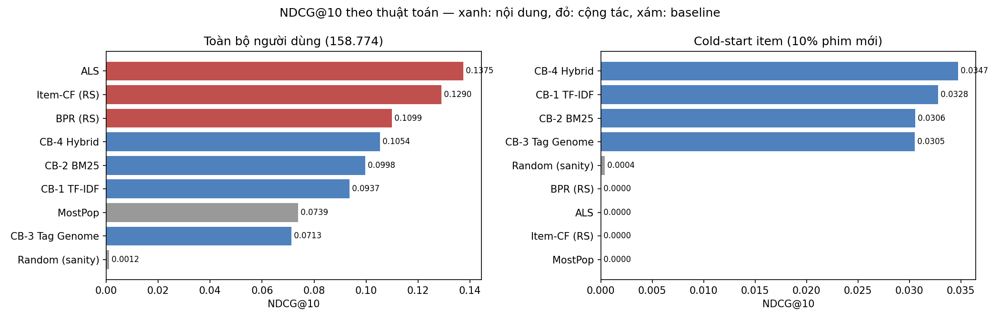
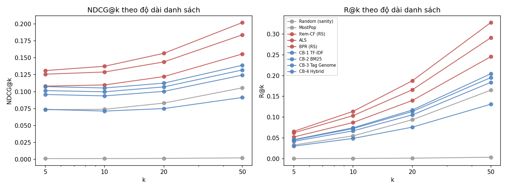
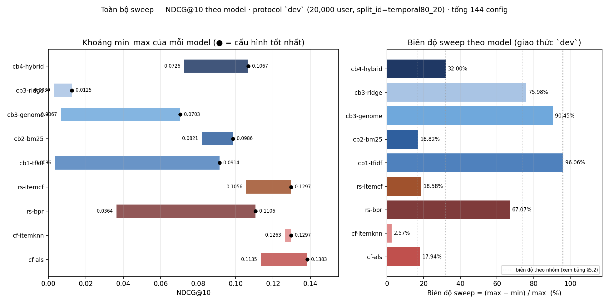
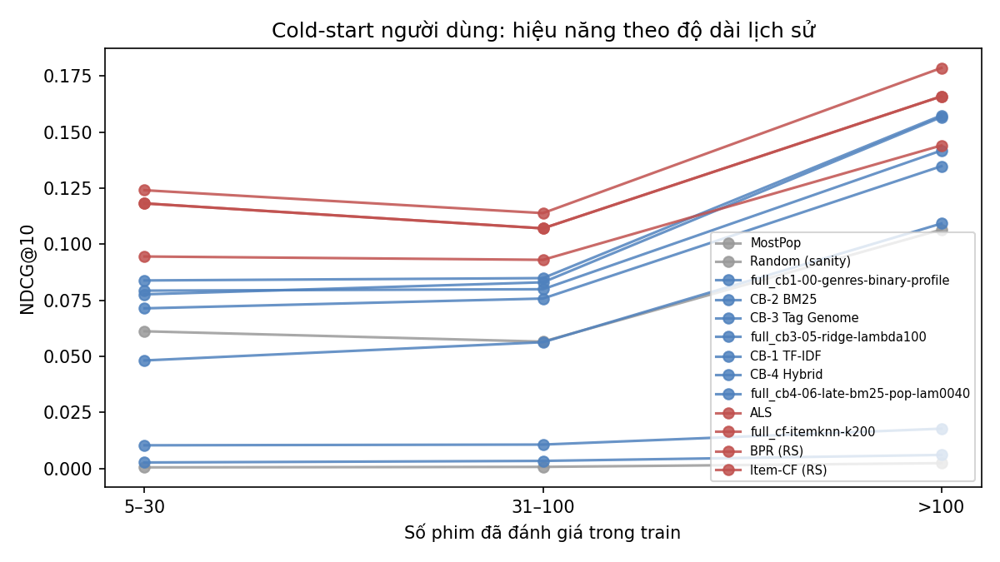

# Chương 5 — Kết quả thực nghiệm

> **Trả lời RQ1** (CF và Content-based thắng ở đâu) và **RQ2** (cold-start item thì sao).
> Mọi số liệu lấy từ `results/final/*.csv`; mỗi bảng ghi rõ giao thức đánh giá.
> Chương 6 (RQ3 — chống rò rỉ) nằm ở [`06-leakage-analysis-and-discussion.md`](06-leakage-analysis-and-discussion.md).

---

## 5.1 Kết quả chính — hai bảng CF và CB

Trước hết là bối cảnh đọc số: đồ án dùng **ba giao thức đánh giá** trên cùng một
bộ dữ liệu, và mỗi dòng kết quả mang bằng chứng protocol (`split_id`,
`catalog_id`, `seed`) để người đọc tự kiểm chứng.

| Giao thức | Số user | `split_id` | Dùng để |
|---|---:|---|---|
| `dev` | 20.000 | `temporal80_20` | **sweep tham số** (144 config) |
| `full` | 158.774 | `temporal80_20` | **bảng chính** ở §5.1, §5.4, §5.5 |
| `coldstart` | 10.992 | `temporal80_20+coldstart_item` | cold-start item (§5.3) |

### Bảng CF — giao thức `full`, 158.774 user

*Nguồn: `results/final/benchmark-cf.csv` — `split_id=temporal80_20`,
`catalog_id=ml25m-n13816-de09a1b710f6`, `seed=42`.*

| Thuật toán | `exp_name` | NDCG@10 | HR@10 |
|---|---|---:|---:|
| ALS | `full_cf-als-f064-a005-reg0p1` | **0,1375** | **0,5366** |
| Item-CF (RS) | `full_rs-itemcf-k200-binary-pos` | 0,1290 | 0,4870 |
| BPR (RS) | `full_rs-bpr-f64-i10-reg0p00001-lr0p01` | 0,1099 | 0,4593 |
| MostPop | `full_baseline-mostpop` | 0,0739 | 0,3246 |
| Random (sanity) | `full_baseline-random` | 0,0012 | 0,0103 |

### Bảng CB — giao thức `full`, 158.774 user

*Nguồn: `results/final/benchmark-cb.csv` — cùng `split_id`/`catalog_id`/`seed`.*

| Thuật toán | `exp_name` | NDCG@10 | HR@10 |
|---|---|---:|---:|
| CB-4 Hybrid | `full_cb4-04-late-bm25-w075` | **0,1054** | **0,4329** |
| CB-2 BM25 | `full_cb2-01-k1-05-b000` | 0,0998 | 0,4205 |
| CB-1 TF-IDF | `full_cb4-03-timedecay-hl0365` | 0,0937 | 0,4020 |
| CB-3 Tag Genome | `full_cb3-04d-item-knn-tau020-k100` | 0,0713 | 0,3381 |

**Hình 5.1** — `results-accuracy.png` (panel trái) và `results-metric-vs-k.png`:
thứ hạng ổn định ở mọi `k ∈ {5, 10, 20, 50}`, không phải hiệu ứng của riêng `k = 10`.

### Diễn giải

Ở giao thức thường, **CF thắng CB**: ALS đạt NDCG@10 = 0,1375 so với CB-4 Hybrid
0,1054. Chênh lệch tính theo mẫu số ALS là

\[
\frac{0{,}137470 - 0{,}105435}{0{,}137470} = 23{,}3\%
\]

(tính theo mẫu số CB-4 thì là 30,4% — hai cách đều được nêu ở đây để tránh nhầm
mẫu số). Khoảng cách này **lớn hơn nhiễu thống kê** — §5.4 cho thấy CI bootstrap 95%
của ALS [0,1366; 0,1383] không chạm CI của CB-4 [0,1047; 0,1062].

Nhưng đây mới chỉ là **con số**, chưa phải **kết luận**. Trước khi nói "CF thắng",
phải trả lời: liệu kết luận đó có phải do CF được tinh chỉnh kỹ hơn CB không? §5.2
kiểm tra đúng câu hỏi đó.

---

## 5.2 Cân bằng sweep — kết luận "CF thắng" có cơ sở không?

### 5.2.1 Độ bao phủ sweep đã cân bằng

| Nhóm | Config trong `configs/` | Đã chạy | Chưa chạy |
|---|---:|---:|---:|
| CF (ALS + Item-CF + BPR) | 51 | **51** | 0 |
| CB (CB-1…CB-4) | 93 | **93** | 0 |

**Bằng chứng kiểm chứng được:** `results/final/ablation-{cf,cb1,cb2,cb3,cb4}.csv` —
144 dòng (51 CF + 93 CB), mỗi dòng mang `params` đầy đủ cùng `split_id`/`catalog_id`/`seed`.
Người đọc không phải tin lời mà tự đếm được. Đây là điểm then chốt: trước đây CF được
quét nhiều hơn CB, nên mọi tuyên bố "CF thắng" đều mang nghi ngờ thiên lệch.

### 5.2.2 Biên độ sweep — phải tách **theo model** và **theo nhóm**

Đây là điểm dễ đọc sai nhất của chương, nên báo cáo ghi rõ cả hai bảng.

> **Quy ước:** biên độ sweep = **(max − min) / max**, tính trên NDCG@10 của giao thức
> `dev` (20.000 user, `split_id=temporal80_20`, `seed=42`).

**Bảng 5.1 — biên độ theo model** (mỗi model là một lưới tham số riêng):

| Model | n | min → max | Biên độ |
|---|---:|---|---:|
| `cf-als` | 15 | 0,1135 → 0,1383 | **17,94%** |
| `cf-itemknn` | 3 | 0,1263 → 0,1297 | **2,57%** |
| `rs-bpr` | 21 | 0,0364 → 0,1106 | **67,07%** |
| `rs-itemcf` | 12 | 0,1056 → 0,1297 | **18,58%** |
| `cb1-tfidf` | 15 | 0,0036 → 0,0914 | **96,06%** |
| `cb2-bm25` | 21 | 0,0821 → 0,0986 | **16,82%** |
| `cb3-genome` | 19 | 0,0067 → 0,0703 | **90,45%** |
| `cb3-ridge` | 3 | 0,0030 → 0,0125 | **75,98%** |
| `cb4-hybrid` | 32 | 0,0726 → 0,1067 | **32,00%** |

**Bảng 5.2 — biên độ theo nhóm** (toàn bảng ablation của nhóm):

| Nhóm | File | n | min → max | Biên độ |
|---|---|---:|---|---:|
| CF | `ablation-cf.csv` | 51 | 0,0364 → 0,1383 | **73,65%** |
| CB-1 | `ablation-cb1.csv` | 15 | 0,0036 → 0,0914 | **96,06%** |
| CB-2 | `ablation-cb2.csv` | 21 | 0,0821 → 0,0986 | **16,82%** |
| CB-3 | `ablation-cb3.csv` | 22 | 0,0030 → 0,0703 | **95,72%** |
| CB-4 | `ablation-cb4.csv` | 35 | 0,0726 → 0,1067 | **32,00%** |

> ⚠️ **Hai quy ước này không được trộn.** "CF 17,94%" là biên độ của **riêng lưới ALS**;
> biên độ của **toàn nhóm CF** là **73,65%** vì nhóm gồm thêm BPR (biên độ 67,07%).
> Tương tự, CB-3 (95,72%) gồm cả lưới `cb3-ridge` (75,98%).
>
> ⚠️ `ablation-cb4.csv` chứa **3 dòng `model=cb1-tfidf`** — đây là họ time-decay
> `cb4-03-*` đặt trên nền CB-1, **không phải** hybrid. Biên độ nhóm CB-4 vẫn đúng vì
> 32/35 dòng là `cb4-hybrid`; bảng theo model tính `cb1-tfidf` trên 15 dòng của file
> sở hữu nó.

**Hình 5.2** — `results-sweep-range.png`: khoảng min–max của từng model (trái) và biên
độ sweep tương ứng (phải). Hình dùng **cùng công thức** với hai bảng trên.

### 5.2.3 Biên độ `dev` có đại diện cho `full` không?

Dùng biên độ sweep (giao thức `dev`) để lập luận về bảng chính (giao thức `full`) chỉ
hợp lệ nếu hai giao thức cho cùng một thứ hạng. `dev` (20.000 user) là **tập con** của
`full` (158.774 user), dùng chung `train.parquet`/`test.parquet` — khác biệt duy nhất là
ai được chấm điểm. Median số tương tác train mỗi user là **58** ở cả hai.

| Mô hình | `dev` (20.000 user) | `full` (158.774 user) | Lệch |
|---|---:|---:|---:|
| ALS | 0,1383 | 0,1375 | −0,6% |
| Item-CF | 0,1297 | 0,1290 | −0,5% |
| BPR | 0,1106 | 0,1099 | −0,6% |
| MostPop | 0,0723 | 0,0739 | +2,2% |
| CB-4 | 0,1043 | 0,1054 | +1,1% |
| CB-2 | 0,0986 | 0,0998 | +1,1% |
| CB-1 | 0,0921 | 0,0937 | +1,7% |
| CB-3 | 0,0703 | 0,0713 | +1,3% |

*Nguồn: `benchmark-cf-dev.csv`, `benchmark-cb-dev.csv`, `benchmark-cf.csv`,
`benchmark-cb.csv`.*

Lệch tuyệt đối ≤ 1,7% (trừ MostPop +2,2%) và **thứ hạng không đảo ở cặp nào**. Kết
luận: biên độ sweep trên `dev` là đại diện hợp lệ cho `full`; đây cũng là bằng chứng
rằng quy trình chọn tham số trên 20.000 user không tạo ra hiệu tượng riêng của tập nhỏ.

### 5.2.4 ALS nhạy với tham số nào?

Đây là chi tiết thường bị đọc sai. Trong một lát cắt cố định `factors=64, α=5`, biên độ
chỉ 0,40% — nhưng đó **không phải** biên độ của mô hình ALS, chỉ là biên độ của
`reg` × `iterations` trong lát cắt đó:

| Lát cắt | Số config | NDCG@10 | Biên độ |
|---|---:|---|---:|
| `reg` × `iterations` (f=64, α=5) | 8 | 0,1377 – 0,1383 | **0,40%** |
| **Toàn lưới** (thêm `α` ∈ {1,5,10,40}, `factors` ∈ {64,128}) | 15 | 0,1135 – 0,1383 | **17,94%** |

*Biên độ toàn lưới tính theo công thức chuẩn `(max−min)/max`; nếu dùng mẫu số trung
bình sẽ ra 18,65% — báo cáo này dùng thống nhất mẫu số max.*

Nhìn theo `factors` × `α` thì rõ ngay tham số nào chi phối:

| factors | α=1 | α=5 | α=10 | α=40 |
|---|---:|---:|---:|---:|
| 64 | 0,1371 | **0,1383** | 0,1333 | 0,1135 |
| 128 | 0,1291 | 0,1331 | 0,1302 | 0,1154 |

Kết luận đúng: ALS **không nhạy** với `reg`/`iterations` nhưng **rất nhạy với `α`**
(α=40 sụp 18% so với α=5) và với `factors` (f=128 kém hơn f=64 ở mọi giá trị α).
Cấu hình thắng vẫn là `f=64, α=5, reg=0,1`.

### 5.2.5 Kết luận của §5.2

Sweep đã **cân bằng về số config** (51 CF / 93 CB), nên kết luận "CF thắng ở giao thức
thường" **không còn mang nghi ngờ thiên lệch độ bao phủ**. Và biên độ sweep cho thấy
các họ content thực ra **nhạy tham số hơn CF nhiều** (CB-1 96,06%, CB-3 95,72% so với
lưới ALS 17,94%) — tức cả hai hướng đều đã được tinh chỉnh đến mức hội tụ của riêng
mình. Kết luận của §5.1 vì thế đứng vững: **CF thắng ở giao thức thường là một kết
luận thật, không phải hệ quả của việc CF được quét kỹ hơn.**

---

## 5.3 Cold-start item — kết luận đảo chiều hoàn toàn

Ở giao thức `coldstart`, **1.381 phim (10%)** bị giữ lại: mọi tương tác train của
chúng bị xoá, test chỉ giữ rating trên chúng. 10.992 user còn đánh giá được.

*Nguồn: `results/final/benchmark-coldstart.csv` — `split_id=temporal80_20+coldstart_item`,
`catalog_id=ml25m-n13816-de09a1b710f6`, `seed=42`.*

| Mô hình | NDCG@10 (`coldstart`) | HR@10 (`coldstart`) | NDCG@10 (`full`) |
|---|---:|---:|---:|
| CB-4 Hybrid | **0,0347** | **0,1108** | 0,1054 |
| CB-1 TF-IDF | 0,0328 | 0,1013 | 0,0937 |
| CB-2 BM25 | 0,0306 | 0,0988 | 0,0998 |
| CB-3 Tag Genome | 0,0305 | 0,0964 | 0,0713 |
| Random (sanity) | 0,0004 | 0,0017 | 0,0012 |
| ALS | **0,0000** | **0,0000** | 0,1375 |
| Item-CF (RS) | **0,0000** | **0,0000** | 0,1290 |
| BPR (RS) | **0,0000** | **0,0000** | 0,1099 |
| MostPop | **0,0000** | **0,0000** | 0,0739 |

### 5.3.1 "0,0000" là *đúng bằng không*, không phải "rất thấp"

Đây là điểm cần nói rõ vì "0,0000" rất dễ bị đọc thành "mô hình này rất yếu". Không
phải. Cơ chế là: mọi tương tác train của phim held-out bị **xoá khỏi ma trận**,
nên:

- **ALS / Item-CF / BPR**: ma trận cộng tác của user không còn tín hiệu nào về các phim
  đó → mô hình học cộng tác **không có gì để học** về chúng. Với MostPop, tất cả phim
  held-out có popularity = 0 nên bị đẩy xuống đáy danh sách.
- **Các mô hình CB**: đặc trưng nội dung (tag, genres, genome) của phim vẫn còn nguyên
  trong catalog → hồ sơ user vẫn khớp được với phim mới.

Nói cách khác, 0,0000 là **hệ quả cấu trúc của phương pháp**, chứ không phải điểm yếu
về hiệu năng: đây chính là định nghĩa của cold-start.

### 5.3.2 Khả năng gợi ý phim chưa từng có tương tác — `frac_unseen@10`

*Nguồn: `results/final/beyond-accuracy-coldstart.csv`.*

| Mô hình | `frac_unseen@10` |
|---|---:|
| CB-4 Hybrid (content thuần) | **0,2223** |
| CB-1 TF-IDF | 0,2140 |
| CB-3 Tag Genome | 0,2116 |
| CB-2 BM25 | 0,2073 |
| Random (sanity) | 0,1022 |
| CB-4 Hybrid (`pop_prior` 0,4) | **0,0036** |
| ALS / Item-CF / BPR / MostPop | 0,0000 |

Chỉ số này đo phần danh sách gợi ý gồm phim user **chưa từng tương tác**: mô hình CF
đạt đúng 0,0000 — không một phim held-out nào được gợi ý, đúng như bản chất lọc cộng
tác. CB-4 đạt 0,2223, tức gần 1/5 danh sách là phim mới.

> **Bẫy `pop_prior` — minh hoạ vì sao phải đánh giá trên cả hai giao thức.**
> Bản CB-4 có λ_pop = 0,4 đạt NDCG@10 = **0,1081** ở giao thức thường (cao hơn bản
> content thuần 0,1054) nhưng **sụp còn 0,0010** ở cold-start, với
> `frac_unseen@10` rơi từ 0,2223 xuống 0,0036 — vì mọi phim held-out có popularity = 0
> nên bị đẩy xuống đáy. Vì vậy **bảng chính lấy bản content thuần**; bản có prior chỉ
> để đối chiếu.

### 5.3.3 Kiểm định thống kê

*Nguồn: `results/final/wilcoxon-coldstart.csv` — Wilcoxon signed-rank ghép cặp, mốc =
CB-4 Hybrid, 10.992 user.*

| So với CB-4 | Chênh lệch TB | tỷ lệ user tốt hơn | tỷ lệ user kém hơn | tỷ lệ hoà | p | Có ý nghĩa |
|---|---:|---:|---:|---:|---:|:---:|
| ALS | 0,034721 | 0,1108 | 0,0000 | 0,8892 | 8,77e-201 | ✅ |
| Item-CF (RS) | 0,034721 | 0,1108 | 0,0000 | 0,8892 | 8,77e-201 | ✅ |
| BPR (RS) | 0,034721 | 0,1108 | 0,0000 | 0,8892 | 8,77e-201 | ✅ |
| MostPop | 0,034721 | 0,1108 | 0,0000 | 0,8892 | 8,77e-201 | ✅ |
| Random (sanity) | 0,034359 | 0,1107 | 0,0015 | 0,8877 | 1,07e-195 | ✅ |
| CB-3 Tag Genome | 0,004220 | 0,0749 | 0,0577 | 0,8674 | 1,04e-06 | ✅ |
| CB-2 BM25 | 0,004141 | 0,0688 | 0,0467 | 0,8846 | 7,07e-12 | ✅ |
| CB-1 TF-IDF | 0,001926 | 0,0665 | 0,0558 | 0,8777 | 3,92e-03 | ✅ |

Đọc cả ba cột tỷ lệ chứ không chỉ "thắng": với mọi mô hình CF, **tỷ lệ hoà là 0,8892**
— tức 88,9% user hòa điểm, và 11,1% user còn lại thắng. Với các mô hình CB khác, tỷ lệ
hoà ~0,87 và phần thắng–thua gần cân bằng (CB-1: 0,0665 thắng vs 0,0558 thua) — vì vậy
p-value của CB-1 lớn hơn nhiều (3,92e-03) dù chênh lệch TB vẫn dương.

### 5.3.4 Kết luận của §5.3

**Kết luận của §5.1 đảo chiều hoàn toàn.** Ở giao thức thường CF thắng 23%; ở giao
thức cold-start item, **mọi mô hình CF = 0,0000** còn CB đạt tới 0,0347 — và chênh
lệch này có ý nghĩa thống kê với `p ≈ 8,77e-201`. Đây không phải "CF kém" mà là
**hai phương pháp trả lời hai câu hỏi khác nhau**.

---

## 5.4 Kiểm định thống kê

### 5.4.1 Bootstrap CI 95%

*Nguồn: `results/final/bootstrap-ci.csv` — giao thức `full`, 158.774 user.*

| Mô hình | NDCG@10 | CI 95% |
|---|---:|---|
| ALS | 0,137470 | [0,136620 ; 0,138343] |
| Item-CF | 0,129014 | [0,128124 ; 0,129905] |
| BPR | 0,109922 | [0,109152 ; 0,110716] |
| CB-4 Hybrid (`pop_prior` 0,4) | 0,108071 | [0,107297 ; 0,108856] |
| CB-4 Hybrid (content thuần) | 0,105435 | [0,104652 ; 0,106205] |
| CB-2 BM25 | 0,099761 | [0,099028 ; 0,100473] |
| CB-1 TF-IDF | 0,093718 | [0,092953 ; 0,094403] |
| MostPop | 0,073903 | [0,073233 ; 0,074637] |
| CB-3 Tag Genome | 0,071292 | [0,070662 ; 0,071955] |
| CB-3 ridge | 0,012852 | [0,012605 ; 0,013104] |
| Chỉ genres | 0,004039 | [0,003915 ; 0,004180] |
| Random (sanity) | 0,001171 | [0,001105 ; 0,001239] |

CI của ALS **[0,136620 ; 0,138343]** và CI của CB-4 content thuần
**[0,104652 ; 0,106205]** không chạm nhau — chênh lệch 23,3% ở §5.1 **lớn hơn nhiễu
thống kê**, không phải hiệu ứng của mẫu 158.774 user.

### 5.4.2 Wilcoxon signed-rank ghép cặp

*Nguồn: `results/final/wilcoxon-cf.csv`, `wilcoxon-cb.csv`, `wilcoxon-coldstart.csv`.*

Wilcoxon chạy **trong từng bảng**, không so chéo CF↔CB. Lý do rất cụ thể:

1. **Khác câu hỏi.** Bảng CF hỏi "thuật toán cộng tác nào tốt nhất?", bảng CB hỏi
   "thuật toán nội dung nào tốt nhất?". Một bảng ghép CF+CB sẽ trộn hai bài toán khác
   nhau và trả lời *cả* câu hỏi nào đó.
2. **Số config tinh chỉnh khác nhau.** CF được sweep 51 config, CB 93 config. Thứ hạng
   trong một bảng phản ánh chất lượng **sau khi** tinh chỉnh trong chính bảng đó; so
   chéo hai bảng với số tinh chỉnh khác nhau là so sánh không cùng điều kiện.
3. **Bằng chứng protocol.** Mỗi bảng giữ nguyên `split_id`/`catalog_id`/`seed` riêng;
   bảng riêng thì bằng chứng đó còn nguyên ý nghĩa. Bảng ghép sẽ phải nhân bản dòng.

Vì thế, kết luận "CF thắng CB 23%" ở §5.1 được dựng trên **hai bảng riêng**, và bổ
sung bằng CI bootstrap (bảng trên) cho thấy khoảng cách không nằm trong nhiễu.

---

## 5.5 Kết quả theo mức độ hoạt động của user

Ba nhóm theo số phim đã đánh giá trong train: **5–30** (41.343 user), **31–100**
(66.131 user), **>100** (51.300 user).

*Nguồn: `results/final/coldstart-user-buckets.csv` — giao thức `full`.*

| Mô hình | 5–30 | 31–100 | >100 |
|---|---:|---:|---:|
| ALS | 0,1241 | 0,1139 | 0,1786 |
| Item-CF (RS) | 0,1182 | 0,1071 | 0,1660 |
| BPR (RS) | 0,0945 | 0,0930 | 0,1441 |
| CB-4 Hybrid (content thuần) | 0,0777 | 0,0830 | 0,1567 |
| CB-2 BM25 | 0,0793 | 0,0799 | 0,1418 |
| CB-1 TF-IDF | 0,0714 | 0,0758 | 0,1348 |
| CB-3 Tag Genome | 0,0482 | 0,0563 | 0,1092 |
| MostPop | 0,0612 | 0,0566 | 0,1065 |
| Chỉ genres | 0,0027 | 0,0034 | 0,0060 |

**Hình 5.3** — `results-user-buckets.png`:

### Phát hiện đáng chú ý

1. **Mô hình CB *cải thiện* theo độ dài lịch sử, không giảm.** CB-2 BM25 đi
   0,0793 → 0,0799 → 0,1418. Điều này **ngược với trực giác** phổ biến rằng
   content-based chỉ tốt cho user mới. Lý do: hồ sơ user của CB là trung bình có
   trọng số của các item đã xem — user xem càng nhiều, hồ sơ càng ổn định, và chính
   những user có lịch sử dài cũng có hồ sơ "chính xác" hơn.
2. **Khoảng cách CF–CB thu hẹp dần theo độ dài lịch sử.** Ở nhóm 5–30, ALS vượt CB-4
   0,0465 (0,1241 vs 0,0777); ở nhóm >100, khoảng cách là 0,0219 (0,1786 vs 0,1567).
   Nói cách khác: **content-based cạnh tranh được với CF ở nhóm user lịch sử ngắn**,
   và càng có nhiều tương tác, CF càng thắng rõ — đúng với logic "CF cần dữ liệu để
   học, CB thì không".
3. **Nhóm >100 có NDCG cao hơn rõ rệt** ở *mọi* mô hình. Đây là hệ quả của cách chia
   tập (split theo thời gian 80/20 theo từng user): user có nhiều tương tác train thì
   có nhiều tín hiệu hơn cho mọi phương pháp, đồng thời có nhiều phim relevant hơn
   trong test.

---

## Tóm tắt Chương 5

| RQ | Kết luận | Bằng chứng |
|---|---|---|
| **RQ1** | CF thắng CB ở giao thức thường (ALS 0,1375 vs CB-4 0,1054, chênh 23,3%), và kết luận này **đã cân bằng** về độ bao phủ sweep (51 CF / 93 CB) | §5.1, §5.2, §5.4 |
| **RQ2** | Ở cold-start item, kết luận **đảo chiều hoàn toàn**: mọi mô hình CF = 0,0000 (đúng bằng không), CB đạt 0,0347, `p ≈ 8,77e-201` | §5.3 |
| *(bổ sung)* | Content-based cải thiện theo độ dài lịch sử và cạnh tranh được với CF ở nhóm user lịch sử ngắn | §5.5 |
