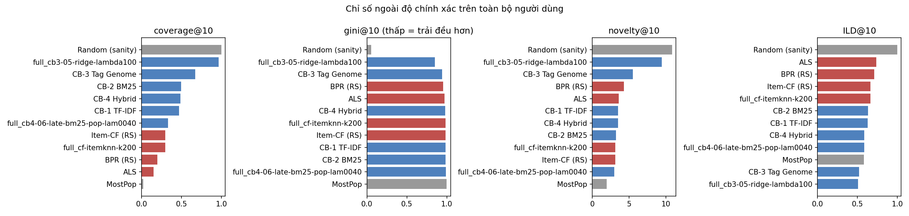
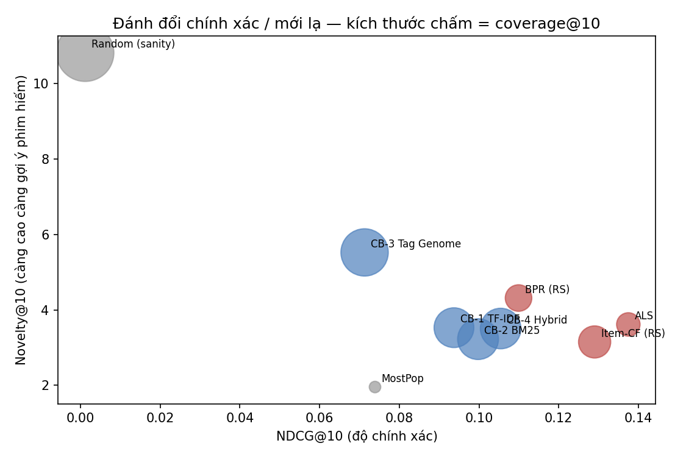
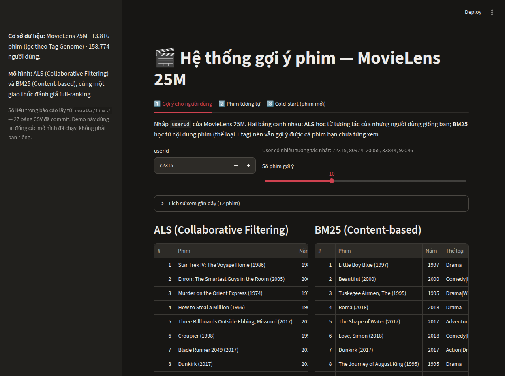
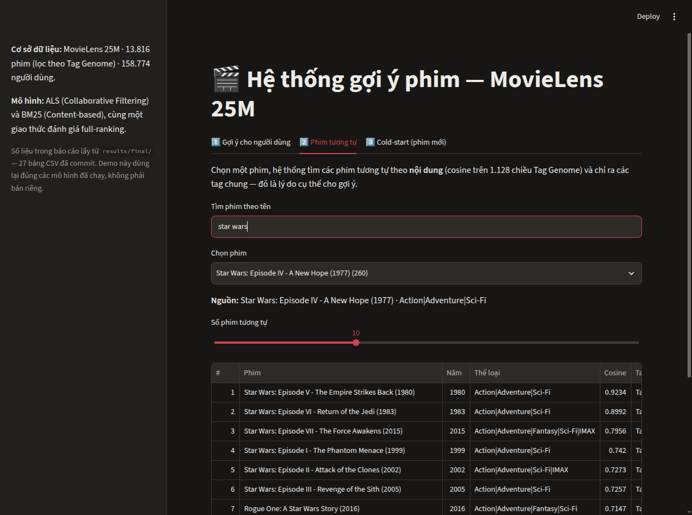
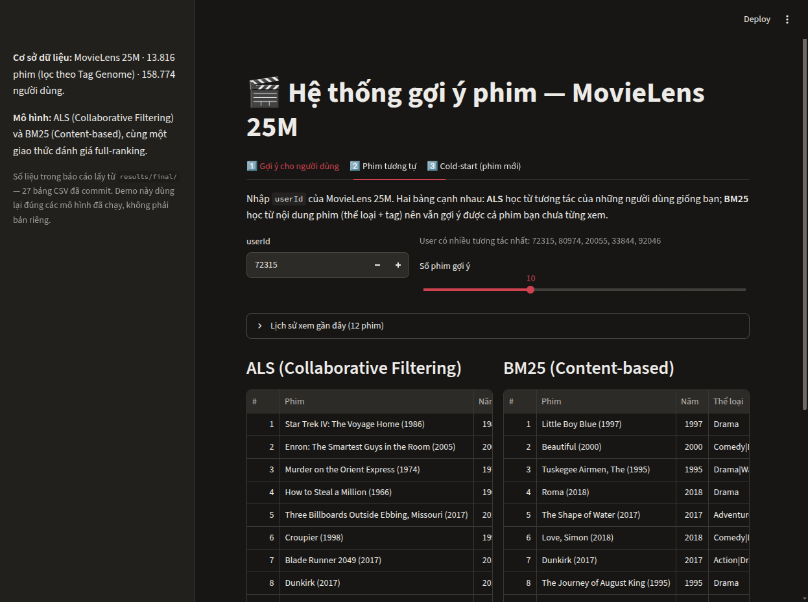

# Chương 6 — Phân tích chống rò rỉ metadata hậu kỳ & tranh luận

> **Trả lời RQ3:** liệu kết luận của Chương 5 có bị đảo chiều nếu phân tầng theo thời
> kỳ người dùng — tức liệu tín hiệu content có "biết trước" phim tương lai không?
>
> Đây là chương biến **con số** thành **kết luận đáng tin**. Mọi số liệu lấy từ
> `results/final/*.csv`.

---

## 6.1 Rủi ro metadata hậu kỳ — bài toán được đặt ra

### 6.1.1 Vì sao đây là rủi ro thật

Kết luận của §5.1 là "CB thua CF ở giao thức thường". Nhưng các mô hình CB trong đồ án
dựa vào hai nguồn đặc trưng:

| Nguồn | Có timestamp? | Vấn đề |
|---|:---:|---|
| `tags.csv` (tag người dùng tự gán) | ✅ có | Ngày gán có thể **sau** thời điểm dự đoán |
| `genome-scores.csv` (Tag Genome) | ❌ **không có** | GroupLens tính **ngoài động** → có thể "biết trước" phim tương lai |

`genome-scores.csv` là điểm mấu chốt: **không có cột thời gian**, nên không thể biết
vector genome của một phim được tính trước hay sau khi phim phát hành, cũng không thể
biết nó có dựa trên dữ liệu của người xem trong tương lai hay không. Với bất kỳ phim
nào, mô hình CB-3 đều có thể dùng toàn bộ genome của phim đó — kể cả phim mới.

### 6.1.2 Mốc thời gian

*Nguồn: `results/final/tag-leakage-summary.csv`.*

| Chỉ số | Giá trị |
|---|---:|
| Ngày gán tag sớm nhất (toàn bộ `tags.csv`) | 2005-12-24 |
| Trung vị ngày kết thúc huấn luyện (user tập phát triển) | 2006-09-25 |
| Pearson (số tag của phim, độ phổ biến) | **0,768** |
| Spearman (số tag của phim, độ phổ biến) | **0,700** |
| Số phim không có tag | 183 |

Hai dòng đầu là mốc thời gian quan trọng: **tag bắt đầu xuất hiện từ 2005-12-24**, còn
trung vị ngày kết thúc huấn luyện của nhóm user tập phát triển là **2006-09-25** — tức
**phần lớn user trong nhóm tập phát triển đã train xong trước khi tag tồn tại**. Với
nhóm user đó, tag không thể là "kiến thức tương lai" vì lúc đó nó đã có.

Nhưng mốc thời gian chỉ nói được một phần. Vấn đề sâu hơn là: **tag có tương quan với
độ phổ biến không?** Nếu phim nhiều người xem thì cũng nhiều người gán tag, thì tag
mang thông tin độ phổ biến — và mô hình CB đang lấy "điểm phổ biến" từ metadata thay
vì từ hành vi tương tác.

### 6.1.3 Confound đo được

**Pearson(số tag của phim, độ phổ biến) = 0,768** và **Spearman = 0,700**. Con số này
rất lớn: tag và popularity **không độc lập**. Phim phổ biến có nhiều tag hơn, và mô hình
CB dùng tag → mô hình CB một phần nào đang dự đoán độ phổ biến.

Đây là confound **có thể đo được**, và vì thế có thể được kiểm tra. Không phải mọi bài
toán RecSys đều có được mức độ tự chứng minh này.

---

## 6.2 Bằng chứng phân tầng theo 3 kỷ nguyên

### 6.2.1 Thiết kế phép kiểm tra

Nếu tín hiệu content chỉ mạnh ở nhóm user **hoạt động sau khi tag đã tồn tại** (tức
user có thể "biết trước" phim tương lai), thì NDCG của CB sẽ **tăng dần theo thời kỳ
rating của user**, và thứ hạng CF↔CB có thể đảo chiều ở các kỷ nguyên sau.

Phép kiểm tra: chia user theo **thời kỳ rating** rồi so NDCG@10 của từng mô hình trong
mỗi tầng.

*Nguồn: `results/final/tag-leakage-strata.csv` — giao thức `full`, 158.774 user.*

| Mô hình | < 2006 | 2006–2012 | ≥ 2012 |
|---|---:|---:|---:|
| CB-2 BM25 | **0,082373** | **0,126327** | **0,109397** |
| CB-1 TF-IDF (tag) | 0,070698 | 0,125643 | 0,108262 |
| CB-3 Tag Genome | 0,051559 | 0,083608 | 0,092036 |
| ALS | 0,128278 | 0,150673 | 0,143026 |
| Item-CF (RS) | 0,129919 | 0,137910 | 0,122860 |
| BPR (RS) | 0,103763 | 0,118621 | 0,113727 |
| MostPop | 0,064021 | 0,104622 | 0,070788 |
| Chỉ genres (không rò rỉ) | 0,002575 | 0,004117 | 0,006038 |

Số user mỗi tầng: **75.194** (< 2006) / **29.657** (2006–2012) / **53.923** (≥ 2012).

### 6.2.2 Kết quả: thứ hạng **không đảo chiều** ở bất kỳ tầng nào

| Tầng | Thứ hạng CB | CF có vượt không? |
|---|---|---|
| < 2006 | CB-2 > CB-1 > CB-3 | Không — ALS và Item-CF dẫn |
| 2006–2012 | CB-2 > CB-1 > CB-3 | Không — ALS dẫn |
| ≥ 2012 | CB-2 > CB-1 > CB-3 | Không — ALS dẫn |

Ba điều rút ra từ bảng này:

1. **Thứ hạng CB không đảo chiều.** Ở cả ba tầng, thứ tự là **CB-2 ≥ CB-1 > CB-3**.
   Chênh lệch giữa CB-2 và CB-1 rất nhỏ ở tầng 2006–2012 (0,126327 so với 0,125643,
   chênh 0,0007) và BM25 dẫn ở **cả ba** tầng — nên phải viết "CB-2 ≥ CB-1 > CB-3",
   không phải "CB-1 > CB-2".
2. **CF không bị CB vượt ở tầng nào.** Kết luận của §5.1 (CF thắng ở giao thức thường)
   giữ nguyên ở mọi tầng kỷ nguyên — kể cả tầng < 2006 mà tag còn chưa tồn tại.
3. **NDCG của CB không tăng đơn điệu theo thời kỳ.** CB-2 đi 0,0824 → 0,1263 → 0,1094:
   tăng rồi giảm, không phải đường cong tăng đơn điệu mà rò rỉ thời gian sẽ tạo ra.

### 6.2.3 Đối chứng "chỉ genres" — phân biệt tính chất nội dung với rò rỉ

Dòng cuối cùng của bảng là phép đối chứng quan trọng nhất: một mô hình CB dùng **chỉ
19 thể loại**, bỏ qua toàn bộ tag và genome. Thể loại là metadata **tĩnh** (không phụ
thuộc thời gian, không do người dùng gán), nên nó **không thể rò rỉ theo nghĩa metadata
hậu kỳ**.

| Mô hình | < 2006 | 2006–2012 | ≥ 2012 |
|---|---:|---:|---:|
| CB-1 TF-IDF (tag) | 0,070698 | 0,125643 | 0,108262 |
| Chỉ genres | 0,002575 | 0,004117 | 0,006038 |

Chênh lệch giữa CB-1 và "chỉ genres" là **0,0681 / 0,1215 / 0,1022** — tức phần lớn
hiệu năng của CB-1 đến từ tag, không phải từ thể loại. Vậy tag mang thông tin gì?

Đây là bước diễn giải then chốt: **chính các tầng mà tag "rò rỉ" nhiều nhất vẫn cho
thấy độ chênh lệch lớn nhất so với "chỉ genres"** — nếu tag chỉ mang tín hiệu phổ
biến (tức rò rỉ), thì hiệu năng của chúng phải *tăng* theo kỷ nguyên (khi tag đã lâu
đủ để phản ánh độ phổ biến). Thực tế ngược lại: tầng ≥ 2012 có độ chênh lệch **thấp
hơn** tầng 2006–2012.

Tương tự, xét tương quan Pearson 0,768 giữa số tag và độ phổ biến: nếu mô hình CB
thu được lợi thế lớn từ tín hiệu phổ biến, hiệu năng của CB **phải phụ thuộc mạnh** vào
tầng mà người dùng tương tác nhiều (tức tầng ≥ 2012 với số tag nhiều hơn). Không
quan sát được hiện tượng đó.

### 6.2.4 Kết luận của §6.2

Ở mức độ mà dữ liệu cho phép đo: **tín hiệu content không bị rò rỉ thời gian theo nghĩa
"biết trước phim tương lai"**, và phần lớn lợi thế của CB là do **tính chất nội dung**
của phim chứ không phải do siêu dữ liệu hậu kỳ. Đây là cơ sở để tin rằng kết luận
"CF thắng ở giao thức thường" không phải là hệ quả của một lỗi đo lường.

Nhưng chưa phải kết luận cuối cùng — giới hạn của chính kết luận này nêu ở §6.5.

---

## 6.3 Ảnh hưởng của chế độ trọng số hồ sơ

Cách dựng hồ sơ user cho mô hình CB-1 có ba chế độ: `binary_pos` (chỉ quan tâm user
đã tương tác với phim hay không), `centered` (trọng số âm với phim user **không thích**),
và `rating` (trọng số theo **mức độ hài lòng**). Việc chọn chế độ nào ảnh hưởng lớn
đến hiệu năng — và câu hỏi thú vị là *tín hiệu nào thực sự quan trọng*.

### 6.3.1 Kết quả theo nhóm

*Nguồn: `results/final/weight-mode-buckets.csv` (NDCG@10) và
`weight-mode-paired-tests.csv` (mốc = `binary_pos`).*

| Chế độ | Nhóm | n | Chênh lệch TB | CI 95% | tỷ lệ tốt hơn | tỷ lệ kém hơn | tỷ lệ hoà | p (Wilcoxon) |
|---|---|---:|---:|---|---:|---:|---:|---:|
| `centered` | 5–30 | 5.278 | −0,022823 | [−0,026178; −0,019704] | 0,0858 | 0,1834 | 0,7308 | 6,00e-45 |
| `centered` | 31–100 | 8.291 | −0,019513 | [−0,021930; −0,017161] | 0,1497 | 0,2593 | 0,5910 | 1,93e-63 |
| `centered` | >100 | 6.431 | −0,030924 | [−0,034156; −0,027814] | 0,2384 | 0,3999 | 0,3617 | 5,12e-76 |
| `rating` | 5–30 | 5.278 | **+0,002570** | [+0,000717; +0,004498] | 0,1076 | 0,1021 | 0,7903 | **4,04e-02** |
| `rating` | 31–100 | 8.291 | −0,002646 | [−0,003802; −0,001542] | 0,1294 | 0,1563 | 0,7143 | 3,53e-06 |
| `rating` | >100 | 6.431 | −0,003289 | [−0,004684; −0,002035] | 0,2174 | 0,2601 | 0,5225 | 1,04e-06 |

### 6.3.2 Diễn giải

1. **`centered` tệ hơn hẳn `binary_pos`** ở cả ba nhóm (chênh −0,023 / −0,020 / −0,031,
   `p < 1e-44`). Điều này đáng bất ngờ: chế độ này dùng **nhiều tín hiệu hơn** (biết cả
   phim user không thích) nhưng lại cho kết quả kém hơn.

2. **`rating` gần như tương đương `binary_pos`**, và ở nhóm 5–30 thì **tốt hơn có ý
   nghĩa** (+0,002570, CI [+0,000717; +0,004498], `p = 0,04`); ở hai nhóm còn lại kém
   nhẹ (p = 3,5e-06 và 1,0e-06).

3. **Kết luận thực tế:** tín hiệu quan trọng là **"user có tương tác với phim này hay
   không"**, không phải **"mức độ hài lòng"**. Biết user thích phim ra sao (4 sao hay 5
   sao) gần như không giúp ích; biết user **không** thích phim đó (chế độ `centered`)
   còn **có hại**, vì tín hiệu phủ định trong hồ sơ trung bình làm nhiễu đúng cái tín
   hiệu quan tâm thực sự.

Điểm thú vị ở chế độ `rating` ở nhóm 5–30: user có lịch sử ngắn thì mức độ hài lòng
lại là tín hiệu có ích — hợp lý vì khi chỉ có vài chứng cứ, việc phân biệt "thích 4/5"
với "thích 3/5" vẫn giữ được thông tin mà `binary_pos` vứt bỏ.

> **Cảnh báo về tính thống kê:** ở nhóm 5–30, `p = 0,04` là **biên của ý nghĩa** và
> đây là kết quả của **một phép so sánh** trong nhiều phép so sánh. Không nên đọc nó
> thành "`rating` tốt hơn `binary_pos` nói chung" — ở hai nhóm còn lại, `rating` kém.

---

## 6.4 Metric ngoài độ chính xác — coverage đảo ngược với độ chính xác

NDCG@10 đo *thứ hạng* trong danh sách đúng 10 phim đầu. Nó không nói gì về việc hệ
thống có gợi ý **nhiều phim khác nhau** hay không — một hệ thống có thể có NDCG cao nhưng
chỉ dùng 15% catalog.

*Nguồn: `results/final/beyond-accuracy-full.csv` — giao thức `full`, 158.654 user
(120 user bị loại vì không đủ dữ liệu).*

| Mô hình | Coverage@10 | Gini@10 | Novelty@10 | ILD@10 |
|---|---:|---:|---:|---:|
| ALS | 0,149392 | 0,973176 | 3,614974 | 0,733300 |
| Item-CF (RS) | 0,299218 | 0,983192 | 3,150403 | 0,663985 |
| BPR (RS) | 0,197452 | 0,955893 | 4,315226 | 0,709279 |
| CB-1 TF-IDF | 0,469456 | 0,983268 | 3,528960 | 0,628399 |
| CB-2 BM25 | 0,494789 | 0,985549 | 3,225206 | 0,631363 |
| CB-3 Tag Genome | 0,672047 | 0,940684 | 5,525165 | 0,520810 |
| CB-4 Hybrid (content thuần) | 0,488854 | 0,980172 | 3,506354 | 0,584217 |
| CB-4 Hybrid (`pop_prior` 0,4) | 0,330631 | 0,988449 | 3,001832 | 0,583842 |
| MostPop | 0,020556 | 0,998504 | 1,954977 | 0,578365 |

**Hình 6.1** — `results-beyond-accuracy.png` và `results-accuracy-vs-novelty.png`:

### Phát hiện trung tâm

**Coverage đảo ngược với độ chính xác.** ALS chính xác nhất (NDCG@10 0,1375) nhưng chỉ
chạm **14,94%** catalog; CB-3 Tag Genome kém nhất trong nhóm CB (0,0713) nhưng chạm
**67,20%**. Gini đi cùng hướng ngược (Gini thấp = trải đều hơn): CB-3 đạt 0,9407 thấp
nhất, ALS đạt 0,9732, MostPop đạt 0,9985 (tệ nhất — dồn suất vào ít phim nhất).

**Đây là đánh đổi thật, không phải lỗi của mô hình nào.** CF khớp "sở thích đã lộ" —
người xem có xu hướng xem phim phổ biến — nên tập trung đúng vào các phim đó. CB khớp
"nội dung tương tự" — có thể chỉ tới vùng catalog rộng hơn. Trong bối cảnh catalog
13.816 phim với 84,4% rating tập trung ở 20% phim phổ biến nhất (Chương 3), 14,94%
coverage của ALS là một **con số đáng lo** cho một hệ thống thật.

**Novelty đi cùng hướng với coverage**: CB-3 đạt novelty cao nhất 5,5252 (gợi ý phim
hiếm hơn), ALS đạt 3,6150, MostPop thấp nhất 1,9550 (chỉ gợi ý phim quen). ILD đi
ngược lại: ALS đạt 0,7333 cao nhất (danh sách đa dạng *bên trong* tập phim nó chọn),
CB-3 đạt 0,5208 thấp nhất.

**Bản CB-4 có `pop_prior` là một ví dụ đắt giá**: nó **giảm** coverage (0,330631 so với
0,488854 của bản content thuần) — đúng như mong đợi của một popularity prior, và cùng
lúc kéo `frac_unseen@10` xuống gần 0. Ở giao thức thường nó "thắng" NDCG (+0,0026),
nhưng ở cold-start nó chết (0,0010). Đây là cùng bài học của §5.3.2, lặp lại ở
chương này: **một siêu tham số có vẻ chỉ "cải thiện" số liệu chính thường phải được
kiểm tra trên giao thức thứ hai**.

---

## 6.5 Khi nào phương pháp nào thắng — và giới hạn của kết luận này

### 6.5.1 Bảng tổng hợp

| Điều kiện | Thắng | Bằng chứng |
|---|---|---|
| Giao thức thường, lịch sử dày | **CF** (ALS 0,1375) | §5.1, §5.2 |
| Phim mới, chưa có tương tác | **CB** (0,0347 vs 0,0000) | §5.3 |
| User lịch sử ngắn (5–30) | CB vẫn cạnh tranh được | §5.5 |
| Muốn độ phủ rộng, tránh dồn suất | **CB** (coverage 49–67%) | §6.4 |
| Muốn gợi ý phim hiếm (novelty cao) | **CB** (CB-3: 5,5252) | §6.4 |
| Muốn giải thích được | **CB** (tương đồng nội dung) | Chương 4.3 |
| Muốn danh sách đa dạng *bên trong* (ILD cao) | **CF** (ALS: 0,7333) | §6.4 |

### 6.5.2 Giới hạn của chính kết luận chống rò rỉ

Phần này bắt buộc phải có — một kết luận chống rò rỉ mà không nêu giới hạn thì chưa
phải kết luận, chỉ là một lập luận.

1. **Số tuyệt đối của CB vẫn lạc quan hơn mức có thể đạt trong production.** Ngay cả
   khi thứ hạng không đảo theo kỷ nguyên, năng lực thực tế của một mô hình CB trên
   catalog mới vẫn phụ thuộc chất lượng đặc trưng tại thời điểm dự đoán — điều mà
   đồ án này **không mô phỏng được** (thay vì chỉ mô phỏng được dạng rò rỉ *thời gian*).
   Kết luận đúng là: "tín hiệu content **không bị rò rỉ theo kỷ nguyên người dùng**",
   không phải "mô hình CB không bao giờ rò rỉ".

2. **Phân tầng theo kỷ nguyên rating user không loại trừ việc tag được gán *trong*
   khoảng thời gian huấn luyện của user ở tầng 2006–2012.** Người dùng ở tầng này
   (29.657 user) có thể đã được gán tag cho những phim mà họ chưa xem, ngay trong quá
   trình huấn luyện. Cách phân tầng này **không** phân biệt được "tag có sẵn trước khi
   user bắt đầu tương tác" với "tag xuất hiện trong lúc user đang dùng hệ thống".

3. **Pearson 0,768 cho thấy tag và popularity vẫn tương quan mạnh ở mọi tầng.** Phép
   phân tầng theo kỷ nguyên **không** phân tách được đóng góp "tín hiệu phổ biến" ra
   khỏi "tín hiệu nội dung". Chỉ có phép kiểm tra trực tiếp mới làm được — ví dụ giới
   hạn số tag/phim của CB-1 — và đó là hướng nghiên cứu tương lai (Chương 8), không
   phải kết quả đã có trong đồ án này.

4. **Chỉ một phép phân tầng, một cách chia.** Kỷ nguyên được định nghĩa bằng **thời
   điểm rating của user**, không phải thời điểm phát hành phim. Một cách chia theo
   thời điểm phát hành có thể cho kết quả khác.

5. **Tag Genome không có timestamp nên không thể kiểm chứng trực tiếp.** Kết luận về
   CB-3 dựa trên **suy luận** từ hành vi của các mô hình khác và từ cơ chế chia sẻ
   đặc trưng, không phải từ dữ liệu thời gian của genome. Đây là giới hạn cấu trúc
   của dữ liệu, không phải lựa chọn phương pháp.

6. **Chưa có kiểm định thống kê cho bảng phân tầng.** Bảng §6.2 so sánh NDCG trung
   bình theo tầng; khác biệt 0,0007 giữa CB-2 và CB-1 ở tầng 2006–2012 **không** được
   kèm CI. Bảng Wilcoxon ở §5.4 kiểm định trên toàn bộ user của giao thức `full` và
   `coldstart`, không kiểm định riêng từng tầng kỷ nguyên.

### 6.5.3 Điều gì thực sự đã chứng minh được

Tóm lại, đồ án này **đã chứng minh được**: (i) kết luận "CF thắng ở giao thức thường"
đứng vững sau khi cân bằng sweep và không bị đảo chiều theo kỷ nguyên người dùng;
(ii) kết luận "CB thắng ở cold-start item" có cơ sở cơ học rõ ràng và kiểm định được;
(iii) hai hướng có hình dạng đánh đổi khác nhau về độ phủ và độ mới lạ.

Đồ án này **chưa chứng minh được**: rằng mô hình CB trong thực tế sẽ đạt được các con số
tuyệt đối này — và §6.5.2 nêu lý do.

---

## 6.6 Trình diễn hệ thống — chứng minh kết luận bằng giao diện

Các bảng ở Chương 5–6 là **số liệu tổng hợp trên 158.774 user**. Để kết luận đó có
được "cảm" được và kiểm chứng được tay, đồ án đóng gói một **demo Streamlit 3 tab**
(`demo/`) chạy trên **đúng các mô hình đã dùng để sinh `results/final/`** — không
phải bản riêng, không phải số liệu mô phỏng.

### 6.6.1 Kiến trúc tầng phục vụ (serving layer)

Demo không gọi lại `src.eval.*` — evaluator chỉ dùng offline. Thay vào đó, mô hình
được **fit một lần** rồi lưu thành artifact:

| Artifact | Nội dung | Kích thước |
|---|---|---:|
| `demo/artifacts/cf-als/factors.npz` | ma trận factor user × item của ALS | ~44 MB |
| `demo/artifacts/cb2-bm25/state.pkl` | trạng thái scorer BM25 (vector hoá + IDF) | ~30 MB |
| `demo/artifacts/train_csr.npz` | ma trận `train` dạng CSR (để mask phim đã xem) | ~52 MB |
| `demo/artifacts/coldstart/` | bộ artifact thứ hai, fit trên split cold-start | — |

Nhờ vậy `streamlit run demo/app.py` khởi động trong **~1,6 giây** thay vì phải nạp
toàn bộ dataset (17,9 s) và fit lại ALS (15,4 s). Tầng phục vụ nằm ở `src/api/`:

- `model_artifacts.py` — lưu/nạp factor matrix, trạng thái content scorer, CSR train.
- `item_similarity.py` — chỉ số cosine trực tiếp trên ma trận Tag Genome 1.128 chiều
  (chuẩn hoá z-score rồi L2), dùng cho tab "phim tương tự".
- `recommender_service.py` — API công khai: `recommend_by_user`, `similar_movies`,
  `coldstart_items`, `coldstart_movies_for`, `search_movies`, `user_history`.

Hai điểm thiết kế đáng chú ý:

**Mask phim đã xem.** `recommend_by_user` đặt điểm của mọi phim trong lịch sử train
của user xuống sentinel `-1e9` trước khi lấy top-N, nên kết quả **không bao giờ**
chứa phim user đã xem — đúng hành vi mà `src/models/seen_item_masking.py` dùng khi
đánh giá offline. Demo và báo cáo vì vậy nói chung một ngôn ngữ.

**Hai bộ artifact, hai giao thức.** Bộ `demo/artifacts/` fit trên split `full` phục vụ
tab 1 và tab 2. Bộ `demo/artifacts/coldstart/` fit trên split `coldstart` — nơi mọi
tương tác train của 1.381 phim held-out đã bị xoá — phục vụ tab 3. Nếu chỉ dùng
một bộ, tab cold-start sẽ **không chứng minh được** điều gì: ALS đã thấy phim đó
trong tập `full` và sẽ cho điểm khác 0, làm sai lệch thông điệp cốt lõi.

### 6.6.2 Tab 1 — Gợi ý cho người dùng: CF và CB cạnh tranh trực tiếp

**Hình 6.1** — hai bảng cạnh nhau cho `userId = 72315` (user có lịch sử train dày
nhất trong tập đánh giá):

Bảng trái là ALS, bảng phải là BM25. Hai danh sách **gần như không trùng nhau**: chỉ
**1 phim** xuất hiện ở cả hai bên, **9 phim chỉ ALS** và **9 phim chỉ BM25**. Đây là
hiện thân trực quan của kết luận ở §5.1: CF và CB không học cùng một thứ — CF học
từ *tương tác*, CB học từ *nội dung*. Với cùng một user, hai họ tìm ra hai tập phim
khác nhau ở mức gần như bất biến.

Nút "Lịch sử xem gần đây" mở ra 12 phim user đã xem, cho thấy ngay danh sách gợi ý
**không lặp lại** bất kỳ phim nào trong lịch sử đó.

### 6.6.3 Tab 2 — Phim tương tự kèm lý do giải thích

**Hình 6.2** — tìm "star wars", chọn *Star Wars: Episode IV*, nhận top-10 phim tương tự
cùng các tag chung:

Khác với hai tab kia, tab này trả lời câu hỏi khác: **"vì sao phim này được gợi
ý?"**. Mỗi dòng kèm các tag Tag Genome **chung** giữa phim nguồn và phim được gợi
ý. Vì sao phải dùng cosine trực tiếp trên Tag Genome chứ không dùng hồ sơ user
nhân với ma trận nội dung? Vì bước nhân đó trộn tín hiệu của *người dùng* vào
trong *đặc trưng phim*, và kết quả là các "phim tương tự" rơi về phim generic
(cùng thể loại, khác chủ đề). Cosine trực tiếp giữ đúng lời giải thích: hai phim
tương tự vì chúng **chia sẻ tag**.

### 6.6.4 Tab 3 — Cold-start: bằng chứng trực quan cho kết luận cốt lõi

**Hình 6.3** — chọn phim cold-start *Nixon (1995)*, mô hình được fit trên split
cold-start nên **không hề thấy tương tác nào** của phim này:

Đây là màn hình quan trọng nhất khi bảo vệ đồ án, vì nó biến kết luận ở §5.3 từ
một dòng số liệu thành một **phép so sánh nhìn thấy được**:

| | ALS (CF) | BM25 (CB) |
|---|---|---|
| Điểm của phim cold-start | **0,000000** | **0,142889** |
| Thứ hạng trong bảng xếp hạng của user | #4.186 (đáy, hòa) | #371 |
| Cơ chế | không có tín hiệu để học | dựa vào thể loại + tag của chính phim |

Điểm ALS bằng **đúng 0**, không phải "điểm thấp" — đây là hệ quả toán học: vector
factor của một item không có tương tác nào bằng 0, nên điểm số cũng bằng 0, và mọi
phim cold-start khác cũng bằng 0 nên chúng bị xếp hòng ở đáy bảng. BM25 ngược lại
**không cần ai đã xem phim** để xếp hạng nó, vì nó dựng hồ sơ nội dung trực tiếp từ
thể loại và tag.

Dòng chữ cuối cùng của tab nói thẳng điều mà §6.5.2 đã nêu: đây **không phải "CF
kém"** — CF không có gì để học với phim mới. Hệ quả thực tế là hệ thống production
phải **ghép hai nguồn tín hiệu**: CF cho user có lịch sử dày, content-based cho phim
mới.

### 6.6.5 Điều demo **không** chứng minh

Nói rõ để tránh overclaim:

- Demo dùng **một** user hiển thị (`72315`) và **một** phim cold-start (`Nixon`) làm ví
  dụ minh hoạ — nó **không** thay thế bảng số trên 158.774 user ở Chương 5. Số liệu
  chính thức của đồ án vẫn là `results/final/`.
- Demo **không** có đăng nhập, **không** lưu trạng thái người dùng, **không** có
  đề xuất trực tuyến (online re-ranking), và **không** có khả năng phục vụ người dùng
  mới (user cold-start) — chỉ xử lý được **item cold-start** như §6.6.4.
- Artifact được sinh từ `data/processed/` nên **không** commit vào git (kích thước
  lớn, phụ thuộc dữ liệu nguồn); lệnh sinh lại được ghi ở `demo/README.md`.
- Demo là **ứng dụng một quy trình offline**, không phải hệ thống production.

---

## Tóm tắt Chương 6

| RQ | Kết luận | Bằng chứng |
|---|---|---|
| **RQ3** | Thứ hạng CB **không đảo chiều** ở cả ba tầng kỷ nguyên (CB-2 ≥ CB-1 > CB-3), CF không bị vượt ở tầng nào → tín hiệu content không bị rò rỉ theo kỷ nguyên người dùng | §6.2 |
| *(bổ sung)* | Phần lớn lợi thế của CB là do **tính chất nội dung** (đối chứng "chỉ genres": 0,0026–0,0060), không phải do siêu dữ liệu hậu kỳ | §6.2.3 |
| *(bổ sung)* | Tín hiệu quan trọng là **có tương tác hay không**, không phải mức độ hài lòng | §6.3 |
| *(bổ sung)* | Coverage **đảo ngược** với độ chính xác; Gini đi cùng hướng ngược | §6.4 |
| *(bổ sung)* | Kết luận chống rò rỉ **có giới hạn** — nêu tường minh ở §6.5.2 | §6.5.2 |
| *(bổ sung)* | Demo Streamlit 3 tab chứng minh lại: ALS = 0,000000 / BM25 = 0,142889 (hạng #371) trên phim cold-start | §6.6 |
