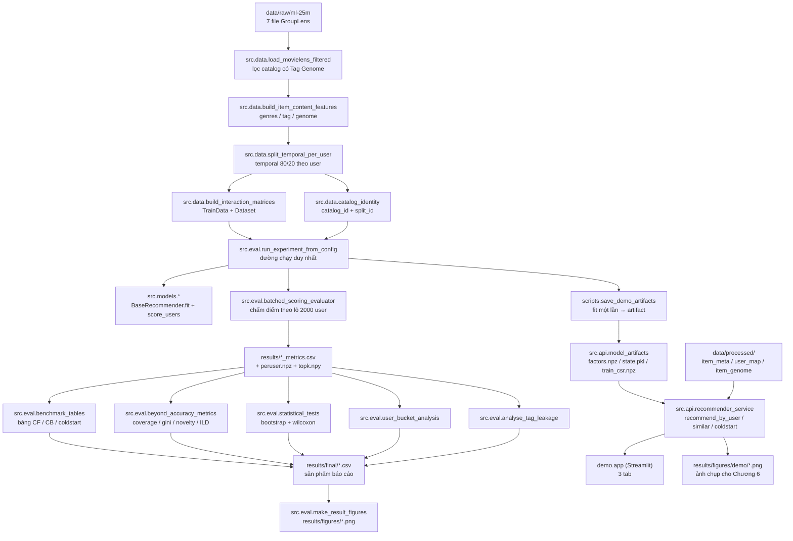

# System Architecture

Mô tả luồng dữ liệu, hợp đồng API giữa các tầng, và các hàng rào chống rò rỉ (leakage)
được cài đặt bằng **cấu trúc** chứ không bằng quy ước miệng.

Đọc kèm: [`codebase-summary.md`](codebase-summary.md).

---

## 1. Sơ đồ tổng thể



### 1.1 Hai đường chạy độc lập

Sơ đồ trên có **hai nhánh tách biệt** từ cùng một tập mô hình:

| Nhánh | Mục đích | Đọc nhãn test? | Artifact |
|---|---|---|---|
| **Offline** (`src.eval.*`) | Chấm điểm, sinh `results/final/` | ✅ Có | `*_topk.npy`, `*_peruser.npz` |
| **Serving** (`src.api.*` → `demo/`) | Trả gợi ý cho người dùng | ❌ **Không** | `demo/artifacts/` |

Ranh giới này được cài bằng **cấu trúc**: `src/api/` **không import `src.eval.*`**, và
`src.api.model_artifacts` chỉ nhận `TrainData` — không có đường nào để lấy nhãn test.
Nhờ vậy demo dùng **đúng mô hình** đã chạy trong báo cáo mà vẫn không thể rò rỉ.

---

## 2. Tầng và hợp đồng

### 2.1 Tầng dữ liệu — `TrainData` vs `Dataset`

Đây là **hàng rào quan trọng nhất** của kiến trúc:

```python
@dataclass
class TrainData:
    train_csr: sparse.csr_matrix   # [n_users, n_items], giá trị = rating
    train_df: pd.DataFrame          # train dạng bảng (cột ts cho time-decay)
    n_users: int
    n_items: int

@dataclass
class Dataset:
    train: TrainData
    test_rel_csr: sparse.csr_matrix # [n_users, n_items], 1 nếu rating >= ngưỡng
    eval_users: np.ndarray
```

Mô hình chỉ nhận `TrainData` qua chữ ký `fit(train, item_features)`. Nó **không có
đường nào** tới `test_rel_csr` — kể cả do gõ nhầm. Lý do không dùng unit test để chặn:
`train_csr` và `test_rel_csr` cùng shape và dtype, nên gõ nhầm vẫn chạy trơn tru và chỉ
metric là nhảy vọt — test sẽ báo "sai" mà không chỉ ra được nguyên nhân.

### 2.2 Hợp đồng mô hình — `BaseRecommender`

```python
class BaseRecommender(ABC):
    def fit(self, train: TrainData, item_features: dict) -> "BaseRecommender": ...
    def score_users(self, user_idx: np.ndarray) -> np.ndarray: ...
```

`score_users` trả ma trận float32 `[batch_size, n_items]` — **không** loại item đã xem.
Việc mask lịch sử thuộc về evaluator (`src/models/seen_item_masking.py`), một chỗ duy nhất
cho mọi mô hình.

Tách `fit` khỏi `score_users` là điều kiện để chấm điểm theo lô: ma trận
`[158.774, 13.816]` float32 là **8,9 GB**, không khả thi. Chấm theo lô 2.000 user giữ
bộ nhớ ở mức ~110 MB.

### 2.3 Tầng đánh giá

```mermaid
flowchart LR
    cfg["configs/*.yaml"] --> rec["run_experiment_from_config"]
    rec --> load["load_dataset(users, split_dir)"]
    load --> fit["model.fit(train, features)"]
    fit --> score["evaluate_model: batch 2000 user"]
    score --> mask["mask lịch sử train"]
    mask --> topk["top-k (k=50)"]
    topk --> metric["P@k R@k HR@k NDCG@k per-user"]
    metric --> save["metrics.csv + peruser.npz + topk.npy"]
```



`run_experiment_from_config` là **đường chạy duy nhất** cho mọi thí nghiệm. Nhờ vậy mọi
mô hình dùng chung: cùng định nghĩa metric, cùng cách chia, cùng cách mask lịch sử.

### 2.4 Bằng chứng protocol

Mỗi dòng `{exp}_metrics.csv` mang `split_id` + `catalog_id` + `seed`:

| Cột | Nghĩa | Cách sinh |
|---|---|---|
| `split_id` | `temporal80_20` hoặc `temporal80_20+coldstart_item` | `src/data/catalog_identity.py::split_id` |
| `catalog_id` | `ml25m-n13816-<hash 12 ký tự>` — hash tập `movieId` đã sắp xếp | `src/data/catalog_identity.py::catalog_id` |
| `seed` | 42 | `src/paths.py::SEED` |

Không có các cột này, "cùng giao thức" chỉ là lời tuyên bố — dấu vết duy nhất là tiền tố
trong tên file, mà đổi tên file là mất dấu vết. Test
`test_final_tables_have_protocol_evidence` chặn việc bảng báo cáo mất các cột này.

---

## 3. Ba giao thức đánh giá

| Giao thức | `users` | `split_dir` | Kết quả | Dùng để |
|---|---|---|---|---|
| `dev` | 20.000 | — | `results/{exp}_metrics.csv` | **chọn tham số** (sweep 159 config) |
| `full` | 158.774 | — | `results/full_{exp}_metrics.csv` | bảng chính — chạy **một lần** sau khi khoá config |
| `coldstart` | 20.000 | `data/processed/coldstart` | `results/coldstart_{exp}_metrics.csv` | cold-start **item** |

Nguyên tắc: **chọn tham số trên `dev`, báo cáo trên `full`.** Script
`run_shared_benchmark.py` `--als-sweep` chỉ cho phép chạy sweep trên `dev` (raise nếu
`--protocol full`) để chặn việc tinh chỉnh trên tập báo cáo.

### 3.1 Split cold-start item

`src/eval/cold_start_item_split.py` giữ lại 10% phim theo **5 nhóm năm phát hành** (phân
vị, không phải ngẫu nhiên đều — phim mới vốn ít tương tác, bốc ngẫu nhiên sẽ làm bài toán
dễ hơn thực tế). Mọi tương tác train của các phim held-out bị xoá.

Số cột item giữ nguyên 13.816 → mọi thuật toán vẫn xếp hạng trên cùng tập ứng viên, và
điểm 0 của CF vẫn được đặt cạnh điểm thật của CB.

### 3.2 Giao thức thay thế: sampled LOO

`src/eval/sampled_loo_evaluator.py` — LOO + 100 negative (He et al. 2017). Mục đích
**không phải** để có thêm một bảng số, mà để đo Kendall τ giữa hai bảng thứ hạng, biến
lựa chọn "full ranking" từ một câu trích dẫn thành kết quả thực nghiệm.

---

## 4. Hàng rào chống rò rỉ

| Rào | Cơ chế | Test |
|---|---|---|
| Mô hình không thấy nhãn test | `fit(train: TrainData)` — không có `Dataset` | `test_eval_leakage_guards.py` |
| Item ngoài catalog | `gather_relevance` **raise** khi có index ngoài `[0, n_items)` | `test_eval_leakage_guards.py` |
| User không có tín hiệu train | metric = 0 **một cách có nguyên tổ chức**, vẫn ở lại tập đánh giá | `test_eval_leakage_guards.py` |
| Ghép cặp thống kê | `load_all` raise khi tập user lệch giữa hai mô hình | `test_phase4_beyond_accuracy.py` |
| Chiều thời gian | split per-user, sort theo `(user_idx, ts, item_idx)` | `test_split_temporal_per_user.py` |
| Rò rỉ tag theo thời kỳ | bảng phân tầng 3 kỷ nguyên + Pearson/Spearman với popularity | `test_phase4_protocols.py` |

### 4.1 Rò rỉ tag — vì sao phải đo

Metadata của bài toán này là **hậu kỳ** (post-hoc): `genome-scores.csv` không có
timestamp — GroupLens tính toàn bộ ngoài dõi. Đặc trưng content vì thế "biết" phim trong
tương lai.

Hai hệ quả đo được:

1. **Pearson(số tag của phim, độ phổ biến) = 0,768** — phim càng nhiều tag càng phổ biến.
   Tag và popularity không độc lập, nên một mô hình content dựa trên tag cũng dựng được
   một phần tín hiệu phổ biến.
2. **Bảng phân tầng kỷ nguyên** (`results/final/tag-leakage-strata.csv`): thứ hạng
   **không đảo chiều** theo thời kỳ user — CB-2 ≥ CB-1 > CB-3 ở cả ba tầng
   (< 2006 / 2006–2012 / ≥ 2012). Riêng "chỉ genres" (không rò rỉ) đạt 0,0026–0,0060 ở
   mọi tầng, tức phần lớn lợi thế của tag là do **tính chất nội dung**, không phải do rò
   rỉ thời gian.

Kết luận này phải được nêu trong báo cáo: số tuyệt đối lạc quan hơn môi trường
production, nhưng **so sánh giữa các mô hình công bằng** vì điều kiện như nhau.

---

## 5. Điểm nghẽn hiệu năng đã biết

| Vấn đề | Kích thước | Xử lý |
|---|---|---|
| Ma trận điểm đầy đủ | `[158.774, 13.816]` float32 = 8,9 GB | Chấm theo lô 2.000 user (~110 MB) |
| Ma trận tương đồng Item-CF | cosine đầy đủ = 763 MB dense | Cắt top-k, cache theo khoá `(đặc trưng, tham số)` |
| `implicit` + OpenBLAS nhiều luồng | BPR chạy 40s thay vì 7s | `num_threads=1` để **tái lập được** tuyệt đối |
| `pandas` đọc lại `item_meta` | lặp lại trong `build_split` | Chỉ đọc cột `item_idx` |

---

## 6. Quyết định thiết kế và lý do

| Quyết định | Lý do |
|---|---|
| Hub là `RecommendationSystem`, `recommendation-cb` được **port code** sang | Không dùng dependency / path phụ thuộc; một nguồn sự thật |
| Lọc catalog theo Tag Genome (13.816 phim) | Mọi mô hình so sánh trên cùng tập ứng viên; giữ 98,7% rating |
| Split temporal per-user 80/20 | Đánh giá được 158.774 user thay vì 4.587 |
| Full ranking, không sampled | Chấm điểm trên 13.816 ứng viên thật; sampled LOO có thể đảo thứ hạng (Krichene & Rendle 2020) |
| CF confidence = `1 + α`, chỉ tương tác relevant | `implicit` coi giá trị là `c_ui`; giữ rating thấp làm mô hình học sai |
| Bảng CF và CB **tách riêng** | Trả lời hai câu hỏi khác nhau; Wilcoxon chỉ chạy trong từng bảng |
| Bản chính CB-4 **không** pop prior | Bản có prior đạt NDCG@10 cao hơn ở giao thức thường nhưng **sụp** ở cold-start (0,0010) |
| Xoá hẳn protocol cũ | Hai evaluator cùng tồn tại gây nhầm số liệu |
