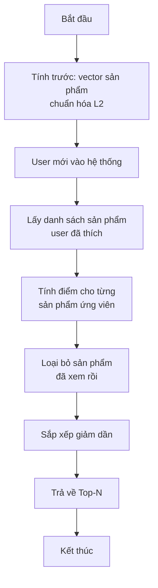
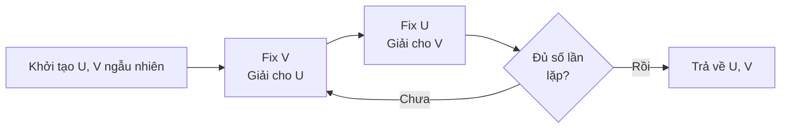
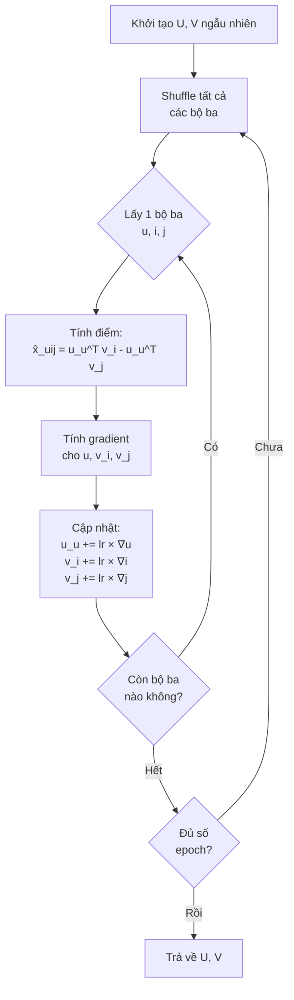

# Lý Thuyết Các Phương Pháp Collaborative Filtering

> **Dành cho người mới:** Document này giải thích 3 phương pháp Collaborative Filtering (CF) mà dự án sử dụng. Mỗi phương pháp được trình bày theo thứ tự: **ví dụ đời thường → ý tưởng chính → công thức toán → cách dùng trong code**.

## Tóm tắt

Có ba cách chính để gợi ý sản phẩm trong dự án này:

1. **Item-based Collaborative Filtering** (Item-CF) — Gợi ý dựa trên "các sản phẩm tương tự nhau"
2. **ALS (Alternating Least Squares)** — Tìm "hồ sơ sở thích ẩn" cho mỗi người và mỗi sản phẩm
3. **BPR (Bayesian Personalized Ranking)** — Học cách **xếp hạng** sản phẩm theo từng cặp

> **Mẹo đọc:** Nếu bạn mới bắt đầu, hãy đọc phần "Ví dụ đời thường" và "Ý tưởng chính" trước. Phần toán có thể đọc sau khi đã hiểu bức tranh tổng thể.

---

## 1. Item-based Collaborative Filtering

### 1.1 Ví dụ đời thường

Hãy tưởng tượng bạn vào một hiệu sách. Người bán hàng không biết bạn thích gì, nhưng anh ấy biết: **những ai mua cuốn "Nhà Giả Kim" thường cũng mua cuốn "Sự Giàu Sang Bất Ngờ"**. Vì vậy, anh ấy gợi ý cuốn thứ hai cho bạn.

**Item-based CF hoạt động y hệt như vậy:**
- Thay vì tìm "người giống bạn", nó tìm **"sản phẩm giống sản phẩm bạn đã thích"**
- Nếu nhiều người cùng thích sản phẩm A và sản phẩm B, thì khả năng cao bạn cũng sẽ thích B nếu bạn đã thích A.

**Tại sao cách này tốt trong thực tế:**
- Danh sách sản phẩm ít thay đổi hơn so với người dùng mới vào hệ thống
- Có thể tính toán trước "sản phẩm nào giống sản phẩm nào" và lưu lại
- Khi có người dùng mới, chỉ cần tra cứu là xong, không cần tính lại từ đầu

**Ứng dụng thực tế:**
- Tiki, Shopee: "Khách hàng mua sản phẩm này cũng mua..."
- YouTube: "Vì bạn đã xem A, có thể bạn sẽ thích B"
- Spotify: "Bài hát tương tự"

### 1.2 Ý tưởng chính

**Trong một câu:** *Tìm những sản phẩm giống với sản phẩm người dùng đã thích, rồi gợi ý chúng.*

### 1.3 Ví dụ nhỏ để hiểu

Giả sử ta có 3 người dùng (A, B, C) và 4 bộ phim (P1, P2, P3, P4). Điểm từ 0 (không thích) đến 5 (rất thích):

| Người dùng | P1 | P2 | P3 | P4 |
|---|---|---|---|---|
| **A** | 5 | 4 | 0 | 0 |
| **B** | 4 | 5 | 0 | 0 |
| **C** | 0 | 0 | 5 | 4 |

**Quan sát:** Người A và B cùng thích P1, P2. Người C thích P3, P4.

**Câu hỏi:** Người A chưa xem P3 và P4. Có nên gợi ý P3 hoặc P4 cho A không?

**Trả lời ngắn:** Không nên, vì những người thích P1, P2 (A, B) đều **không thích** P3, P4.

**Cách tính độ giống nhau giữa 2 phim (Cosine Similarity):**

Xem mỗi phim là một vector điểm số từ các người dùng:
- P1 = [5, 4, 0]
- P2 = [4, 5, 0]
- P3 = [0, 0, 5]
- P4 = [0, 0, 4]

Độ giống nhau = cosin của góc giữa 2 vector. Kết quả:
- sim(P1, P2) ≈ 0.98 (rất giống)
- sim(P1, P3) = 0.00 (không liên quan)
- sim(P3, P4) ≈ 0.98 (rất giống)

### 1.4 Công thức toán học

**Độ tương đồng giữa 2 sản phẩm (Cosine Similarity):**

Cho hai sản phẩm \(i\) và \(j\), độ tương đồng được tính trên không gian người dùng:

$$
\text{sim}(i, j) = \frac{\mathbf{r}_i \cdot \mathbf{r}_j}{\|\mathbf{r}_i\| \|\mathbf{r}_j\|}
$$

Trong đó:
- \(\mathbf{r}_i\): vector điểm số của sản phẩm \(i\) từ tất cả người dùng
- \(\mathbf{r}_j\): vector điểm số của sản phẩm \(j\) từ tất cả người dùng
- \(\|\cdot\|\): độ dài vector (norm L2)
- \(\cdot\): tích vô hướng

**Điểm gợi ý cho người dùng \(u\) với sản phẩm \(j\):**

$$
\text{score}(u, j) = \sum_{i \in I_u} \text{sim}(i, j) \times r_{ui}
$$

Trong đó:
- \(I_u\): tập sản phẩm người dùng \(u\) đã tương tác
- \(r_{ui}\): điểm người dùng \(u\) cho sản phẩm \(i\)

**Cách làm việc:**
1. Tính điểm cho tất cả sản phẩm ứng viên
2. Loại bỏ sản phẩm người dùng đã tương tác
3. Sắp xếp giảm dần theo điểm
4. Trả về top N sản phẩm

### 1.5 Thuật toán



### 1.6 Phân tích độ phức tạp (đơn giản hóa)

**Thời gian tính toán:**
- **Giai đoạn chuẩn bị (offline):** Tính toán độ giống giữa các cặp sản phẩm. Nhiều sản phẩm → mất nhiều thời gian hơn.
- **Giai đoạn gợi ý (online, mỗi khi có request):** Nhanh nếu đã tính trước được độ giống giữa các sản phẩm.

**Bộ nhớ:**
- Lưu ma trận độ giống: tốn bộ nhớ khi có nhiều sản phẩm (ví dụ: 100,000 sản phẩm → 10 tỷ cặp)
- **Mẹo:** Thực tế chỉ cần lưu top-K sản phẩm giống nhất cho mỗi sản phẩm (ví dụ: top 50), tiết kiệm bộ nhớ rất nhiều.

**Một số cách tối ưu:**
1. **Top-K Similarity:** Chỉ lưu K sản phẩm giống nhất cho mỗi sản phẩm
2. **Sparse Matrix:** Dùng ma trận thưa (scipy.sparse) để tiết kiệm bộ nhớ
3. **Tính theo lô:** Tính độ giống theo từng nhóm nhỏ thay vì toàn bộ

### 1.7 Ưu và nhược điểm

**Ưu điểm:**
- Ổn định: danh sách sản phẩm ít thay đổi hơn sở thích người dùng
- Có thể giải thích được: "Vì bạn thích X nên gợi ý Y"
- Có thể tính trước offline, gợi ý online rất nhanh
- Người dùng mới chỉ cần 1 tương tác là có thể gợi ý được ngay

**Nhược điểm:**
- Sản phẩm mới chưa có ai đánh giá → không gợi ý được (gọi là "cold-start")
- Có xu hướng gợi ý các sản phẩm phổ biến (popularity bias)
- Tốn bộ nhớ khi có nhiều sản phẩm
- Khó khám phá sản phẩm mới lạ cho người dùng (filter bubble)

### 1.8 Chi tiết triển khai

**Code tham khảo:** [`src/recommenders/item_cf.py`](../src/recommenders/item_cf.py)

**Những quyết định thiết kế chính:**

1. **Chuẩn hóa L2** — đảm bảo cosine similarity chỉ phụ thuộc vào hướng vector, không phụ thuộc độ dài:
   ```python
   from sklearn.preprocessing import normalize
   normalized_item_user = normalize(item_user_csr, norm='l2', axis=1)
   ```

2. **Dùng ma trận thưa** — tiết kiệm bộ nhớ vì hầu hết người dùng chỉ tương tác với một phần nhỏ sản phẩm:
   ```python
   from scipy.sparse import csr_matrix
   similarities = normalized_item_user.dot(target_item_vector)
   ```

3. **Cách tính điểm gợi ý:** Cộng dồn điểm từ tất cả sản phẩm người dùng đã thích, mỗi sản phẩm đóng góp theo độ giống với sản phẩm ứng viên.

> **Tóm tắt một câu:** Item-CF tính "sản phẩm nào giống sản phẩm nào", rồi gợi ý cho người dùng những sản phẩm giống với những gì họ đã thích.

---

## 2. ALS (Alternating Least Squares) Matrix Factorization

### 2.1 Ví dụ đời thường

Hãy tưởng tượng mỗi người dùng có một **"hồ sơ sở thích ẩn"** mà ta không nhìn thấy trực tiếp. Ví dụ:

- **Anh A** thích: Hành động 70%, Lãng mạn 10%, Khoa học viễn tưởng 90%
- **Phim "Inception"** thuộc: Hành động 90%, Lãng mạn 20%, Khoa học viễn tưởng 80%

Nếu ta biết "hồ sơ ẩn" của anh A và của phim, ta có thể dự đoán anh A có thích Inception hay không bằng cách **nhân các con số tương ứng rồi cộng lại**:

$$0.7 \times 0.9 + 0.1 \times 0.2 + 0.9 \times 0.8 = 1.37$$

**ALS làm điều này:** Nó tự động "khám phá" hồ sơ ẩn này từ dữ liệu người dùng đã tương tác.

**Tại sao cần ALS?**
- Item-based CF hoạt động tốt khi có điểm đánh giá rõ ràng (1-5 sao). Nhưng trong thực tế, nhiều khi ta chỉ biết người dùng đã click, xem, mua → đây gọi là **implicit feedback** (phản hồi ngầm).
- ALS được thiết kế đặc biệt cho loại dữ liệu này: **biết rằng người dùng có tương tác** (không biết họ thích hay không thích).

### 2.2 Ý tưởng chính

**Trong một câu:** *Biểu diễn mỗi người dùng và sản phẩm bằng một vector nhỏ gọi là "latent factors", rồi dự đoán điểm bằng tích vô hướng của 2 vector.*

### 2.3 Ví dụ nhỏ để hiểu

Giả sử ta có ma trận người dùng - sản phẩm (R), trong đó 1 = đã tương tác, 0 = chưa tương tác:

| | S1 | S2 | S3 | S4 |
|---|---|---|---|---|
| **U1** | 1 | 1 | 0 | 0 |
| **U2** | 1 | 1 | 0 | 0 |
| **U3** | 0 | 0 | 1 | 1 |
| **U4** | 0 | 0 | 1 | 1 |

**Mục tiêu của ALS:** Tìm 2 ma trận nhỏ hơn (U cho người dùng, V cho sản phẩm) sao cho khi nhân U × Vᵀ, ta xấp xỉ được ma trận R.

Ví dụ với k = 2 (chỉ 2 chiều ẩn):
- Ma trận U (4 người dùng × 2 chiều): mỗi hàng là "vector sở thích" của 1 người
- Ma trận V (4 sản phẩm × 2 chiều): mỗi hàng là "vector đặc trưng" của 1 sản phẩm

Khi nhân U × Vᵀ, ta hy vọng thu được gần giống ma trận R ban đầu. Và điểm hay là: các ô chưa tương tác (0) giờ có **giá trị thực** → đây chính là dự đoán điểm sở thích.

### 2.4 Nền tảng Matrix Factorization

**Phân tích ma trận:**

$$
\mathbf{R} \approx \mathbf{U} \times \mathbf{V}^T
$$

Trong đó:
- \(\mathbf{R} \in \mathbb{R}^{m \times n}\): ma trận người dùng - sản phẩm
- \(\mathbf{U} \in \mathbb{R}^{m \times k}\): ma trận vector người dùng
- \(\mathbf{V} \in \mathbb{R}^{n \times k}\): ma trận vector sản phẩm
- \(k\): số chiều ẩn (latent dimensions), thường từ 32 đến 200

**Intuition về Latent Factors:**

Mỗi người dùng và sản phẩm được biểu diễn trong không gian \(k\)-chiều. Ví dụ với phim:
- \(\mathbf{v}_{\text{Inception}} = [0.9_{\text{Action}}, 0.2_{\text{Romance}}, 0.8_{\text{SciFi}}]\)
- \(\mathbf{u}_{\text{Alice}} = [0.7_{\text{Action}}, 0.1_{\text{Romance}}, 0.9_{\text{SciFi}}]\)
- Điểm dự đoán: \(\mathbf{u}_{\text{Alice}}^T \mathbf{v}_{\text{Inception}} = 0.9 \times 0.7 + 0.2 \times 0.1 + 0.8 \times 0.9 = 1.37\)

**Tại sao Matrix Factorization tốt:**
- Nén dữ liệu thưa thành dạng nhỏ gọn
- Khám phá các mẫu ẩn mà mắt thường không thấy
- Dự đoán được cho các cặp người dùng - sản phẩm chưa tương tác
- Tính nhanh: chỉ cần phép nhân vector khi dự đoán

### 2.5 Công thức cho Implicit Feedback

**Bài báo tham khảo:** Hu, Y., Koren, Y., & Volinsky, C. (2008). "Collaborative Filtering for Implicit Feedback Datasets." ICDM.

**Khái niệm Preference (sở thích) và Confidence (độ tin cậy):**

ALS phân biệt 2 khái niệm quan trọng:
- **Preference** \(p_{ui}\): có tương tác hay không (0 hoặc 1)
- **Confidence** \(c_{ui}\): mức độ tin tưởng vào preference đó

**Preference (có hoặc không):**

$$
p_{ui} = \begin{cases}
1 & \text{nếu người dùng } u \text{ đã tương tác với sản phẩm } i \\
0 & \text{ngược lại}
\end{cases}
$$

**Confidence (độ tin cậy):**

$$
c_{ui} = 1 + \alpha \cdot r_{ui}
$$

Trong đó:
- \(r_{ui}\): số lần tương tác (số lần xem, số lần mua, v.v.)
- \(\alpha\): hệ số điều chỉnh (mặc định 1.0, thường từ 1 đến 40)

**Ví dụ dễ hiểu về Confidence:**
- Bạn xem 1 video 1 lần → có thể chỉ tò mò, độ tin cậy thấp
- Bạn xem 1 video 100 lần → chắc chắn thích, độ tin cậy cao
- ALS sẽ "lắng nghe" các tương tác nhiều lần hơn so với tương tác 1 lần

**Hàm mục tiêu (Objective Function):**

$$
\min_{\mathbf{U}, \mathbf{V}} \sum_{u,i} c_{ui} (p_{ui} - \mathbf{u}_u^T \mathbf{v}_i)^2 + \lambda \left( \sum_u \|\mathbf{u}_u\|^2 + \sum_i \|\mathbf{v}_i\|^2 \right)
$$

**Giải thích từng phần:**
- **Sai số có trọng số:** \(c_{ui} (p_{ui} - \mathbf{u}_u^T \mathbf{v}_i)^2\) — tương tác nào có confidence cao thì sai số bị phạt nặng hơn
- **Regularization L2:** \(\lambda (\|\mathbf{U}\|^2 + \|\mathbf{V}\|^2)\) — giữ cho vector không quá lớn, tránh overfitting

**So với Matrix Factorization thông thường:**
- MF thường: chỉ tối ưu trên các ô đã tương tác (rất ít so với tổng số ô)
- ALS for implicit: tối ưu trên **tất cả** các ô (m × n), nhưng với trọng số confidence khác nhau

### 2.6 Thuật toán Alternating Least Squares

**Ý tưởng cốt lõi:**

Tối ưu đồng thời cả U và V rất khó (bài toán không lồi). Nhưng nếu ta **cố định U rồi tối ưu V**, hoặc ngược lại, bài toán trở thành **lồi** và có công thức giải chính xác. Vì vậy, ta luân phiên: fix U → giải V → fix V → giải U → lặp lại.



**Thuật toán chi tiết:**

```text
Thuật toán: ALS-Implicit(R, k, λ, α, iterations)

Đầu vào:
  - R: ma trận tương tác người dùng - sản phẩm (m × n)
  - k: số chiều ẩn
  - λ: hệ số regularization
  - α: hệ số confidence
  - iterations: số vòng lặp

Khởi tạo:
  - U ← ma trận ngẫu nhiên (m × k)
  - V ← ma trận ngẫu nhiên (n × k)

Lặp từ 1 đến iterations:

  # Bước 1: Cố định V, tối ưu U
  Với mỗi người dùng u = 1 đến m:
    Tạo ma trận đường chéo confidence: C^u
    Giải: u_u = (V^T C^u V + λI)^(-1) V^T C^u p_u

  # Bước 2: Cố định U, tối ưu V
  Với mỗi sản phẩm i = 1 đến n:
    Tạo ma trận đường chéo confidence: C^i
    Giải: v_i = (U^T C^i U + λI)^(-1) U^T C^i p_i

Trả về U, V
```

**Tính chất quan trọng:**

1. **Có công thức chính xác:** Không cần gradient descent, mỗi bài toán con giải được bằng công thức đóng
2. **Lồi:** Khi cố định 1 ma trận, bài toán con là lồi
3. **Hội tụ đảm bảo:** Loss giảm đơn điệu theo từng vòng lặp
4. **Song song được:** Các người dùng (và sản phẩm) có thể được cập nhật song song độc lập

### 2.7 Sinh gợi ý

**Công thức điểm:**

Cho người dùng \(u\) và sản phẩm \(i\), điểm dự đoán:

$$
\hat{r}_{ui} = \mathbf{u}_u^T \mathbf{v}_i = \sum_{f=1}^{k} u_{uf} \cdot v_{if}
$$

**Quy trình gợi ý Top-N:**

```python
def recommend(user_id, n=10):
    # 1. Lấy vector người dùng
    user_vector = U[user_id]  # shape: (k,)

    # 2. Tính điểm cho tất cả sản phẩm
    scores = V.dot(user_vector)  # shape: (n_items,)

    # 3. Loại bỏ sản phẩm đã tương tác
    seen_items = get_user_interactions(user_id)
    scores[seen_items] = -inf

    # 4. Lấy top-N
    top_n_indices = np.argsort(scores)[::-1][:n]
    return top_n_indices
```

**Lưu ý về điểm số:**
- Điểm cao → dự đoán thích nhiều hơn
- Điểm chỉ mang tính **tương đối**, không phải xác suất
- Có thể âm (vì vector ẩn có thể có giá trị âm)
- Dùng để **xếp hạng**, không dùng để dự đoán điểm số cụ thể

### 2.8 Hyperparameters (Tham số cần tinh chỉnh)

| Tham số | Ký hiệu | Mô tả | Khoảng thường dùng | Tác động |
|---|---|---|---|---|
| **Factors** | \(k\) | Số chiều ẩn | 20-200 | Cao hơn: biểu diễn phong phú hơn nhưng chậm hơn |
| **Regularization** | \(\lambda\) | Độ phạt L2 | 0.001-0.1 | Cao hơn: tránh overfit nhưng có thể underfit |
| **Iterations** | \(T\) | Số vòng lặp ALS | 10-50 | Nhiều hơn: hội tụ tốt hơn nhưng lợi ích giảm dần |
| **Alpha** | \(\alpha\) | Hệ số confidence | 1-40 | Cao hơn: tin tưởng tương tác nhiều hơn |

**Hướng dẫn tinh chỉnh:**
1. **Khởi đầu:** k=64, λ=0.01, α=1.0, iterations=15
2. **Grid search:** Thử k ∈ {32, 64, 128}, λ ∈ {0.01, 0.1}
3. **Theo dõi:** Loss huấn luyện nên giảm đơn điệu
4. **Đánh giá:** Dùng ranking metrics (NDCG@K, HitRate@K)

### 2.9 Độ phức tạp tính toán

**Mỗi vòng lặp:**

**Thời gian:**
$$
O(k^2(m + n) + k \cdot \text{nnz}(\mathbf{R}))
$$

Tóm gọn:
- Cập nhật tất cả người dùng: tốn \(O(k^2 m)\)
- Cập nhật tất cả sản phẩm: tốn \(O(k^2 n)\)
- Phép toán ma trận thưa: tốn \(O(k \cdot \text{nnz}(\mathbf{R}))\)

**Bộ nhớ:**
$$
O(k(m + n) + \text{nnz}(\mathbf{R}))
$$

Tóm gọn:
- Vector người dùng: \(O(km)\)
- Vector sản phẩm: \(O(kn)\)
- Ma trận tương tác: \(O(\text{nnz}(\mathbf{R}))\)

**Hiệu năng thực tế:**

Tập dữ liệu MovieLens 25M (162,000 người dùng, 59,000 phim, 25 triệu ratings):
- Cấu hình: k=64, iterations=15, 16 CPU cores
- Thời gian huấn luyện: ~5-10 phút
- Song song hóa: gần tuyến tính (các người dùng/sản phẩm độc lập)

**Khả năng mở rộng:**
- Xử lý được hàng triệu người dùng/sản phẩm
- Các phép toán ma trận thưa rất quan trọng (hầu hết các ô là 0)
- Đã có triển khai phân tán (Spark MLlib)

### 2.10 Ưu và nhược điểm

**Ưu điểm:**
- Phù hợp tự nhiên với implicit feedback (click, xem, mua)
- Xử lý tất cả các ô (đã quan sát và chưa quan sát)
- Confidence weighting nắm bắt được sự không chắc chắn
- Có thể mở rộng: phép toán ma trận thưa, song song được
- Huấn luyện nhanh: có công thức chính xác, không cần tinh chỉnh learning rate
- Phương pháp trưởng thành: đã được chứng minh trong sản xuất (Spotify, Netflix)

**Nhược điểm:**
- Cold-start: người dùng/sản phẩm mới chưa có tương tác → không gợi ý được
- Nhạy với hyperparameter: cần tinh chỉnh k, λ, α
- Xu hướng gợi ý sản phẩm phổ biến (popularity bias)
- Khó giải thích: latent factors không có ý nghĩa rõ ràng
- Giả định tuyến tính: \(\mathbf{u}^T \mathbf{v}\) có thể không nắm bắt được mối quan hệ phức tạp

### 2.11 Chi tiết triển khai

**Tài liệu tham khảo:**
- Code: [`src/recommenders/als_recommender.py`](../src/recommenders/als_recommender.py)
- Thư viện: `implicit.als.AlternatingLeastSquares`
- Bài báo: Hu, Y., Koren, Y., & Volinsky, C. (2008). ICDM.

**Những quyết định thiết kế chính:**

```python
from implicit.als import AlternatingLeastSquares

class ALSRecommender:
    def __init__(self, factors=64, regularization=0.01,
                 iterations=15, alpha=1.0):
        self.model = AlternatingLeastSquares(
            factors=factors,
            regularization=regularization,
            iterations=iterations,
            random_state=42,
            calculate_training_loss=True
        )
        self.alpha = alpha

    def fit(self, train_implicit_df):
        # Chuyển thành ma trận có trọng số confidence
        # c_ui = 1 + alpha * r_ui
        confidence_matrix = self._build_confidence_matrix(
            train_implicit_df, alpha=self.alpha
        )
        # Huấn luyện mô hình (định dạng item_user cho implicit)
        self.model.fit(confidence_matrix.T.tocsr())
        return self
```

**Binary vs Weighted Matrix:**
- **ALS:** Ma trận confidence có trọng số (c_ui = 1 + α × r_ui)
- **BPR:** Ma trận binary (p_ui ∈ {0, 1})

**Các công thức Confidence:**
1. **Tuyến tính:** \(c_{ui} = 1 + \alpha r_{ui}\) (mặc định)
2. **Logarit:** \(c_{ui} = 1 + \alpha \log(1 + r_{ui})\) (khi số lần tương tác phân bố lệch)
3. **Binary:** \(c_{ui} = 1 + \alpha \cdot \mathbb{1}[r_{ui} > 0]\) (confidence đồng đều)

> **Tóm tắt một câu:** ALS tìm "vector sở thích ẩn" cho người dùng và sản phẩm bằng cách luân phiên tối ưu, với trọng số confidence cho biết mức độ tin tưởng vào mỗi tương tác.

---

## 3. BPR (Bayesian Personalized Ranking)

### 3.1 Ví dụ đời thường

Hãy tưởng tượng bạn đang ở nhà hàng buffet:
- Bạn đã ăn pizza (rất ngon) và chưa ăn bông cải xanh
- Câu hỏi: **Pizza có hợp khẩu vị của bạn hơn bông cải xanh không?**

Câu trả lời rõ ràng là: Pizza hợp hơn. BPR học chính xác loại so sánh này:

> "Với người dùng U: sản phẩm i (đã thích) **nên được xếp hạng cao hơn** sản phẩm j (chưa thích)"

**So sánh với ALS:**
- ALS cố gắng dự đoán **điểm số chính xác** (ví dụ: bạn sẽ rate phim này 4.2 sao)
- BPR chỉ cần học **thứ hạng** (phim A xếp trên phim B là đủ)
- Cho bài toán "Top-N gợi ý", thứ hạng quan trọng hơn điểm số chính xác

**Tại sao BPR tốt cho ranking:**
- Mục tiêu huấn luyện khớp với mục tiêu đánh giá (NDCG@K, HitRate@K)
- Nhiều tín hiệu huấn luyện: từ vài nghìn tương tác có thể tạo ra hàng triệu cặp so sánh
- Không giả định "chưa tương tác = không thích" (rất quan trọng trong implicit feedback)

### 3.2 Ý tưởng chính

**Trong một câu:** *Thay vì dự đoán điểm số, học cách xếp hạng các sản phẩm bằng cách so sánh từng cặp (sản phẩm đã thích vs. chưa thích).*

### 3.3 Ví dụ nhỏ để hiểu

Giả sử người dùng A đã thích: Phim P1, P2, P3. Chưa xem: P4, P5, P6.

**BPR tạo ra các bộ ba (triplet) (user, liked, not_liked):**
- (A, P1, P4), (A, P1, P5), (A, P1, P6)
- (A, P2, P4), (A, P2, P5), (A, P2, P6)
- (A, P3, P4), (A, P3, P5), (A, P3, P6)

Tổng cộng: 3 × 3 = 9 bộ ba. Mỗi bộ ba nói: "Người dùng A thích P1 hơn P4", v.v.

**Mục tiêu:** Điều chỉnh vector người dùng và sản phẩm sao cho:
- Điểm(u, P1) > Điểm(u, P4)
- Điểm(u, P1) > Điểm(u, P5)
- ... (tương tự cho các cặp khác)

### 3.4 Nền tảng lý thuyết

**Bài báo tham khảo:** Rendle, S., Freudenthaler, C., Gantner, Z., & Schmidt-Thieme, L. (2009). "BPR: Bayesian Personalized Ranking from Implicit Feedback." UAI.

**Giả định xếp hạng theo cặp:**

Cho người dùng \(u\):
- **Sản phẩm tích cực** \(i\): người dùng đã tương tác (click, mua, đánh giá ≥ 4)
- **Sản phẩm tiêu cực** \(j\): người dùng chưa tương tác
- **Giả định:** Người dùng thích \(i\) hơn \(j\), viết là \(i >_u j\)

**Insight quan trọng:**
- "Chưa tương tác" không có nghĩa là "không thích" — chỉ là chưa biết
- Nhưng để xếp hạng, ta có thể giả định "đã thấy" > "chưa thấy"

### 3.5 Công thức toán học

**Thứ tự cá nhân hóa (Personalized Total Order):**

Cho mỗi người dùng \(u\), định nghĩa thứ tự ưu tiên trên các sản phẩm:

$$
>_u \subseteq I \times I
$$

Trong đó \(i >_u j\) nghĩa là người dùng \(u\) thích sản phẩm \(i\) hơn sản phẩm \(j\).

**Dữ liệu huấn luyện dưới dạng bộ ba (triplets):**

$$
D_S = \{(u, i, j) \mid i \in I_u^+ \land j \in I \setminus I_u^+\}
$$

Trong đó:
- \(I_u^+\): tập sản phẩm người dùng \(u\) đã tương tác (tích cực)
- \(I \setminus I_u^+\): tập sản phẩm người dùng \(u\) chưa tương tác

**Công thức Bayesian:**

BPR tối ưu hóa xác suất hậu định (posterior) của thứ tự xếp hạng:

$$
p(\Theta \mid >_u) \propto p(>_u \mid \Theta) \times p(\Theta)
$$

Trong đó:
- \(\Theta\): tham số mô hình (vector người dùng và sản phẩm)
- \(p(>_u \mid \Theta)\): likelihood của thứ tự quan sát được
- \(p(\Theta)\): prior (Gaussian để regularization)

**Likelihood (xác suất xếp hạng đúng):**

Giả định các bộ ba độc lập:

$$
p(>_u \mid \Theta) = \prod_{(u,i,j) \in D_S} p(i >_u j \mid \Theta)
$$

Xác suất mô hình xếp \(i\) trên \(j\):

$$
p(i >_u j \mid \Theta) = \sigma(\hat{x}_{uij})
$$

Trong đó:
- \(\sigma(x) = \frac{1}{1 + e^{-x}}\): hàm sigmoid
- \(\hat{x}_{uij} = \hat{x}_{ui} - \hat{x}_{uj}\): hiệu điểm

**Tiêu chí BPR-Opt:**

Tối đa hóa log-posterior (tương đương cực tiểu hóa âm log-posterior):

$$
\text{BPR-Opt} = \sum_{(u,i,j) \in D_S} \ln \sigma(\hat{x}_{uij}) - \lambda_\Theta \|\Theta\|^2
$$

**Các thành phần:**
- \(\ln \sigma(\hat{x}_{uij})\): log-likelihood của xếp hạng đúng
- \(\lambda_\Theta \|\Theta\|^2\): regularization L2 (ước lượng MAP)

**Intuition (trực giác):**
- Nếu \(\hat{x}_{ui} >> \hat{x}_{uj}\): mô hình tự tin, \(\sigma(\hat{x}_{uij}) \approx 1\), loss ≈ 0
- Nếu \(\hat{x}_{ui} \approx \hat{x}_{uj}\): mô hình không chắc chắn, \(\sigma(\hat{x}_{uij}) \approx 0.5\), loss âm nhẹ
- Nếu \(\hat{x}_{ui} < \hat{x}_{uj}\): xếp hạng sai, \(\sigma(\hat{x}_{uij}) < 0.5\), phạt nặng

### 3.6 Matrix Factorization cho BPR

**Hàm điểm:**

Dùng matrix factorization để tính điểm:

$$
\hat{x}_{ui} = \mathbf{u}_u^T \mathbf{v}_i = \sum_{f=1}^{k} u_{uf} \cdot v_{if}
$$

Trong đó:
- \(\mathbf{u}_u \in \mathbb{R}^k\): vector người dùng \(u\)
- \(\mathbf{v}_i \in \mathbb{R}^k\): vector sản phẩm \(i\)
- \(k\): số chiều embedding

**Hiệu điểm theo cặp:**

$$
\hat{x}_{uij} = \hat{x}_{ui} - \hat{x}_{uj} = \mathbf{u}_u^T (\mathbf{v}_i - \mathbf{v}_j)
$$

**Tham số:**

$$
\Theta = \{\mathbf{U}, \mathbf{V}\}
$$

Trong đó:
- \(\mathbf{U} \in \mathbb{R}^{m \times k}\): ma trận vector người dùng
- \(\mathbf{V} \in \mathbb{R}^{n \times k}\): ma trận vector sản phẩm

**Regularization:**

$$
\|\Theta\|^2 = \sum_u \|\mathbf{u}_u\|^2 + \sum_i \|\mathbf{v}_i\|^2
$$

### 3.7 Thuật toán học: BPR-Opt với SGD

**Stochastic Gradient Descent (SGD):**

Số lượng bộ ba rất lớn (có thể hàng tỷ), nên ta dùng SGD với sampling.



**Thuật toán chi tiết:**

```text
Thuật toán: LearnBPR(D_S, k, λ, learning_rate, iterations)

Đầu vào:
  - D_S: tập các bộ ba huấn luyện {(u, i, j)}
  - k: số chiều embedding
  - λ: hệ số regularization
  - learning_rate: tốc độ học SGD
  - iterations: số epoch huấn luyện

Khởi tạo:
  - U ← ma trận ngẫu nhiên (m × k)
  - V ← ma trận ngẫu nhiên (n × k)

Với mỗi epoch:
  Xáo trộn (shuffle) D_S

  Với mỗi bộ ba (u, i, j):
    # 1. Forward: tính hiệu điểm
    x̂_ui = u_u^T v_i
    x̂_uj = u_u^T v_j
    x̂_uij = x̂_ui - x̂_uj

    # 2. Tính đạo hàm sigmoid
    σ_uij = σ(-x̂_uij) = 1 / (1 + exp(x̂_uij))

    # 3. Cập nhật gradient
    ∇_u = σ_uij × (v_i - v_j) - λ × u_u
    u_u ← u_u + learning_rate × ∇_u

    ∇_i = σ_uij × u_u - λ × v_i
    v_i ← v_i + learning_rate × ∇_i

    ∇_j = σ_uij × (-u_u) - λ × v_j
    v_j ← v_j + learning_rate × ∇_j

Trả về U, V
```

**Chiến lược sampling:**

1. **Uniform Sampling:** Lấy mẫu ngẫu nhiên đồng đều các bộ ba
2. **Bootstrap Sampling:** Lấy mẫu có hoàn lại (cho phép lặp lại bộ ba)
3. **Negative Sampling:** Với mỗi (u, i) tích cực, lấy mẫu j từ sản phẩm chưa tương tác
   - Kiểm tra: đảm bảo j ∉ I_u^+ (thực sự là tiêu cực)
   - Cân bằng: tránh sản phẩm phổ biến chiếm ưu thế

**Tính chất hội tụ:**
- Tối ưu không lồi (không đảm bảo tối ưu toàn cục)
- Hội tụ đến cực tiểu cục bộ với learning rate phù hợp
- Early stopping dựa trên ranking metric trên tập validation

### 3.8 Dự đoán và gợi ý

**Tính điểm:**

Cho người dùng \(u\) và sản phẩm \(i\):

$$
\text{score}(u, i) = \mathbf{u}_u^T \mathbf{v}_i
$$

**Tính chất:**
- Điểm mang tính **xếp hạng tương đối**, không phải giá trị tuyệt đối
- Không phải xác suất (có thể âm)
- Không phải dự đoán điểm rating (thang 1-5)
- Chỉ dùng để xếp hạng/sắp xếp sản phẩm

**Quy trình gợi ý Top-N:**

```python
def recommend(user_id, n=10, seen=None):
    # 1. Lấy vector người dùng
    user_vector = U[user_id]  # (k,)

    # 2. Tính điểm cho tất cả sản phẩm
    scores = V.dot(user_vector)  # (n_items,)

    # 3. Loại bỏ sản phẩm đã tương tác
    if seen:
        scores[list(seen)] = -np.inf

    # 4. Lấy top-N theo điểm
    top_n_indices = np.argsort(scores)[::-1][:n]
    return top_n_indices
```

**Quy trình xếp hạng:**
1. Tính điểm cho tất cả sản phẩm ứng viên
2. Loại bỏ sản phẩm trong I_u^+ (đã xem rồi)
3. Sắp xếp giảm dần theo điểm
4. Trả về top-N sản phẩm

### 3.9 Hyperparameters (Tham số cần tinh chỉnh)

| Tham số | Mô tả | Khoảng thường dùng | Tác động |
|---|---|---|---|
| **factors (k)** | Số chiều embedding | 32-128 | Cao hơn: biểu diễn phong phú hơn nhưng chậm hơn, dễ overfit |
| **learning_rate** | Tốc độ học SGD | 0.01-0.1 | Quá cao: không ổn định; quá thấp: hội tụ chậm |
| **regularization (λ)** | Phạt L2 | 0.001-0.1 | Cao hơn: generalize tốt hơn nhưng có thể underfit |
| **iterations** | Số epoch huấn luyện | 50-200 | BPR cần nhiều epoch hơn ALS (thường 100+) |
| **verify_negative_samples** | Kiểm tra j ∉ I_u^+ | True | Đảm bảo bộ ba hợp lệ, chậm hơn một chút |

**Hướng dẫn tinh chỉnh:**

1. **Khởi đầu:** k=64, lr=0.05, λ=0.01, iterations=100
2. **Learning rate:** Tham số nhạy cảm nhất
   - Quá cao: loss dao động, không hội tụ
   - Quá thấp: hội tụ chậm, có thể kẹt ở cực tiểu cục bộ xấu
   - Phương pháp adaptive: Adam, AdaGrad có thể giúp
3. **Iterations:** Theo dõi NDCG@K trên validation
   - Thường 100-150 là đủ
   - Lợi ích giảm dần sau đó
4. **Early stopping:** Dừng khi metric validation ngưng cải thiện

**So sánh hyperparameter giữa BPR và ALS:**

| Khía cạnh | ALS | BPR |
|---|---|---|
| Số iterations thường | 15-30 | 100-200 |
| Learning rate | Không cần (có công thức đóng) | 0.01-0.1 (rất quan trọng) |
| Hội tụ | Đơn điệu | Có thể dao động |
| Thời gian mỗi iteration | Chậm hơn (phép toán ma trận) | Nhanh hơn (phép toán vector) |

### 3.10 Độ phức tạp tính toán

**Mỗi iteration:**

**Thời gian:**

$$
O(|D_S| \times k)
$$

Trong đó:
- \(|D_S|\): số bộ ba được lấy mẫu mỗi epoch
- Thường \(|D_S| = \text{sampling\_factor} \times \text{nnz}(\mathbf{R})\)
- Phổ biến: lấy mẫu 1-10 tiêu cực cho mỗi tích cực
- \(k\): số chiều embedding

**Chi tiết mỗi bộ ba:**
- Tính điểm: \(O(k)\) cho tích vô hướng
- Tính gradient: \(O(k)\)
- Cập nhật tham số: \(O(k)\) cho 3 vector (u, v_i, v_j)
- Tổng: \(O(k)\)

**Bộ nhớ:**

$$
O(k(m + n) + \text{nnz}(\mathbf{R}))
$$

- Vector người dùng: \(O(km)\)
- Vector sản phẩm: \(O(kn)\)
- Dữ liệu huấn luyện: \(O(\text{nnz}(\mathbf{R}))\)
- Không cần lưu toàn bộ tập bộ ba (lấy mẫu on-the-fly)

**So sánh BPR vs ALS:**

| Metric | ALS | BPR |
|---|---|---|
| Thời gian mỗi iteration | \(O(k^2 \times (m+n) + k \times \text{nnz})\) | \(O(k \times \|D_S\|)\) |
| Số iterations cần | 15-30 | 100-200 |
| Tốc độ mỗi iteration | Chậm hơn (phép toán ma trận) | Nhanh hơn (phép toán vector) |
| Tổng thời gian huấn luyện | Tương đương | Tương đương |
| Song song hóa | Dễ hơn (độc lập theo user/item) | Khó hơn (SGD tuần tự) |
| Bộ nhớ | Như nhau | Như nhau |

**Hiệu năng thực tế:**

Tập dữ liệu MovieLens 25M:
- Cấu hình: k=64, iterations=100, 1 CPU core
- Thời gian huấn luyện: ~15-20 phút
- Tăng tốc với đa luồng: hạn chế (SGD tuần tự)
- Tăng tốc với GPU: khả thi nhưng có overhead truyền thông

**Chiến lược tối ưu:**
1. **Hogwild! SGD:** Cập nhật song song không khóa (chấp nhận xung đột nhỏ)
2. **Mini-batch:** Xử lý B bộ ba trước khi cập nhật (GPU-friendly)
3. **Cache negative sampling:** Lưu cache tránh sản phẩm phổ biến
4. **Early stopping:** Theo dõi metric validation mỗi N iterations

### 3.11 BPR vs ALS: So sánh mục tiêu

**Bảng so sánh toàn diện:**

| Khía cạnh | ALS | BPR |
|---|---|---|
| **Mục tiêu** | Tái tạo ma trận | Xếp hạng theo cặp |
| **Hàm loss** | Sai số bình phương có trọng số | Logistic loss theo cặp |
| **Tín hiệu huấn luyện** | Pointwise (từng rating riêng lẻ) | Pairwise (so sánh cặp sản phẩm) |
| **Ma trận đầu vào** | Có trọng số confidence | Binary (0/1) |
| **Tối ưu hóa** | Alternating Least Squares | SGD trên bộ ba |
| **Tối ưu ranking trực tiếp** | Không (gián tiếp qua tái tạo) | Có |
| **Metric thường dùng** | Reconstruction error | NDCG@K, HitRate@K |
| **Số iterations** | 15-30 | 100-200 |
| **Hội tụ** | Đơn điệu (đảm bảo) | Có thể dao động |
| **Learning rate** | Không cần (công thức đóng) | Rất quan trọng |
| **Phù hợp nhất cho** | Implicit feedback tổng quát | Top-N ranking |
| **Song song hóa** | Dễ (theo user/item) | Khó hơn (SGD tuần tự) |
| **Độ trưởng thành** | Cao (Spotify, Netflix) | Đang phát triển |

**Khi nào nên chọn ALS:**
- Cần huấn luyện nhanh với hội tụ đảm bảo
- Hệ thống phân tán lớn (Spark)
- Confidence weighting quan trọng
- Ưu tiên sự đơn giản của pointwise optimization

**Khi nào nên chọn BPR:**
- Chất lượng xếp hạng là tối quan trọng (NDCG@K là metric chính)
- Sẵn sàng tinh chỉnh learning rate cẩn thận
- Muốn sự liên kết trực tiếp giữa huấn luyện và đánh giá
- Cần hiệu năng ranking state-of-art

### 3.12 Ưu và nhược điểm

**Ưu điểm:**
- Tối ưu ranking trực tiếp: huấn luyện cái mà ta đánh giá (NDCG@K)
- Thường vượt trội các phương pháp pointwise trên NDCG@K
- Phù hợp tự nhiên với implicit feedback: chỉ cần tương tác binary
- Có nền tảng lý thuyết: framework Bayesian với giải thích xác suất rõ ràng
- Nhiều tín hiệu huấn luyện: hàng triệu bộ ba từ vài nghìn tương tác
- Ma trận đơn giản: chỉ cần preference binary (không cần tinh chỉnh confidence)

**Nhược điểm:**
- Cần nhiều iterations hơn: 100-200 so với 15-30 của ALS
- Nhạy với learning rate: cần tinh chỉnh cẩn thận, có thể không hội tụ nếu sai
- Tối ưu không lồi: không đảm bảo tối ưu toàn cục, có thể kẹt ở cực tiểu cục bộ
- Song song hóa khó hơn mỗi iteration: SGD tuần tự hạn chế tăng tốc
- Cold-start: giống ALS (người dùng/sản phẩm mới cần tương tác)
- Hiệu năng phụ thuộc vào chiến lược negative sampling

### 3.13 Khi nào dùng BPR

**Dùng BPR khi:**
- Mục tiêu chính: chất lượng xếp hạng Top-N
- Metric đánh giá: NDCG@K, HitRate@K, MAP@K, MRR
- Có implicit feedback: click, xem, mua (tương tác binary)
- Chất lượng ranking quan trọng hơn tốc độ
- Sẵn sàng huấn luyện lâu hơn để có metric tốt hơn
- Đang nghiên cứu/thử nghiệm các phương pháp dựa trên xếp hạng

**Dùng ALS khi:**
- Cần huấn luyện nhanh hơn: có công thức đóng, ít iterations
- Hệ thống lớn: dễ song song hóa (Spark MLlib)
- Confidence quan trọng: tương tác có trọng số (số lần xem, điểm rating)
- Cần sự ổn định trong production: triển khai trưởng thành, hội tụ đảm bảo
- Muốn cân bằng giữa tốc độ/độ chính xác
- Môi trường phân tán: hỗ trợ tốt hơn cho huấn luyện phân tán

**Dùng Item-based CF khi:**
- Khả năng giải thích quan trọng: cần lý do "Bạn thích X, vậy gợi ý Y"
- Catalog nhỏ-vừa: |I| < 100K sản phẩm
- Tập sản phẩm ổn định: sản phẩm không thay đổi thường xuyên
- Baseline đơn giản: triển khai nhanh không cần độ phức tạp ML
- Có explicit ratings: điểm sao, thích/không thích

### 3.14 Chi tiết triển khai

**Tài liệu tham khảo:**
- Code: [`src/recommenders/bpr_recommender.py`](../src/recommenders/bpr_recommender.py)
- Thư viện: `implicit.bpr.BayesianPersonalizedRanking`
- Bài báo: Rendle, S., Freudenthaler, C., Gantner, Z., & Schmidt-Thieme, L. (2009). UAI.

**Những quyết định thiết kế chính:**

```python
from implicit.bpr import BayesianPersonalizedRanking

class BPRRecommender:
    def __init__(self, factors=64, learning_rate=0.05,
                 regularization=0.01, iterations=100,
                 verify_negative_samples=True, random_state=42):
        self.model = BayesianPersonalizedRanking(
            factors=factors,
            learning_rate=learning_rate,
            regularization=regularization,
            iterations=iterations,
            verify_negative_samples=verify_negative_samples,
            random_state=random_state
        )

    def fit(self, train_implicit_df):
        # Chuyển thành ma trận BINARY (không có trọng số)
        binary_matrix = self._build_binary_matrix(train_implicit_df)
        # Huấn luyện mô hình (định dạng item_user)
        self.model.fit(binary_matrix.T.tocsr())
        return self
```

**Xây dựng ma trận binary:**

```python
def _build_binary_matrix(df):
    # p_ui = 1 nếu có tương tác, 0 nếu không
    # KHÔNG có confidence weighting (khác với ALS)
    df_binary = df.copy()
    df_binary['interaction'] = 1  # Binary

    matrix = csr_matrix(
        (df_binary['interaction'], (user_indices, item_indices)),
        shape=(n_users, n_items)
    )
    return matrix
```

**Khác biệt so với ALS:**
- **ALS:** c_ui = 1 + α × r_ui (có trọng số confidence)
- **BPR:** p_ui ∈ {0, 1} (binary)

> **Tóm tắt một câu:** BPR học cách xếp hạng bằng cách so sánh từng cặp (sản phẩm đã thích vs. chưa thích), tối ưu trực tiếp cho ranking thay vì dự đoán điểm số chính xác.

---

## 4. So sánh tổng quan

### 4.1 Bảng tổng quan các phương pháp

| Đặc điểm | Item-based CF | ALS | BPR |
|---|---|---|---|
| **Cách tiếp cận** | Dựa trên độ tương đồng | Matrix Factorization | Matrix Factorization |
| **Ý tưởng cốt lõi** | Sản phẩm tương tự cho người dùng tương tự | Phân tích ra vector ẩn | Tối ưu xếp hạng theo cặp |
| **Dữ liệu đầu vào** | Explicit/Implicit ratings | Implicit feedback | Implicit feedback |
| **Tối ưu hóa** | Tính độ tương đồng | Alternating Least Squares | SGD trên bộ ba |
| **Mục tiêu** | Điểm tương đồng có trọng số | Tái tạo có trọng số | Likelihood xếp hạng theo cặp |
| **Độ phức tạp huấn luyện** | O(\|I\|² × \|U\|) | O(k² × (m+n) × T) | O(k × \|D_S\| × T) |
| **Độ phức tạp dự đoán** | O(\|I_u\| × \|I\|) | O(k) | O(k) |
| **Số iterations thường** | Không cần (tính 1 lần) | 15-30 | 100-200 |
| **Hyperparameters** | Ít (threshold) | factors, λ, α, iterations | factors, lr, λ, iterations |
| **Khả năng giải thích** | Cao ("thích X → gợi ý Y") | Thấp (vector ẩn) | Thấp (vector ẩn) |
| **Cold-start (sản phẩm)** | Kém | Kém | Kém |
| **Cold-start (người dùng)** | Tốt (nếu có 1 rating) | Kém | Kém |
| **Khả năng mở rộng** | Trung bình (O(\|I\|²) memory) | Cao (ma trận thưa, song song) | Cao (SGD, song song vừa) |
| **Metric tốt nhất** | Precision@K | Reconstruction, NDCG@K | NDCG@K, HitRate@K |
| **Độ trưởng thành** | Rất cao (Amazon) | Rất cao (Spotify, Netflix) | Đang phát triển |

### 4.2 Trade-offs hiệu năng

**Chất lượng xếp hạng (NDCG@K):**
```
BPR > ALS > Item-CF
```
- BPR: tối ưu ranking trực tiếp
- ALS: cân bằng tốt
- Item-CF: baseline đơn giản

**Tốc độ huấn luyện:**
```
Item-CF (một lần) > ALS (vừa) ≈ BPR (nhiều iterations)
```
- Item-CF: tính trước độ tương đồng 1 lần
- ALS: ~15-30 iterations, công thức đóng
- BPR: ~100-200 iterations, SGD

**Tốc độ dự đoán:**
```
ALS (O(k)) = BPR (O(k)) >> Item-CF (O(|I_u| × |I|))
```
- Matrix factorization: tích vector không đổi
- Item-CF: quét tuyến tính qua sản phẩm

**Bộ nhớ:**
```
Item-CF (O(|I|²)) > ALS (O(k×(m+n))) = BPR (O(k×(m+n)))
```
- Item-CF: ma trận độ tương đồng đầy đủ
- MF: vector nhỏ gọn

**Khả năng giải thích:**
```
Item-CF >> ALS = BPR
```
- Item-CF: liên kết sản phẩm-sản phẩm rõ ràng
- MF: vector ẩn khó diễn giải

### 4.3 Cây quyết định: Chọn phương pháp nào?

```mermaid
flowchart TD
    A[Bạn cần gợi ý gì?] --> B{Cần giải thích<br/>được không?}
    B -->|Có| C[Item-based CF]
    B -->|Không| D{Catalog lớn<br/>không?}
    D -->|Không > 100K| C
    D -->|Có| E{Metric chính<br/>là gì?}
    E -->|NDCG@K ranking| F[BPR]
    E -->|Reconstruction/<br/>tốc độ| G[ALS]
    E -->|Cân bằng| G
```

### 4.4 Khuyến nghị theo use case

**E-commerce (Tiki, Shopee):**
- **Chính:** ALS hoặc BPR (khả năng mở rộng, implicit feedback từ mua/xem)
- **Baseline:** Item-CF (giải thích được, "Khách cũng mua")
- **Chiến lược:** Kết hợp (Item-CF để giải thích, ALS để xếp hạng chính)

**Streaming (Netflix, Spotify):**
- **Chính:** ALS (đã chứng minh ở quy mô lớn, confidence weighting cho việc xem lại)
- **Thay thế:** BPR (chất lượng ranking)
- **Cold-start:** Content-based cho sản phẩm mới

**Tin tức/Content (Medium, Reddit):**
- **Chính:** Item-CF hoặc ALS (cập nhật nhanh, phù hợp thời gian)
- **Cân nhắc:** Trọng số thời gian gần đây quan trọng

**Social Media (Facebook, Twitter):**
- **Chính:** ALS + Graph-based methods
- **Quy mô:** Triển khai phân tán rất quan trọng

### 4.5 Bài học chính

1. **Không có phương pháp nào tốt nhất cho mọi trường hợp:** Lựa chọn phụ thuộc vào dữ liệu, metric, và ràng buộc hệ thống

2. **Item-based CF:**
   - Tốt nhất cho: Khả năng giải thích, catalog nhỏ, baseline đơn giản
   - Bỏ qua nếu: Catalog lớn (hàng triệu sản phẩm), cần mẫu ẩn

3. **ALS:**
   - Tốt nhất cho: Hệ thống production, khả năng mở rộng đã chứng minh, hiệu năng cân bằng
   - Bỏ qua nếu: Chất lượng ranking quan trọng tuyệt đối hơn tốc độ

4. **BPR:**
   - Tốt nhất cho: Ranking metric state-of-art, nghiên cứu, tập trung Top-N
   - Bỏ qua nếu: Cần huấn luyện nhanh, hội tụ đảm bảo, phân tán lớn

5. **Nên kết hợp:** Kết hợp nhiều phương pháp (ví dụ: ALS để xếp hạng + Item-CF để giải thích)

---

## 5. Tài liệu tham khảo

### Bài báo chính

1. **Sarwar, B., Karypis, G., Konstan, J., & Riedl, J. (2001).** "Item-based Collaborative Filtering Recommendation Algorithms." *WWW '01: Proceedings of the 10th International Conference on World Wide Web*, 285-295.
   - Bài báo gốc về Item-based CF
   - Cosine similarity, adjusted cosine
   - So sánh với user-based CF

2. **Hu, Y., Koren, Y., & Volinsky, C. (2008).** "Collaborative Filtering for Implicit Feedback Datasets." *2008 Eighth IEEE International Conference on Data Mining (ICDM)*, 263-272.
   - ALS cho implicit feedback
   - Khái niệm confidence weighting
   - Xử lý tất cả các ô (đã quan sát + chưa quan sát)

3. **Rendle, S., Freudenthaler, C., Gantner, Z., & Schmidt-Thieme, L. (2009).** "BPR: Bayesian Personalized Ranking from Implicit Feedback." *Proceedings of the Twenty-Fifth Conference on Uncertainty in Artificial Intelligence (UAI)*, 452-461.
   - Tối ưu xếp hạng theo cặp
   - Framework Bayesian
   - Ranking metric vượt trội

4. **Koren, Y., Bell, R., & Volinsky, C. (2009).** "Matrix Factorization Techniques for Recommender Systems." *Computer*, 42(8), 30-37.
   - Tổng quan về matrix factorization
   - Insights từ Netflix Prize
   - SVD, SVD++, temporal dynamics

### Sách và bài khảo cứu

5. **Ricci, F., Rokach, L., & Shapira, B. (2015).** *Recommender Systems Handbook* (2nd ed.). Springer.
   - Tổng quan toàn diện về RecSys
   - Các chương về CF, content-based, hybrid methods
   - Quy trình đánh giá

6. **Aggarwal, C. C. (2016).** *Recommender Systems: The Textbook*. Springer.
   - Xử lý toán học chi tiết
   - Bao gồm cả phương pháp cổ điển và hiện đại
   - Ví dụ code

### Tập dữ liệu

7. **Harper, F. M., & Konstan, J. A. (2015).** "The MovieLens Datasets: History and Context." *ACM Transactions on Interactive Intelligent Systems (ToCHI)*, 5(4), 1-19.
   - Tập dữ liệu MovieLens 1M, 10M, 20M, 25M
   - Phương pháp thu thập dữ liệu
   - Hướng dẫn sử dụng

### Thư viện triển khai

8. **implicit - Fast Python Collaborative Filtering for Implicit Datasets**
   - GitHub: https://github.com/benfred/implicit
   - Triển khai ALS, BPR được tối ưu với Cython
   - Được sử dụng trong dự án này

9. **scikit-learn - Machine Learning in Python**
   - Documentation: https://scikit-learn.org/
   - Cosine similarity, normalization utilities
   - Công cụ ML tổng quát

10. **scipy - Scientific Computing in Python**
    - Phép toán ma trận thưa (CSR, COO formats)
    - Lưu trữ và tính toán hiệu quả
    - https://scipy.org/

### Metric đánh giá

11. **Järvelin, K., & Kekäläinen, J. (2002).** "Cumulated Gain-based Evaluation of IR Techniques." *ACM Transactions on Information Systems (TOIS)*, 20(4), 422-446.
    - NDCG (Normalized Discounted Cumulative Gain)
    - Position-based discounting
    - Graded relevance

12. **Cremonesi, P., Koren, Y., & Turrin, R. (2010).** "Performance of Recommender Algorithms on Top-N Recommendation Tasks." *Proceedings of the Fourth ACM Conference on Recommender Systems (RecSys)*, 39-46.
    - Quy trình đánh giá Top-N
    - Precision@K, Recall@K
    - Phương pháp leave-one-out

### Tài liệu bổ sung

13. **He, X., Liao, L., Zhang, H., Nie, L., Hu, X., & Chua, T. S. (2017).** "Neural Collaborative Filtering." *WWW '17*, 173-182.
    - Mở rộng deep learning cho MF
    - Không gian ẩn phi tuyến

14. **Rendle, S. (2012).** "Factorization Machines." *ICDM '10*, 995-1000.
    - Framework tổng quát bao gồm BPR
    - Factorization dựa trên đặc trưng

---

## Phụ lục A: Ký hiệu toán học

| Ký hiệu | Mô tả |
|---|---|
| \(m\) | Số người dùng |
| \(n\) | Số sản phẩm |
| \(k\) | Số chiều vector ẩn |
| \(\mathbf{R}\) | Ma trận tương tác người dùng - sản phẩm (\(m \times n\)) |
| \(\mathbf{U}\) | Ma trận vector người dùng (\(m \times k\)) |
| \(\mathbf{V}\) | Ma trận vector sản phẩm (\(n \times k\)) |
| \(\mathbf{u}_u\) | Vector ẩn của người dùng \(u\) (k-chiều) |
| \(\mathbf{v}_i\) | Vector ẩn của sản phẩm \(i\) (k-chiều) |
| \(r_{ui}\) | Điểm/tương tác của người dùng \(u\) cho sản phẩm \(i\) |
| \(p_{ui}\) | Preference binary (1 nếu có tương tác, 0 nếu không) |
| \(c_{ui}\) | Trọng số confidence cho ô \((u, i)\) |
| \(\alpha\) | Hệ số confidence (cho ALS) |
| \(\lambda\) | Hệ số regularization L2 |
| \(I_u^+\) | Tập sản phẩm người dùng \(u\) đã tương tác (tích cực) |
| \(i >_u j\) | Người dùng \(u\) thích sản phẩm \(i\) hơn \(j\) |
| \(\hat{x}_{ui}\) | Điểm dự đoán cho người dùng \(u\) và sản phẩm \(i\) |
| \(\hat{x}_{uij}\) | Hiệu điểm \(\hat{x}_{ui} - \hat{x}_{uj}\) |
| \(\sigma(x)\) | Hàm sigmoid \(1/(1+e^{-x})\) |
| \(\text{nnz}(\mathbf{R})\) | Số ô khác 0 trong ma trận \(\mathbf{R}\) |

---

## Phụ lục B: Tham chiếu code

**Cấu trúc dự án:**

```
RecommendationSystem/
├── src/
│   └── recommenders/
│       ├── item_cf.py              # Triển khai Item-based CF
│       ├── als_recommender.py      # Triển khai ALS
│       └── bpr_recommender.py      # Triển khai BPR
├── notebooks/
│   ├── 02-cf-experiments.ipynb     # Thử nghiệm Item-CF và ALS
│   └── 03-bpr-experiments.ipynb    # Thử nghiệm BPR
└── docs/
    └── theoretical-foundations-cf-methods.md  # Document này
```

**Các file chính:**
- [`src/recommenders/item_cf.py`](../src/recommenders/item_cf.py): Item-based CF với cosine similarity
- [`src/recommenders/als_recommender.py`](../src/recommenders/als_recommender.py): ALS với thư viện implicit
- [`src/recommenders/bpr_recommender.py`](../src/recommenders/bpr_recommender.py): BPR với thư viện implicit

---

**Phiên bản tài liệu:** 2.0 (Đã viết lại cho người mới)
**Cập nhật lần cuối:** 2026-09-16
**Tác giả:** RecSys2026 Team
**Mục đích:** Nền tảng lý thuyết cho báo cáo hệ thống gợi ý (Chương 2)
