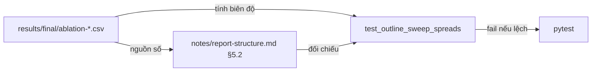

# Phase 01 — Nền tảng cho Chương 5–6

**Trạng thái:** ⬜ Chưa bắt đầu
**Ưu tiên:** Cao (Phase 4–5 phụ thuộc kết quả)
**Plan gốc:** [`../plan.md`](plan.md) — mọi số liệu chuẩn nằm ở §0.4–0.6 của plan

## Context Links

- Plan đầy đủ: [`../plan.md`](plan.md)
- Khung báo cáo (nguồn cấu trúc chương): [`notes/report-structure.md`](../../notes/report-structure.md)
- Test hiện có: [`tests/test_phase3_docs_and_final_tables.py`](../../tests/test_phase3_docs_and_final_tables.py)
- Bảng ablation: `results/final/ablation-{cf,cb1,cb2,cb3,cb4}.csv`

## Overview

Tạo thư mục `docs/report/` (được git track, khác `notes/` đang gitignore) kèm
`README.md` làm mục lục; đính chính §5.2 của khung báo cáo về quy ước biên độ sweep;
thêm test chặn hồi quy.

## Key Insights

- Khung §5.2 đang **trộn hai quy ước biên độ**: "CF 17,94%" là biên độ riêng lưới ALS
  (mẫu số max), còn các số CB-1/CB-2/CB-3/CB-4 là biên độ **toàn nhóm**.
  Biên độ toàn nhóm CF thật là **73,65%**.
- `notes/` **đã được git track** (dù `.gitignore` có `notes/`) → sửa xong phải
  `git add -u notes/report-structure.md`, `git add notes/...` sẽ bị bỏ qua.
- Test biên độ phải **tính động** từ CSV để thêm config mới mà quên sửa khung thì bị bắt.

## Requirements

**Chức năng**
- `docs/report/README.md`: mục lục 8 chương, nguồn sự thật, quy ước trích dẫn, mapping § ↔ file CSV.
- `notes/report-structure.md` §5.2: bảng biên độ tách **theo model** / **theo nhóm**, kèm protocol.

**Phi chức năng**
- Test động, không hard-code số.
- Không tạo file `.md` thừa.

## Architecture

## Related Code Files

**Sửa**
- `notes/report-structure.md` — §5.2
- `tests/test_phase3_docs_and_final_tables.py` — thêm test

**Tạo**
- `docs/report/README.md`

## Implementation Steps

1. Tạo `docs/report/` + `README.md` với: mục lục 8 chương (đánh dấu chương đã viết),
   nguồn sự thật (`results/final/` 27 bảng + `results/figures/`), quy ước §1 của plan,
   bảng mapping chương ↔ file CSV.
2. Đọc `notes/report-structure.md` §5.2, thay đoạn biên độ bằng 2 bảng từ plan §0.4.
3. Thêm câu giải thích công thức `(max−min)/max` + protocol `dev` (20.000 user).
4. Kiểm tra lại các con số còn lại của §5.2 khớp plan §0.4.
5. Thêm test `test_outline_sweep_spreads_match_ablation_tables()` vào
   `tests/test_phase3_docs_and_final_tables.py`: quét cặp `<số>%` trong ngữ cảnh
   "biên độ", so với giá trị tính từ CSV, ngưỡng ± 0,01 điểm %.
6. Chạy `venv/bin/python -m pytest tests/test_phase3_docs_and_final_tables.py -q`.

## Todo List

- [ ] Tạo `docs/report/README.md`
- [ ] Sửa `notes/report-structure.md` §5.2
- [ ] Thêm test biên độ sweep
- [ ] `pytest` xanh

## Success Criteria

- `docs/report/README.md` tồn tại, nêu rõ nguồn sự thật + quy ước.
- §5.2 phân biệt được biên độ theo model và theo nhóm, kèm protocol.
- Test fail nếu khung ghi sai biên độ (kiểm chứng bằng cách sửa tạm 1 số → test đỏ).

## Risk Assessment

| Rủi ro | Mức | Giảm thiểu |
|---|---|---|
| Test quá chặt, khớp 1 số là fail vô lý | Trung bình | Ngưỡng ± 0,01 điểm %; bỏ qua số không liên quan metric |
| `git add` bỏ qua file trong `notes/` | Thấp | Dùng `git add -u notes/report-structure.md` |

## Security Considerations

Không có. Chỉ đọc/ghi file markdown và test.

## Next Steps

- Phase 02 sinh hình sweep (dùng số biên độ đã đính chính).
- Phase 04–05 viết Chương 5–6.
