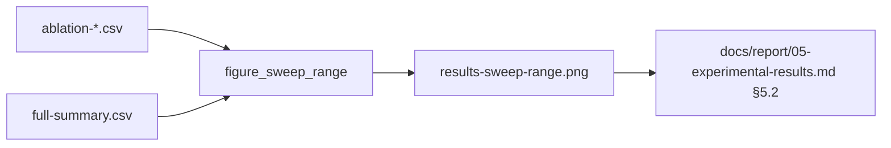

# Phase 02 — Sinh hình sweep còn thiếu

**Trạng thái:** ⬜ Chưa bắt đầu
**Ưu tiên:** Trung bình (Chương 5.2 §5.2 nhúng hình này)
**Plan gốc:** [`../plan.md`](plan.md)

## Context Links

- Plan: [`../plan.md`](plan.md) §3
- Code: [`src/eval/make_result_figures.py`](../../src/eval/make_result_figures.py)
- Hình hiện có: `results/figures/` (9 file PNG, đã commit)
- Bảng nguồn: `results/final/ablation-{cf,cb1,cb2,cb3,cb4}.csv`

## Overview

`notes/report-structure.md` §5.2 yêu cầu "thanh ngang so sánh NDCG@10 toàn sweep
CF vs CB" nhưng hình này **chưa tồn tại**. Thêm `figure_sweep_range()` để sinh
`results/figures/results-sweep-range.png`.

## Key Insights

- Hình phải **tự chứng minh được**: tiêu đề phải ghi `dev` + 20.000 user + `split_id`.
- Biên độ trên hình là điều khoản kết luận 5.2 → hình và bảng §5.2 phải dùng **cùng
  quy ước** (tính theo model, theo `model` trong CSV).
- ⚠️ `ablation-cb4.csv` có 3 dòng `model=cb1-tfidf` (họ time-decay `cb4-03-*`) →
  tô màu theo **model** (đúng), ghi chú trong caption.
- matplotlib phiên bản quyết định byte output → phải xác nhận 8 hình cũ **không đổi**.

## Requirements

**Chức năng**
- `figure_sweep_range()` đọc 5 file ablation, vẽ thanh ngang NDCG@10 cho từng config.
- Tô màu theo `model`, đánh dấu `★` config đã chạy trên `full`.
- Lưu `results/figures/results-sweep-range.png`, dpi 150.

**Phi chức năng**
- Dùng lại `COLORS` và `_family()` sẵn có.
- Không đổi 8 hình cũ.

## Architecture

## Related Code Files

**Sửa**
- `src/eval/make_result_figures.py` — thêm `figure_sweep_range()`, gọi trong `main()`

**Sinh ra**
- `results/figures/results-sweep-range.png`

## Implementation Steps

1. Snapshot: `md5sum results/figures/*.png > /tmp/fig_before.txt`.
2. Thêm `figure_sweep_range()`:
   - đọc 5 file `ablation-*.csv`, cột `exp_name`, `model`, `NDCG@10`;
   - gộp thành 1 bảng, tô màu theo `model` (dùng bảng màu riêng cho `model` vì
     `_family()` phân loại theo *nhóm*, không phân biệt `cb3-genome` vs `cb3-ridge`);
   - `★` cho config có trong `results/final/full-summary.csv`;
   - tiêu đề ghi `dev · 20.000 user · split_id=temporal80_20`.
3. Gọi trong `main()`, thêm `"results-sweep-range.png"` vào `written`.
4. Chạy `venv/bin/python -m src.eval.make_result_figures`.
5. `md5sum results/figures/*.png > /tmp/fig_after.txt` rồi `diff` — **chỉ dòng mới
   được xuất hiện**. Nếu hình cũ đổi byte → dừng, báo lại (không commit).

## Todo List

- [ ] Snapshot md5
- [ ] Viết `figure_sweep_range()`
- [ ] Sinh hình
- [ ] Diff md5 xác nhận 8 hình cũ không đổi

## Success Criteria

- `results/figures/results-sweep-range.png` tồn tại, đọc được, tô màu đúng nhóm model.
- `diff /tmp/fig_before.txt /tmp/fig_after.txt` chỉ ra đúng 1 dòng mới.

## Risk Assessment

| Rủi ro | Mức | Giảm thiểu |
|---|---|---|
| Hình cũ đổi byte do khác matplotlib | Trung bình | Dừng và báo, không commit hình đổi |
| Biểu đồ 144 thanh quá chật | Trung bình | Nhóm theo model, dùng `barh` với figsize lớn |

## Security Considerations

Không có.

## Next Steps

- Phase 04 nhúng hình vào Chương 5.2.
