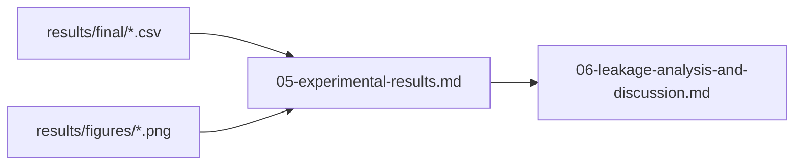

# Phase 04 — Viết Chương 5 (Kết quả)

**Trạng thái:** ⬜ Chưa bắt đầu
**Ưu tiên:** Cao
**Plan gốc:** [`../plan.md`](plan.md) §5 — **mọi số liệu chuẩn ở §0.6**

## Context Links

- Plan: [`../plan.md`](plan.md) §0.6 (số liệu chuẩn) + §5
- Khung: [`notes/report-structure.md`](../../notes/report-structure.md) §5.1–5.5
- Nguồn: `results/final/*.csv`, `results/figures/*.png`

## Overview

Viết `docs/report/05-experimental-results.md` — 5 mục, ~8 trang. Đây là chương có
mật độ số liệu cao nhất của báo cáo.

## Key Insights

- **Nguồn sự thật duy nhất**: `results/final/*.csv`. Mọi bảng trích phải kèm
  `split_id` + `catalog_id`.
- Chênh lệch ALS − CB-4: (0,137470 − 0,105435)/0,137470 = **23,3%** (mẫu số ALS —
  khung đang dùng cách này, giữ nguyên và nêu rõ mẫu số).
- "0,0000 là **đúng bằng không**" — phải giải thích cơ chế (xoá mọi tương tác train
  của phim held-out), không được để người đọc hiểu là "rất thấp".
- Wilcoxon: báo cả **3 cột** tỷ lệ thắng/thua/hoà — không chỉ "thắng 32%" mà giấu
  "hoà 44%".
- Mọi bảng sweep là protocol `dev` (20.000 user); bảng chính là `full` (158.774 user)
  → **phải ghi rõ** ở từng bảng.

## Requirements

**Chức năng**
- §5.1 Bảng CF + CB protocol `full`, ALS 0,1375 vs CB-4 0,1054 (chênh 23%).
- §5.2 Cân bằng sweep: CF 51/51, CB 93/93; bằng chứng 5 file ablation (144 dòng).
- §5.3 Cold-start: CB-4 0,0347 vs CF 0,0000; `frac_unseen@10`; Wilcoxon p ≈ 8,77e-201.
- §5.4 Thống kê: bootstrap CI + Wilcoxon + lý do không so chéo CF↔CB.
- §5.5 Nhóm user: CB **cải thiện** theo độ dài lịch sử.
- Nhúng hình: `results-accuracy.png`, `results-metric-vs-k.png`,
  `results-sweep-range.png`, `results-user-buckets.png`.

**Phi chức năng**
- Số dấu phẩy kiểu Việt (`0,1375`).
- Bảng có cột protocol khi trích từ repo.

## Architecture

## Related Code Files

**Tạo**
- `docs/report/05-experimental-results.md`

**Đọc**
- `results/final/benchmark-{cf,cb,coldstart}.csv`
- `results/final/ablation-{cf,cb1,cb2,cb3,cb4}.csv`
- `results/final/bootstrap-ci.csv`
- `results/final/wilcoxon-{cf,cb,coldstart}.csv`
- `results/final/coldstart-user-buckets.csv`
- `results/final/beyond-accuracy-full.csv`

## Implementation Steps

1. Đọc lại §5.1–5.5 trong `notes/report-structure.md`.
2. **§5.1** — 2 bảng (CF, CB) từ `benchmark-{cf,cb}.csv`, kèm ghi chú protocol
   (`full`, 158.774 user, `split_id`/`catalog_id`). Diễn giải chênh 23%. Nhúng 2 hình.
3. **§5.2** — bảng "config trong `configs/` vs đã chạy" (51/51, 93/93); đường dẫn 5 file
   ablation; bảng biên độ **theo model** + **theo nhóm** (plan §0.4) kèm công thức và
   protocol; đối chiếu `dev` vs `full` (lệch ≤ 1,7%, không đảo thứ hạng); nhấn mạnh
   ALS nhạy `α` (α=40 → 0,113470) mà không nhạy `reg`/`iterations` (0,40% trong lát
   cắt đó) — dùng **đúng con số mà test `test_docs_state_full_als_spread` yêu cầu**.
   Nhúng `results-sweep-range.png`.
4. **§5.3** — bảng 9 dòng `benchmark-coldstart.csv`; giải thích cơ chế "0,0000";
   `frac_unseen@10` (CB-4 0,2223 vs pop_prior 0,0036 → nêu bẫy `pop_prior`); bảng
   Wilcoxon `wilcoxon-coldstart.csv` (8 dòng) với p và 3 cột tỷ lệ.
5. **§5.4** — `bootstrap-ci.csv` (12 dòng): ALS [0,136620;0,138343] vs CB-4
   [0,104652;0,106205] không chạm; giải thích vì sao không so chéo CF↔CB trong cùng
   bảng (câu hỏi khác + số config lệch 51 vs 93).
6. **§5.5** — bảng `coldstart-user-buckets.csv`; nêu rõ CB-2 0,0793→0,0799→0,1418
   (**tăng**, ngược trực giác). Nhúng `results-user-buckets.png`.
7. Đối chiếu từng số với CSV (script ở Phase 06 sẽ tự kiểm).

## Todo List

- [ ] §5.1 bảng chính
- [ ] §5.2 cân bằng sweep + hình
- [ ] §5.3 cold-start
- [ ] §5.4 thống kê
- [ ] §5.5 nhóm user

## Success Criteria

- Mọi số trong file khớp `results/final/*.csv`.
- Bảng nào trích từ repo đều ghi protocol.
- 5 mục đủ nội dung, không còn placeholder.
- Đủ 4 hình nhúng.

## Risk Assessment

| Rủi ro | Mức | Giảm thiểu |
|---|---|---|
| Chép nhầm số | Cao | Lấy từ plan §0.6 + script đối chiếu ở Phase 06 |
| Dùng nhầm biên độ (model vs nhóm) | Trung bình | Ghi rõ nhãn cột; test Phase 01 bắt |
| Quên nói "0,0000 = đúng bằng không" | Trung bình | Checklist §5.3 |

## Security Considerations

Không có.

## Next Steps

- Phase 05 viết Chương 6 (dùng bảng `tag-leakage-strata.csv`).
