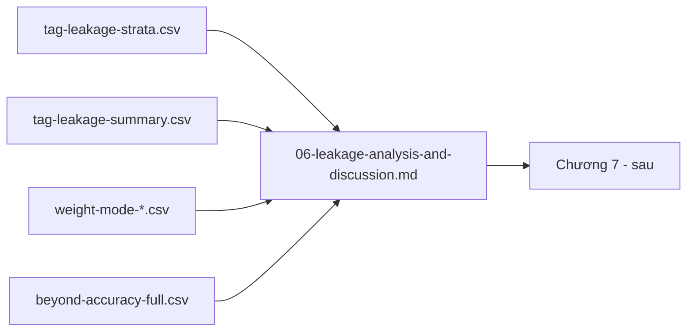

# Phase 05 — Viết Chương 6 (Chống rò rỉ & tranh luận)

**Trạng thái:** ⬜ Chưa bắt đầu
**Ưu tiên:** Cao — đây là chương điểm khác biệt của đồ án
**Plan gốc:** [`../plan.md`](plan.md) §6 — **mọi số liệu chuẩn ở §0.6**

## Context Links

- Plan: [`../plan.md`](plan.md) §0.6 + §6
- Khung: [`notes/report-structure.md`](../../notes/report-structure.md) §6.1–6.5
- Nguồn: `results/final/tag-leakage-{strata,summary}.csv`,
  `results/final/weight-mode-{buckets,paired-tests}.csv`,
  `results/final/beyond-accuracy-full.csv`

## Overview

Viết `docs/report/06-leakage-analysis-and-discussion.md` — 5 mục, ~6 trang. Chương
này biến "con số" thành "kết luận đáng tin".

## Key Insights

- Vấn đề trung tâm: `genome-scores.csv` **không có timestamp** (GroupLens tính ngoài
  động) → có thể "biết trước" phim tương lai.
- Đo được confound: Pearson(số tag, độ phổ biến) = **0,768**, Spearman 0,700 →
  tag và popularity **không độc lập**.
- Bằng chứng phân tầng: thứ hạng **không đảo chiều** ở bất kỳ tầng nào →
  **CB-2 ≥ CB-1 > CB-3** ở cả ba tầng.
- Đối chứng "chỉ genres" (không rò rỉ) đạt 0,0026–0,0060 ở mọi tầng → phần lớn lợi
  thế của tag là do **tính chất nội dung**, không phải do rò rỉ thời gian.
- ⚠️ **Phải nêu giới hạn của chính kết luận chống rò rỉ** (checklist bắt buộc).

## Requirements

**Chức năng**
- §6.1 Rủi ro metadata hậu kỳ + confound đo được.
- §6.2 Bảng phân tầng 3 kỷ nguyên + kết luận + đối chứng "chỉ genres".
- §6.3 Chế độ trọng số hồ sơ.
- §6.4 Metric ngoài độ chính xác (coverage đảo ngược độ chính xác).
- §6.5 Bảng "khi nào thắng" + **mục giới hạn của kết luận chống rò rỉ**.
- Nhúng hình: `results-beyond-accuracy.png`, `results-accuracy-vs-novelty.png`.

**Phi chức năng**
- Số dấu phẩy kiểu Việt.
- Thứ hạng ghi đúng `CB-2 ≥ CB-1 > CB-3`.

## Architecture

## Related Code Files

**Tạo**
- `docs/report/06-leakage-analysis-and-discussion.md`

## Implementation Steps

1. Đọc lại §6.1–6.5 trong `notes/report-structure.md`.
2. **§6.1** — tag bắt đầu 2005-12-24; median ngày kết thúc huấn luyện user tập phát
   triển 2006-09-25 → phần lớn user tập phát triển **train trước khi tag tồn tại**;
   Pearson 0,768 / Spearman 0,700; 183 phim không có tag.
3. **§6.2** — bảng 8 dòng `tag-leakage-strata.csv` + số user mỗi tầng
   (75.194 / 29.657 / 53.923); kết luận thứ hạng không đảo; phân tích dòng "chỉ genres";
   ⚠️ nhắc chênh nhỏ ở tầng 2006–2012 (0,126327 vs 0,125643) nhưng BM25 dẫn cả ba tầng.
4. **§6.3** — bảng `weight-mode-buckets.csv` + `weight-mode-paired-tests.csv`:
   `centered` kém hẳn (p < 1e-44); `rating` tương đương, và **tốt hơn** ở nhóm 5–30
   (+0,00257, p = 0,04); diễn giải "có tương tác hay không" quan trọng hơn "mức độ hài lòng".
5. **§6.4** — bảng `beyond-accuracy-full.csv` (9 dòng chính): ALS coverage 14,9% vs
   CB-3 67,2%; Gini đi cùng hướng ngược. Nhúng 2 hình.
6. **§6.5** — bảng "điều kiện → thắng → bằng chứng" (5 dòng); **mục giới hạn**:
   - số tuyệt đối của CB vẫn lạc quan hơn production;
   - phân tầng theo kỷ nguyên rating user **không** loại trừ việc tag được gán *trong*
     khoảng thời gian train của user ở tầng 2006–2012;
   - Pearson 0,768 cho thấy tag và popularity vẫn tương quan mạnh ở mọi tầng.
7. Đối chiếu từng số với CSV.

## Todo List

- [ ] §6.1 metadata hậu kỳ
- [ ] §6.2 bảng 3 kỷ nguyên
- [ ] §6.3 trọng số hồ sơ
- [ ] §6.4 metric ngoài độ chính xác
- [ ] §6.5 bảng thắng + giới hạn

## Success Criteria

- Đủ 5 mục; mục giới hạn của kết luận chống rò rỉ **không được thiếu**.
- Mọi số khớp CSV.
- Thứ hạng ghi `CB-2 ≥ CB-1 > CB-3`.

## Risk Assessment

| Rủi ro | Mức | Giảm thiểu |
|---|---|---|
| Kết luận chống rò rỉ bị viết quá mạnh | Cao | Mục giới hạn tường minh ở §6.5 |
| Dùng nhầm "CB-1 > CB-2" | Trung bình | Có test `test_docs_do_not_claim_cb1_above_cb2`; tự đọc lại |

## Security Considerations

Không có.

## Next Steps

- Phase 06 đồng bộ docs + kiểm chứng + commit.
