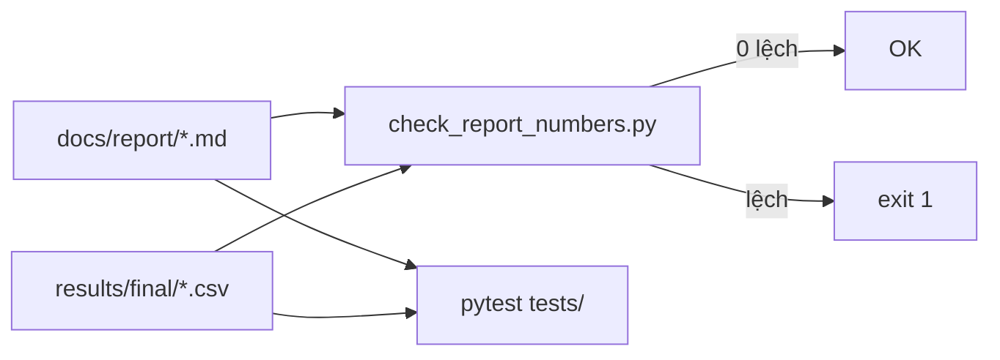

# Phase 06 — Đồng bộ tài liệu, kiểm chứng, commit

**Trạng thái:** ⬜ Chưa bắt đầu
**Ưu tiên:** Cao (đóng phase)
**Plan gốc:** [`../plan.md`](plan.md) §7 + §9

## Context Links

- Plan: [`../plan.md`](plan.md) §7
- Roadmap: [`docs/development-roadmap.md`](../../docs/development-roadmap.md)
- Changelog: [`docs/project-changelog.md`](../../docs/project-changelog.md)
- Tests: `tests/`

## Overview

Cập nhật roadmap + changelog, viết script đối chiếu số liệu báo cáo ↔ CSV, chạy
pytest, commit. **Không push.**

## Key Insights

- Script đối chiếu tự động thay thế việc "đọc tay" — agent sau có thể chạy lại bất cứ
  lúc nào để chắc báo cáo không lệch khỏi `results/final/`.
- Cách so khớp: lấy mọi giá trị số từ CSV → định dạng kiểu Việt 4 chữ số thập phân
  (`0,1375`) → quét số trong markdown → mọi số kiểu `0,xxxx` phải có trong tập đó.
  Bỏ qua số không phải metric (số trang, số chương, năm) — nên dùng **whitelist**:
  số trong báo cáo phải khớp, không yêu cầu mọi số trong CSV đều xuất hiện.
- `notes/` gitignore nhưng đã track → `git add -u notes/report-structure.md`.

## Requirements

**Chức năng**
- `docs/development-roadmap.md`: phase 06 ⬜ → 🔄; mốc tổng thể; §5.1 cập nhật.
- `docs/project-changelog.md`: mục thay đổi mới.
- `scripts/check_report_numbers.py`: fail nếu số trong báo cáo lệch `results/final/`.
- `pytest tests/` xanh.
- Commit đã tạo, chưa push.

**Phi chức năng**
- Script tự chứng minh, không cần người đọc.
- Không push.

## Architecture

## Related Code Files

**Sửa**
- `docs/development-roadmap.md`
- `docs/project-changelog.md`

**Tạo**
- `scripts/check_report_numbers.py`

**Thêm**
- Test cho script (khuyến nghị): `tests/test_report_numbers_consistency.py`

## Implementation Steps

1. **Roadmap** — sửa 3 chỗ:
   - Mốc tổng thể: "Báo cáo | ⬜ Chưa bắt đầu" → "🔄 Đang làm (Chương 5–6 xong)".
   - Lịch sử phase: `| 06 | Viết báo cáo | ⬜ Chưa bắt đầu | — |` → `🔄 Đang làm`.
   - §5.1: dòng "khung gợi ý **không dùng được**" → trạng thái mới (khung đã viết lại
     cho 25M/9 mô hình; Chương 5–6 đã có prose).
2. **Changelog** — thêm mục: đính chính biên độ sweep (17,94% = lưới ALS vs 73,65% =
   nhóm CF), sửa script LOO, thêm `results-sweep-range.png`, thêm Chương 5–6.
3. **Script** `scripts/check_report_numbers.py`:
   - nạp mọi CSV trong `results/final/`;
   - gom mọi giá trị số → định dạng `0,xxxx` (4 chữ số, dấu phẩy);
   - quét `docs/report/05-*.md`, `docs/report/06-*.md` cho mẫu `\b\d,\d{4}\b`;
   - số nào không có trong tập → báo + `exit 1`;
   - in tổng số đã đối chiếu.
   - Cân nhắc: số `%` (biên độ) cũng cần khớp — dùng mẫu `\d+,\d{2}\s*%` và so với
     giá trị `(max−min)/max` tính từ CSV.
4. **Test** — `tests/test_report_numbers_consistency.py`: khẳng định script trả 0 khi
   chạy trên `docs/report/` (test chậm, đánh dấu `@pytest.mark.slow` nếu cần).
5. Chạy `venv/bin/python -m pytest tests/ -q` — phải xanh toàn bộ.
6. Chạy `venv/bin/python scripts/check_report_numbers.py` — phải báo 0 lệch.
7. Commit (xem lệnh bên dưới). **Không push.**

## Todo List

- [ ] Roadmap 3 chỗ
- [ ] Changelog
- [ ] `check_report_numbers.py`
- [ ] Test cho script
- [ ] `pytest` xanh
- [ ] Script đối chiếu: 0 lệch
- [ ] Commit (không push)

## Success Criteria

- `pytest tests/` xanh toàn bộ.
- `check_report_numbers.py` báo 0 lệch.
- Roadmap/changelog khớp hiện trạng thực tế.
- Commit đã tạo trên branch `v1`, `git status` sạch.

## Risk Assessment

| Rủi ro | Mức | Giảm thiểu |
|---|---|---|
| Script báo lệch giả (số không phải metric) | Cao | Whitelist: chỉ số có dạng `0,xxxx` / `xx,xx%`; thêm `--verbose` để xem chi tiết |
| Commit nhầm file nhạy cảm | Thấp | Chỉ `git add` từng đường dẫn cụ thể trong plan |

## Security Considerations

- **Không** commit `.env`, key, credential.
- `.gitignore` đã chặn `data/`, `results/*` (trừ `results/final/*.csv` và
  `results/figures/`) — chỉ add hình PNG mới trong `results/figures/`.

## Next Steps

- Sau khi báo cáo xong: chạy sweep `full` (144 config) để đối xứng tuyệt đối.
- Chạy thật `scripts/run_sampled_loo_comparison.py` → Kendall τ → Chương 7.4.
